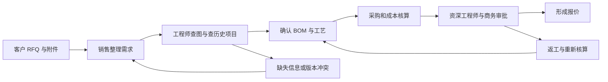
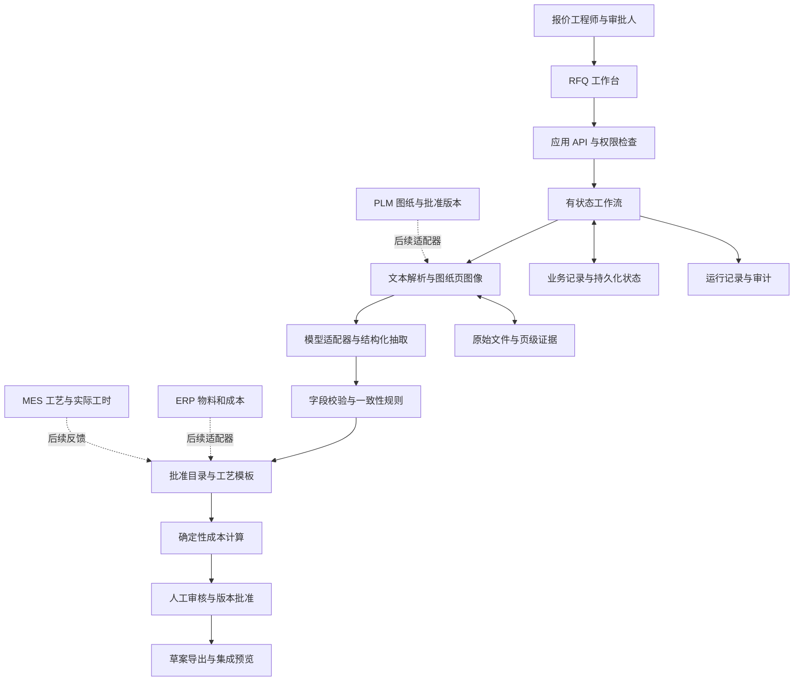
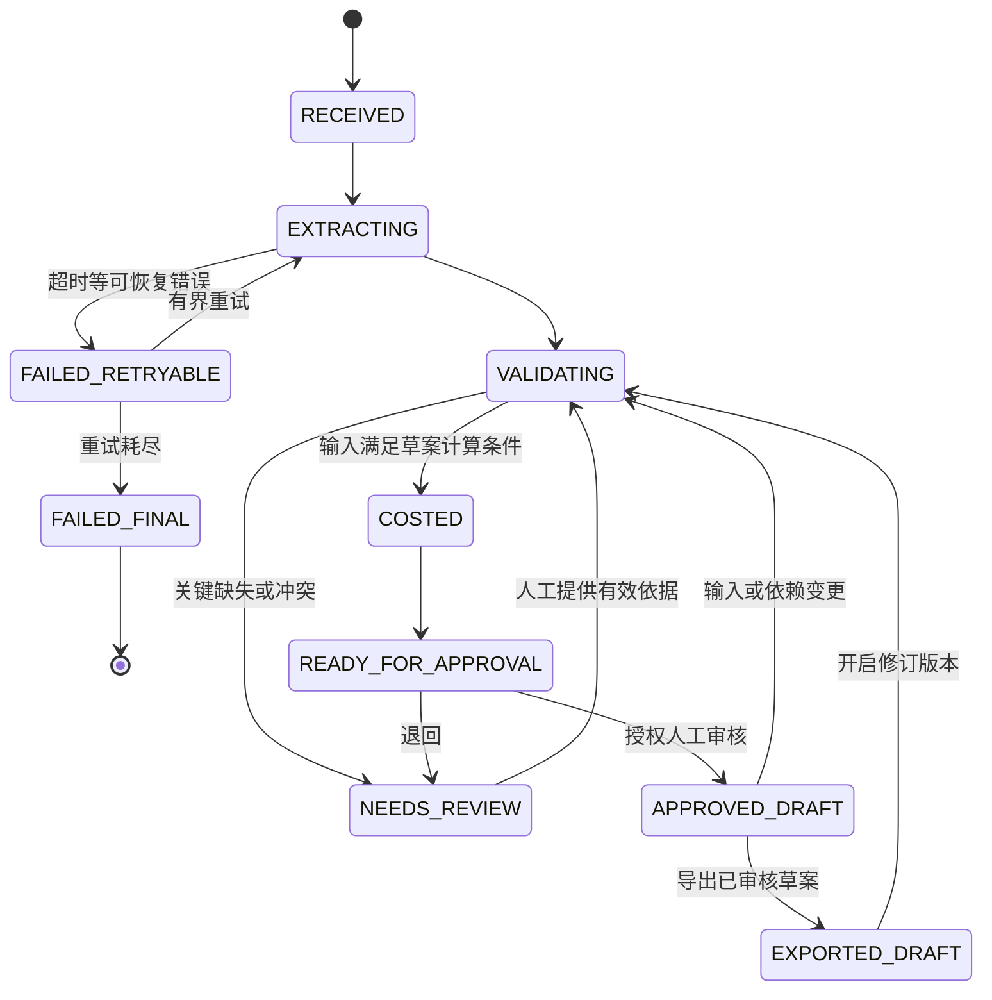

# IndustrialMind FDE 项目需求分析与实施规划

> [!abstract] 建议做什么
> 选择题目的 **Option B：可运行原型**，做一个 **PrecisionMotion RFQ 工程报价工作台**：将 RFQ 和二维图纸转换为带来源证据的工程信息，通过受控规则形成成本与报价草案，遇到版本冲突或缺失数据时暂停，最后由工程师审核并导出。
>
> 核心演示链路：**输入文件 → 提取并定位证据 → 发现问题 → 人工修正 → 确定性计算 → 审批与导出 → 展示可衡量的业务价值**。
>
> 平台方案覆盖题目的五个部分；实际编码集中在一个业务闭环。让面试官看到你能把模糊客户需求变成可交付的软件，并能说明验证方法、上线条件和扩展路径。

> [!info] 文档边界
> 本文是需求与实施规划，文中的功能、样例文件、评测结果模板和验收指标均不是已实现成果。准备周期暂按单人 **10 个工作日、约 60–80 小时**设计，另提供 3 天缩减版。没有真实客户数据、系统权限、IndustrialMind 私有 SDK 或客户工程规范。
> 面试方案可以提高说服力，无法保证录用；重点是提供面试官能够检查的能力证据。

## 导航

- [[#1. 依据、事实与假设]]
- [[#2. 从公司业务推导项目定位]]
- [[#3. 客户问题与需求发现]]
- [[#4. 场景优先级与范围选择]]
- [[#5. 题目要求与交付物映射]]
- [[#6. MVP 详细需求]]
- [[#7. 演示数据与可复算样例]]
- [[#8. 技术架构与实施方向]]
- [[#9. 评测、验收与试点设计]]
- [[#10. 三年商业价值测算]]
- [[#11. 实施计划与客户路线图]]
- [[#12. 现场演示与面试表达]]
- [[#13. 风险、取舍与应答准备]]
- [[#14. 完成定义与下一步行动]]
- [[#15. 参考资料与术语]]

## 1. 依据、事实与假设

### 1.1 两份本地材料

| 编号 | 材料 | 本文如何使用 |
|---|---|---|
| S1 | [[IndustrialMind.ai Solution Design Challenge]] | 客户设定、五部分作业要求、两种交付选项和阶段时间线的主要依据 |
| S2 | [[About IndustrialMind.ai  (For Candidates)]] | 公司定位、业务领域、客户类型和 ANDRITZ 合作背景的主要依据；文件名中 `ai` 后有两个空格 |

**证据分层规则：**

- **材料事实**：S1/S2 明确写出的信息，以“题目给定”或“材料称”表述。
- **公开补充**：可访问的公司原始发布或技术官方文档，附链接，不覆盖题目设定。
- **方案判断**：本人的优先级、架构和产品建议，可以解释理由，不冒充官方要求。
- **建模假设**：工时、费率、采用率、成本和收益等自设变量，后续需要验证。
- **待确认项**：实际 ERP/PLM/MES、数据质量、接口许可、客户审批政策等，不能默认已知。

### 1.2 题目给定的客户事实

| 维度    | S1 给定信息                            | 对方案的影响                       |
| ----- | ---------------------------------- | ---------------------------- |
| 客户    | PrecisionMotion GmbH，德国工业自动化零部件制造商 | 以工程和制造工作流组织方案                |
| 规模    | 2,500 名员工，150 名工程师                 | 核心目标是*工程团队效率*，不能把全体员工都算作收益人群 |
| 工厂    | 德国、波兰、中国                           | 需要考虑工厂权限、语言、单位、工艺与成本差异       |
| 产品    | 减速箱、伺服电机、工业执行器、定制机械装配件             | 可从执行器配套的简单机加工零件切入            |
| 年 RFQ | 约 **15,000** *份*****               | 适合选择重复发生、可计时的报价准备工作          |
| 年图纸   | 约 50,000 张                         | 图纸理解和版本管理是重要能力               |
| 年 CAD | 约 30,000 个模型                       | 平台应预留 CAD 能力，但不要求首版完成原生三维理解  |
| 工程变更  | 每年数千次                              | 必须关注修订版、失效信息和审批失效机制          |
| 当前流程  | 人工看图、BOM、工艺路线和报价；资深工程师参与设计审查；知识分散  | 需要连接输入、判断、复核和下游交付            |

> [!warning] 不应从材料外推的结论
> PrecisionMotion 是题目提供的客户场景；本文不把它当作已核实的真实签约客户。材料没有给出其软件品牌、报价周期、工程工时、错误率、产品毛利或可直接接入的 API。50,000 张图纸与 30,000 个 CAD 也不能直接视为互不重叠的 80,000 个项目，更不能据此认定每个 RFQ 的实际附件数量。

### 1.3 岗位与题目之间的关系

用户目标是 FDE 面试，而 S1 将答题者设定为 **Solution Architect**。本文因此同时覆盖两类能力：

1. **方案能力**：理解客户、选择切入点、设计架构、测算价值、规划落地。
2. **FDE 能力**：快速获得数据、交付可运行工作流、处理不完整信息、*集成现有系统*、现场定位问题、用结果推动采用。

这是一套面试准备判断，不是公司已经公布的评分表。两份材料也没有提供完整岗位 JD、面试时长或必用技术栈。

## 2. 从公司业务推导项目定位

S2 将 IndustrialMind 描述为面向制造业的 AI Engineer，能力涉及文档与图纸理解、工程知识、工艺、质量和根因分析。S1 进一步把报价、BOM、工艺路线和设计验证放入同一个平台命题。

**由此得到的项目定位：让 AI 参与一项可追踪的工程任务，并交付工程人员可以审核、使用和交接的结果。**

| 公司材料中的方向 | 项目中应该展示的能力 | 可检查的演示证据 |
|---|---|---|
| 图纸与文档理解 | 提取材料、数量、修订版等关键字段，并定位来源 | 点击字段回到 PDF 页码和区域 |
| 工程知识复用 | 从经过批准的规则和历史案例中找依据 | 历史记录附适用条件、版本和不同点 |
| Agent 工作流 | 状态可见、工具调用可审计、异常可恢复 | 工作流暂停后，由用户修正并继续 |
| 工程决策支持 | 区分事实、建议和未确认事项 | 缺失公差、版本冲突被列为待办 |
| 工作流自动化 | 输出结构化工单和草案，而不只输出解释文本 | 报价 JSON、审核记录、集成预览 |
| 多工厂复用 | 公共流程与工厂特定规则分开 | 工厂参数作为可配置输入，而非写死在提示词中 |

公开补充：公司官网另有定制液压缸报价案例，描述 RFQ、BOM、工艺、成本和现有系统衔接。这支持本项目方向与公司公开业务一致；该案例中的收益数字属于公司发布的个案描述，**不直接用于 PrecisionMotion 的收益承诺**。[公司报价案例，2026-02-23](https://www.industrialmind.ai/en/use-cases/ai-assisted-quotation-generation-for-custom-hydraulic-cylinders)

### 面试时应让对方形成的判断

> “这个候选人能选出值得做的流程，知道工程信息什么时候可信，能够做出可验证的原型，并有办法把原型推进到客户试点。”

融资、创始人背景和客户 Logo 可以帮助理解公司阶段，但不应占用主要演示时间。更有价值的是解释：你的方案如何减少客户等待，如何避免错误进入下一步，以及下一周可以和客户验证什么。

## 3. 客户问题与需求发现

### 3.1 当前流程与问题链



这里的岗位分工是需要客户确认的流程假设。S1 确认的是流程高度依赖人工，没有给出实际组织审批顺序。

| 痛点 | 可能的根因 | 业务影响 | 验证方式 | AI 适合承担的部分 |
|---|---|---|---|---|
| RFQ 整理反复进行 | 文件格式不一致，字段散落在邮件和附件 | 工程师重复录入，信息遗漏 | 跟踪 10–20 个近期 RFQ 的输入与操作 | 提取、归一化、生成缺失清单 |
| 查图与查旧项目耗时 | 图号、版本、材料和历史项目未关联 | 处理工时增加，复用不充分 | 观察工程师查找路径并计时 | 带权限和版本过滤的检索 |
| BOM 与工艺准备重复 | 缺少可复用模板，历史结果难追踪 | 工程资源集中在重复任务 | 对比同类零件的历史交付物 | 提出有依据的草案，提示差异 |
| 报价在部门间等待 | 不确定项没有清晰负责人，审批队列长 | 报价周期延长 | 区分实际工作时间与排队时间 | 生成明确待办、补齐审批上下文 |
| 资深工程师成为瓶颈 | 隐性经验没有转成可维护规则 | 审查等待，对少数人员依赖高 | 记录驳回理由和重复检查项 | 执行已批准规则，集中展示例外 |
| 变更影响传播不完整 | 修订版与下游输出没有依赖关系 | 旧版成本、工艺或报价继续使用 | 检查最近工程变更的影响范围 | 标识过期结果、要求重新确认 |

**“最耗工时的步骤”目前是待验证假设。** 从 S1 可优先调查看图、BOM、工艺和报价；不能仅凭资料就声称某一步占工程师工作量的具体比例。

### 3.2 关键用户与成功标准

| 用户或决策者      | 关心的问题                 | 产品需要提供的结果        |
| ----------- | --------------------- | ---------------- |
| 报价工程师：主要用户  | 信息够不够？为什么这样算？还需要确认什么？ | 提取字段、来源、成本明细和待办  |
| 资深工程师：技术审批人 | 版本对不对？工艺适不适用？异常有没有漏？  | 差异和例外优先的审核界面     |
| 销售：流程发起人    | 什么时候可以给客户反馈？缺哪些输入？    | RFQ 状态、澄清清单、草案   |
| 财务或商务负责人    | 费率、毛利、条款和授权是否有效？      | 可复算价格、参数版本和审批权限  |
| 工程经理：业务负责人  | 实际减少多少工作？返工是否增加？      | 分场景的工时、质量与采用率    |
| IT 与系统负责人   | 接入什么数据？部署在哪里？谁能看到？    | 接口契约、权限、审计和运行边界  |
| 管理层：预算决策者   | 收益能否实现？何时扩展或停止？       | 有基线的试点报告、成本与阶段门槛 |

### 3.3 首轮客户发现访谈

以下是实际交付时要询问客户的问题，不是本阶段向用户索要资料的阻塞清单。

| 要确认的问题 | 需要的数据或参与者 | 答案如何改变方案 |
|---|---|---|
| 15,000 份 RFQ 中，哪些是重复件、变型件和全新设计？ | 销售运营；按产品族分组的历史 RFQ | 决定适用比例和首个试点产品族 |
| 一份 RFQ 的实际工作时间、等待时间和返工时间分别是多少？ | 报价工程师；操作观察和时间记录 | 决定价值模型，避免把计算加速等同于流程加速 |
| 哪些输入缺失时必须暂停？谁有权解决？ | 技术与商务审批人 | 定义阻断规则与责任人 |
| 最新“可用版本”如何确定？是否存在项目特定冻结版本？ | PLM/文控负责人 | 避免用最大修订号代替批准版本 |
| 成本来自什么来源，是否有效期不同？ | ERP、采购和财务 | 决定成本表结构、过期检查和权限 |
| 哪些 BOM 与工艺可复用，谁批准过？ | 工艺工程师 | 决定模板准入和适用边界 |
| ERP、PLM、MES 的真实品牌、版本和可用接口是什么？ | IT 与集成负责人 | 决定 CSV、API、事件或人工导入路线 |
| 客户是否允许将图纸发送到外部模型服务？ | 数据所有者与 IT | 决定模型托管、网络和存储方案 |
| 不同工厂的材料、设备和费率是否可以互用？ | 各工厂负责人 | 决定知识分区与规则适用性 |
| 谁负责试点，谁可以改变现有审批流程？ | 业务赞助人 | 决定采用计划和试点能否执行 |

> [!tip] 第一次访谈的具体产物
> 一张客户确认的流程图、一个合适的产品族、10–20 个脱敏 RFQ 包、一份字段与错误清单、一名业务负责人，以及试点指标的定义。访谈结束时应能说清下一次验证什么。

## 4. 场景优先级与范围选择

### 4.1 候选场景比较

以下是基于现有材料的方案判断，不是客户实测排序。

| 场景 | 业务价值与依赖 | 原型可展示性 | 建议 |
|---|---|---|---|
| RFQ 到报价准备 | 高频、可计时；依赖图纸、成本和规则 | 可串起输入、计算、审核和导出 | **首选主线** |
| 图纸审查 | 贴近公司能力；复杂符号识别和判断要求高 | 局部字段提取与版本检查很直观 | 作为主线中的有限能力 |
| 工程知识检索 | 易开始；单独使用时与业务收益的联系较弱 | 可演示引用和复用，但容易停留在问答 | 为主线提供依据，P1 增强 |
| BOM 生成 | 价值明确；完整装配结构需要可靠输入 | 简单件可演示，复杂装配容易夸大能力 | MVP 使用明确的零件物料草案 |
| 工艺规划 | 可以减少重复准备；依赖设备与规则 | 模板候选容易展示，真实可制造性难验证 | 只展示已批准模板的建议 |
| RCA 根因分析 | 潜在价值高；需要真实质量与时序数据 | 仅有文档很难证明因果关系 | 后续阶段 |
| 原生 CAD 理解与自动设计 | 潜力高；几何、装配和工程验证复杂 | 高风险、准备成本高 | 不纳入首个原型 |

### 4.2 推荐的范围

**主场景：** 执行器配套的定制机加工安装支架，单一零件族、单一工厂、EUR、毫米单位。它是为演示选定的合成场景，并非客户材料披露的真实零件。

**业务目标：** 让报价工程师用更少的操作和查找时间，准备一份可以审核的内部报价草案。

**MVP 必须完成：**

- 接收一份 RFQ 与一张简单二维图纸，形成结构化需求。
- 给关键字段附上来源；明确显示缺失、冲突和待确认信息。
- 读取版本化的样例成本表与批准工艺模板，形成物料和工艺草案。
- 用程序计算价格，支持现场修改数量并重算。
- 完成人工确认、审批失效、审计记录和草案导出。
- 至少展示一个正常场景、一个阻断场景和一个失败恢复场景。

**首版不实现的能力及理由：**

| 延后内容                     | 理由与后续入口                             |
| ------------------------ | ----------------------------------- |
| 任意 CAD 格式与完整几何推理         | 无样例、解析器和验证基础；先接受导出的 PDF，保留 CAD 文件引用 |
| 复杂装配 BOM 自动重建            | 单张零件图不能证明装配关系；之后接入批准 EBOM 和装配资料     |
| 全自动制造可行性判断               | 需要真实设备能力、夹具和工艺验证；首版仅检查明确规则          |
| 自动承诺客户交期                 | 没有产能、供应商交期和排程；输出“待确认”               |
| 正式对客报价与 ERP/MES 实写       | 当前只有原型与合成数据；演示使用草案导出和写入预览           |
| 完整企业权限与 SSO              | 本地原型可展示作用域检查；正式身份与授权列入试点准入          |
| 训练行业基础模型、复杂多 A gent 自由协商 | 不能直接验证本次客户价值；先验证输入、规则和流程质量          |

> [!important] BOM 的准确表述
> 此处展示的是**单一零件的原材料/毛坯需求草案**，不是从一张图恢复完整装配 EBOM。表面处理属于工序或外协服务，应与物料行区分。只有提供批准的装配结构后，才讨论多层 BOM。

## 5. 题目要求与交付物映射

| S1 要求                      | 本项目的回答                 | 现场可展示内容         | 本文位置        |
| -------------------------- | ---------------------- | --------------- | ----------- |
| Part 1：痛点、工程工作量、最高 ROI     | 分析 RFQ 流程与瓶颈；用试点验证优先级  | 当前流程与目标流程，基线假设  | 第 3、4、10 节  |
| Part 2：Agents、数据、用户流程、输出   | 设计工程平台，先实现报价准备闭环       | 输入文件、证据、草案和审批   | 第 6、7、8 节   |
| Part 3：架构、模型、知识库、编排、人工、集成  | 有状态工作流、结构化输出、版本化数据和适配器 | 架构图、状态、审计、集成预览  | 第 8 节       |
| Part 4：生产率、人力、周期、工时、三年 ROI | 提供可改参数的测算、口径和负收益情景     | 手动修改节省工时，解释回本条件 | 第 10 节      |
| Part 5：0–3、3–9、9–24 月路线图   | 每个阶段都有负责人、输出和继续条件      | 从单产品族到多工厂的阶段计划  | 第 11 节      |
| Option B：可运行、解释架构、样例输入输出   | 完成可复现原型和演示资料           | 现场操作与复算         | 第 7、12、14 节 |

题目允许 A/B 二选一，并未要求同时提交 PPT 和原型。建议以 B 为主，另外准备一页架构、一个 ROI 表和简短讲解提纲；若需要讲稿载体，可做 8–10 页辅助材料，但不要挤占可运行原型的完成时间。

## 6. MVP 详细需求

### 6.1 完整用户故事

> 作为报价工程师，我希望上传 RFQ 和图纸后，系统整理关键参数、指出冲突、引用成本与工艺依据，并生成可修改的报价草案。作为审批人，我希望先看到未解决项和变更影响，能够检查证据，再批准一个明确版本的内部草案。

### 6.2 功能需求与验收条件

**P0：必须完成；P1：闭环稳定后增加；P2：客户落地阶段。**

| ID | 级别 | 需求 | 可验证的验收条件 |
|---|---|---|---|
| FR-01 | P0 | RFQ 与文件导入 | 选择样例或上传受支持文件后，得到 RFQ ID、文件 hash、导入时间和原始文件列表；错误格式有明确反馈 |
| FR-02 | P0 | 核心字段提取 | 提取零件号、要求修订版、数量、材料、单位；未找到的字段保持空值并标记 `missing` |
| FR-03 | P0 | 证据定位 | 每个关键字段关联原文与页码；图纸字段附可视区域；点击后能够看到对应证据 |
| FR-04 | P0 | 一致性与版本检查 | RFQ 要求 B 版而上传 A 版时进入待确认；不能仅以“文件名最新”自动接受 |
| FR-05 | P0 | 物料与工艺草案 | 每行标明来自当前输入、批准模板或人工确认；未知材料和未知工艺不自动补齐 |
| FR-06 | P0 | 成本计算 | 使用固定版本费率、数量和公式；100 件与 500 件的样例金额可独立复算 |
| FR-07 | P0 | 不确定项队列 | 每项显示原因、影响、证据、建议操作和负责人类型；关键缺失未解决时不能批准 |
| FR-08 | P0 | 人工修正与重算 | 修正字段后记录旧值、新值、原因和操作人；只复用仍然有效的中间结果 |
| FR-09 | P0 | 草案审批与失效 | 审批绑定输入和报价版本；数量、图纸、费率等依赖变化后自动失效，要求重新审核 |
| FR-10 | P0 | 导出与集成预览 | 批准后的内部草案可导出 Markdown/JSON；带 `DRAFT`、来源和版本；展示 ERP 映射预览但不调用真实系统 |
| FR-11 | P0 | 状态、审计与恢复 | 可看到每步状态和耗时；模拟模型超时后重试或进入明确失败状态；不会产生重复有效草案 |
| FR-12 | P0 | 数据作用域检查 | 本地样例项目之间的检索、文件读取和导出遵守后端作用域限制；说明身份使用演示账户 |
| FR-13 | P1 | 历史案例检索 | 返回相关历史案例及差异；过期、未批准或不适用的记录不能成为当前价格依据 |
| FR-14 | P1 | 工程变更影响视图 | 显示材料/修订版变更影响哪些物料、工艺、成本和审批 |
| FR-15 | P2 | 正式企业集成 | 使用客户实际身份、接口、测试环境和字段映射，验证重试与人工接管 |

说明：任何状态都可导出**诊断报告**；只有 `APPROVED_DRAFT` 才能导出**已审核的结构化报价草案**并生成集成预览。二者都不是可直接发送给客户的正式合同报价。

### 6.3 输入、输出与阻断规则

| 类别 | 首版内容 | 缺失或异常时的行为 |
|---|---|---|
| RFQ | 零件号、数量、要求修订版、币种、附件；期望交期可选 | 零件号、数量、修订版不明确则阻断审批 |
| 图纸 | 简单 PDF；标题栏、材料、单位与被选中的关键尺寸 | 无法识别时要求人工确认，不估计不可读数字 |
| 材料和工艺 | 批准材料目录、工艺模板、适用产品族 | 无匹配项则创建工程评审待办 |
| 价格 | 毛坯成本、机时费率、准备时间、单件工时、外协费、毛利目标 | 缺项、过期、币种或单位冲突时阻断成本批准 |
| 主输出 | 结构化需求、证据、问题清单、单件物料与工艺草案、成本与报价草案 | 明确区分已核实字段与候选建议 |
| 配套输出 | 审批记录、变更记录、集成预览、运行摘要 | 保留产生结果时的版本和来源 |

对于交期、运费、税费等不在首版核算范围内的内容，显式列出“未计算/待确认”，不能默认是零。内部草案可以保留这些待办，**正式对客发布应有额外商业门槛**，本原型不实现该发布动作。

### 6.4 最少四个界面

1. **RFQ 工作台**：样例入口、文件列表、当前状态、异常数量、下一步负责人。
2. **证据与确认页**：左侧 PDF/原文，中间结构化字段，右侧冲突和修正表单。
3. **成本与草案页**：物料、工序、费率、计算明细、数量调整、待确认条件。
4. **审批与运行记录页**：变更差异、批准按钮、审批版本、导出和集成预览。

产品界面使用工程师能理解的词，如“材料待确认”“图纸版本不一致”。节点名、模型参数和完整运行日志放入可展开的诊断区域。

### 6.5 非功能要求

| 维度 | 原型目标与边界 |
|---|---|
| 可复现 | 固定样例、模型配置、提示词和成本表版本；同一确认输入的确定性计算结果必须一致 |
| 响应 | 一份 1–3 页合成图纸包，目标在 60 秒内到达可审核状态；这是待测目标，记录实际中位数和 P95 |
| 操作反馈 | 上传后立即显示任务状态；异步过程有进度；超时有下一步操作 |
| 容错 | 每次调用有超时和有界重试；重试不重复提交审批或创建有效导出 |
| 可追溯 | 记录输入 hash、规则版本、费率版本、模型配置、来源和人工修改 |
| 权限 | 后端约束项目与数据范围；试点前接入真实身份验证，不能把前端角色切换当成权限体系 |
| 文件处理 | 演示暂限 PDF、文本和受控 CSV/JSON；设置大小与页数上限，异常文件给出处理结果 |
| 可观测 | 记录步骤耗时、调用次数、token/服务用量、错误类别和费用估算口径 |
| 可维护 | 数值、规则、模板与提示词分开版本管理；业务逻辑可独立于模型验证 |

按每年 250 个工作日估算，题目规模对应约 60 份 RFQ、200 张图纸、120 个 CAD/工作日。这只是平均吞吐的假设换算；实际并发、文件大小和尖峰必须另测，不足以直接决定服务器数量。

## 7. 演示数据与可复算样例

### 7.1 样例包设计

全部使用自己制作的合成资料，文件和界面明确标注 `SYNTHETIC DEMO DATA`。不使用未经授权的公司图纸，也不把合成参数描述为真实加工建议。

| 计划创建的文件 | 内容与作用 |
|---|---|
| `rfq_PM_2026_001.md` | 要求零件 `PM-BRKT-010`、B 版、100 件、EUR，供德国工厂评审 |
| `PM-BRKT-010_rev_B.pdf` | 合成二维支架图，包含标题栏、明确材料、毫米单位和少量可辨认尺寸 |
| `PM-BRKT-010_rev_A.pdf` | 同零件旧版图，用于测试 RFQ 和图纸版本冲突 |
| `PM-BRKT-010_unclear.pdf` | 人为移除或模糊关键标注，测试不能凭空补值的行为 |
| `material_catalog.csv` | 受控材料目录、毛坯料号、计价单位、有效期 |
| `routing_templates.json` | 支架工艺模板，包含适用条件、工序、成本参数和批准状态 |
| `rates_EUR_demo_v1.csv` | 全部为演示费率，记录币种、有效期、工厂和版本 |
| `approved_rules_demo_v1.md` | 自编演示规则：版本匹配、材料存在、单位明确、费率有效等 |
| `history_cases.json` | P1 数据，含相似旧件、不同材料或过期费率的反例 |
| `expected_outputs/` | 人工定义的字段、阻断原因、计算结果和期望状态 |

这些文件是后续实施任务，本规划阶段不生成整套数据和代码。绘图可以使用可重复生成的简单 SVG/PDF，关键在于标题栏、标注与期望答案一致，避免视觉装饰妨碍识别。

### 7.2 正常样例的计算规则

选择单一支架进行预算成本计算。以下所有值均为合成数据，**不表示真实制造成本**。单件工时来自已批准的演示模板，不由模型根据图形猜测。

| 项目 | 样例值 | 计价规则 |
|---|---:|---|
| 毛坯材料 | €8.00/件 | 每件使用一个已批准的毛坯物料 |
| 加工时间 | 0.12 小时/件 | 模板参数 |
| 机时费率 | €60.00/小时 | 加工与准备使用同一演示费率 |
| 外协表面处理 | €2.00/件 | 单独服务项，不放入原材料 BOM |
| 检验时间 | 0.02 小时/件 | 模板参数 |
| 检验费率 | €50.00/小时 | 与机时费率分开 |
| 批次准备时间 | 1.50 小时/批 | 在该批次数量中摊销 |
| 目标毛利率 | 25% | 使用毛利率公式，不等同于成本加价 25% |

$$
C_{variable}=8+0.12\times60+2+0.02\times50=18.20\text{ EUR/件}
$$

$$
C_{unit}(Q)=18.20+\frac{1.50\times60}{Q}
$$

$$
P_{unit}=\operatorname{RoundHalfUp}\left(\frac{C_{unit}}{1-0.25},2\right),\qquad P_{total}=Q\times P_{unit}
$$

| 数量 | 单件成本 | 单件草案价格 | 批次草案金额 |
|---:|---:|---:|---:|
| 100 | €19.10 | €25.47 | €2,547.00 |
| 500 | €18.38 | €24.51 | €12,255.00 |

金额使用十进制定点计算，按“单价先保留两位，再乘数量”的口径；因此实际毛利会因舍入略有变化。此样例未计入包装、运输、税费和其他制造费用，只能称为**受限范围的内部预算草案**。扩大数量时沿用固定单价参数是演示假设，真实情况需要重新确认供应商阶梯价和产能。

**现场亮点：** 把 100 件改为 500 件，程序立即重算准备费摊销，同时使旧审批失效。可以证明价格来自可检查的公式，工作流也理解变更影响。

### 7.3 必须准备的演示场景

| 编号 | 输入变化 | 期望行为 | 证明什么 |
|---|---|---|---|
| D1 正常 | B 版图、完整 RFQ、有效成本参数 | 得到来源明确的内部草案，人工批准后导出 | 主流程确实完成 |
| D2 版本冲突 | RFQ 要求 B，上传 A | 进入 `NEEDS_REVIEW`；定位两个版本来源；更换文件后重新验证 | 系统不会静默使用旧版 |
| D3 关键数据缺失 | 图纸材料或关键标注不可读 | 保持空值，列出需工程师确认的内容，不用历史案例猜值 | 有边界的不确定性处理 |
| D4 数量变更 | 已批准 100 件改为 500 件 | 重算金额，记录变更，旧审批失效 | 可复算与版本依赖 |
| D5 服务失败 | 人为注入一次模型超时 | 显示失败阶段，支持有界重试；成功后保留重试记录 | 工程可靠性 |
| D6 不适用检索 | P1：最相似历史件材料不同或费率已过期 | 只作为参考，不直接作为有效成本来源 | 相似不等于可复用 |

D2/D3 是提前设计并明确标注的测试案例。面试中可以请对方选择案例或改参数，但不能把预制结果冒充不可预期的实时推理。

## 8. 技术架构与实施方向

### 8.1 平台能力与本次实现的关系

| Agent / 能力 | 输入 | 输出 | 本次范围与人工责任 |
|---|---|---|---|
| Drawing Assistant | PDF、RFQ、图纸修订信息 | 带证据的关键字段与冲突 | P0；工程师核实关键数据，不做完整机械设计验证 |
| Quotation Agent | 已确认字段、物料、工艺、费率 | 内部成本与报价草案 | P0；模型组织信息，程序算价格，人工批准 |
| BOM Agent | 明确物料依据、批准模板、未来的 EBOM | 物料草案与来源 | P0 仅单件毛坯；装配展开进入后续阶段 |
| Process Planning Agent | 产品族、批准模板、工厂能力 | 工序候选和待确认项 | P0 用一个模板；工艺工程师承担适用性确认 |
| Design Review Agent | 图纸、客户规则、工程变更 | 规则检查问题和风险说明 | P0 只做明确一致性检查；复杂审查后续验证 |
| Engineering Knowledge Agent | 带权限与版本的知识资料 | 适用参考、证据和差异 | P0 直接读取小型批准目录；P1 增加历史检索 |
| RCA / Manufacturing Intelligence | 未来接入的质量、工艺和生产记录 | 问题假设与验证建议 | P2；当前材料不足以证明生产因果关系 |

这些是逻辑职责，不要求实现七个互相聊天的进程。首版使用一个有状态工作流，只有适合模型处理的节点调用模型，其余使用解析器、规则和确定性函数。

### 8.2 架构图



**部署选择：** 原型本机运行，使用合成资料；模型可以通过一个获准的托管服务调用。试点部署位置、是否允许外发、备份和模型托管方式，需根据客户数据政策确定。私有部署也需要单独评估模型能力、硬件和运维成本。  

### 8.3 推荐技术栈与取舍

| 层 | 首版建议 | 选择理由与升级条件 |
|---|---|---|
| 界面 | Streamlit 或自己最熟悉的轻量 Web 界面，默认 Streamlit | 优先完成证据查看与审核；只有已熟练掌握前端时才选择 React |
| 业务层 | Python 模块；P0 可同进程调用，P1 再用 FastAPI 暴露独立接口 | 先保持领域模型清晰，不为演示过早拆服务 |
| 数据结构 | Pydantic 模型及显式业务校验 | 约束字段、枚举与单位；schema 通过不代表事实正确 |
| 工作流 | 显式状态机；有暂停恢复需求时使用 LangGraph | 需要保存状态和人工恢复，不需要自主无限循环 |
| 持久化 | SQLite、文件目录和持久化工作流存储 | 本机方便复现；并发和正式试点再迁移 PostgreSQL 与对象存储 |
| 模型 | 一个可替换的多模态模型适配器 | 以本项目图纸字段评测决定供应商和模型，不靠参数规模决定 |
| 文档处理 | 优先读取 PDF 文本层，必要时渲染图像并做 OCR/视觉抽取 | 保留版面、页码和原文，避免直接丢成无来源长文本 |
| 知识 | P0 使用批准 CSV/JSON/Markdown；P1 视规模增加关键词与向量混合检索 | 小样例不必先维护向量数据库；精确零件号与版本过滤必须保留 |
| 验证 | 业务计算与状态规则测试，加上独立样本评测 | 重点验证风险和真实行为，避免只验证界面存在 |

结构化数据可用 Pydantic 描述并校验，但来源真实性、单位关系和工程有效性仍要额外验证。[Pydantic 官方 Models 文档](https://pydantic.dev/docs/validation/latest/concepts/models/)

LangGraph 的持久化和中断机制可以支持保存状态、等待人工输入和恢复执行；本机演示也应使用持久化存储，而不是仅用内存保存审核进度。[官方 Persistence 文档](https://docs.langchain.com/oss/python/langgraph/persistence)、[官方 Interrupts 文档](https://docs.langchain.com/oss/python/langgraph/interrupts)

如果后续独立服务承担较重的文档任务，应引入任务队列和 worker，再设计幂等与状态恢复；不要把框架的进程内后台任务当成生产任务队列。FastAPI 官方也区分轻量后台任务与需要独立任务工具的重计算场景。[FastAPI Background Tasks](https://fastapi.tiangolo.com/tutorial/background-tasks/)

> [!important] 关于 IndustrialMind 平台接入
> 两份材料没有提供私有 API、SDK 或部署说明。上述是**与其公开能力相对应的参考原型架构**，不代表已经使用或复刻公司内部平台。获得公司沙箱后，优先评估哪些解析、知识和工作流模块能调用现有能力，避免重复建设。

### 8.4 模型具体做什么

**适合模型的任务：** RFQ 语义整理、有限图纸字段提取、非结构化文本转换、基于已检索依据解释问题、整理澄清问题。

**应由确定性程序承担的任务：** 金额计算、币种与单位检查、版本比对、规则适用性过滤、权限、状态迁移、审批有效性、幂等导出。

模型选型时，用同一批样本比较两种可用配置，关注关键字段错误、漏报、拒答率、延迟与单任务成本。保留实际模型标识、配置和评测日期；不用“最新”“最强”作为选型依据。

调用约束：模型只返回 schema 允许的字段；未找到的信息返回空值；提取值必须带来源；工具限定为只读检索和计算等明确功能。输入文件中的指令属于待处理文本，不能改变系统规则或授权。

证据实现优先采用“解析器生成带 ID 的文本块/区域 → 模型返回引用 ID → 程序回查原文和坐标”的流程。图像抽取结果也要回到实际页图检查。不要让模型随意编写页码和坐标，再把这些数字当成已经验证的证据。

不把模型自报的“置信度 0.98”当作概率保证。首版状态优先使用 `observed`、`missing`、`conflicting`、`human_confirmed`；如果保留数值置信度，应单独评估其校准情况。

### 8.5 核心数据对象与证据契约

| 对象 | 关键字段 | 用途 |
|---|---|---|
| `RFQ` | ID、项目、客户、工厂、零件、数量、要求修订版、状态 | 工作流主实体 |
| `Document` | 文件 ID、hash、修订版、类型、批准状态、作用域 | 输入版本与权限 |
| `ExtractedField` | 字段路径、值、单位、状态、证据、人工修正 | 事实与来源绑定 |
| `Issue` | 类型、严重性、受影响项、负责人、解决依据 | 不确定项管理 |
| `MaterialLine` | 物料号、数量、单位、来源、适用性 | 单件原料或后续 BOM 行 |
| `RoutingStep` | 工序、模板版本、设备类别、时间、来源 | 工艺草案 |
| `CostLine` | 数量、费率、币种、成本版本、公式、结果 | 可复算成本 |
| `QuoteDraft` | 草案版本、输入快照、价格、排除项、审批状态 | 审核与导出 |
| `Approval` | 审批人、时间、批准对象版本、依赖 hash | 防止旧审批继续有效 |
| `AuditEvent` | 操作人、动作、旧值、新值、原因、时间、运行 ID | 问题复盘与追踪 |

字段证据结构示意，具体字段应在实施时固化为 schema：

```json
{
  "rfq_id": "PM-DEMO-2026-001",
  "field": "part.material",
  "value": "Al-6061-T6",
  "unit": null,
  "status": "observed",
  "source": {
    "document_id": "PM-BRKT-010-B",
    "revision": "B",
    "page": 1,
    "bbox": [0.61, 0.83, 0.94, 0.90],
    "quote": "Material: Al-6061-T6"
  },
  "human_confirmed": false
}
```

示例坐标是待制作图纸的占位演示值，不能直接当成真实定位。`bbox` 约定为以左上角为原点、归一化到 0–1 的 `[x0,y0,x1,y1]`；页码从 1 开始。原文、图像坐标、页码必须在生成样例后联合校验。人工覆盖原始提取结果时保留原始值，并新增修改事件。

### 8.6 工作流和审批设计



执行要求：

- 规则节点决定能否继续，模型不能直接把状态写成已批准。
- 规则校验通过后可计算待审草案；关键技术字段的人工确认必须在最终批准前完成。
- 审批绑定输入快照、模板、费率和草案版本；任何相关变更都重新验证。
- 人工确认必须有理由或补充来源；“强行忽略错误”不能成为默认路径。
- 审核暂停前不执行对外副作用；重试和恢复必须允许安全重复执行。
- 使用 LangGraph 时注意恢复会重新运行中断节点开头的代码，导出等副作用应分离并做幂等。[官方中断恢复说明](https://docs.langchain.com/oss/python/langgraph/interrupts)
- 展示决策依据、工具结果和来源摘要，不依赖模型隐藏推理过程作为审计记录。

### 8.7 知识与版本治理

知识优先级应由客户定义，建议首轮讨论以下顺序：项目明确批准输入 → 当前有效受控标准/目录 → 已批准历史项目 → 其他参考资料。若两个权威来源冲突，进入人工确认；不能用检索相似度自动裁决。

索引或目录至少包含：项目范围、工厂、产品族、零件号、修订版、批准状态、生效时间、失效时间、原始文件位置。查询与原文下载都要检查权限。当前项目批准的旧版可以仍然有效，不能一律取修订号最大的文件。

人工确认结果先进入待审知识区，由知识负责人审核后发布新版本。不能把一次工程师修改直接变成所有项目的通用规则。记录每次发布的适用范围，并能回滚错误规则。

### 8.8 ERP / PLM / MES 集成路线

| 系统 | 首期需要读取的内容 | 可能的后续写入 | 接入注意点 |
|---|---|---|---|
| ERP | 料号、材料价格、费率、采购单位、成本有效期 | 审批后的报价草案或物料申请 | 真实接口待确认；避免重复建单；明确单位和币种 |
| PLM | 图纸、修订版、批准状态、EBOM、变更记录 | 工程评审任务或建议 | 不直接改已发布设计；遵循客户版本冻结机制 |
| MES | 设备与工艺约束、实际工时、执行反馈 | 后续批准工艺的受控发布 | 原型不生成可直接执行的生产指令 |

接入顺序：**脱敏文件/样例适配器 → 客户只读接口 → 测试环境受控写入 → 小范围正式上线**。

所有适配器设计统一的输入输出契约。真实写入阶段必须定义幂等键、版本检查、重试次数、错误队列和人工补偿流程。外部请求超时后先查询结果再重试，不能假定“没有返回就是没有写入”。

本机原型的 `ERP Preview` 只是字段映射和拟提交载荷展示。界面标为 `SIMULATED / NO EXTERNAL WRITE`，不显示伪造的真实系统成功回执。

### 8.9 建议代码组织与实施顺序

以下是未来目录建议，不表示当前目录已包含这些文件：

```text
app/                    # 界面与交互
domain/                 # RFQ、证据、问题、草案、审批模型
workflow/               # 状态迁移、暂停、恢复与依赖失效
services/
  extraction/           # 文件解析与模型适配器
  validation/           # 一致性、适用性与缺失检查
  costing/              # 定点数成本与价格计算
  retrieval/            # 批准目录与后续历史检索
adapters/               # 本地数据及未来 ERP/PLM/MES 契约
fixtures/               # 合成输入与规则版本
evals/                  # 冻结样本、标准答案、评测脚本与报告
tests/                  # 关键计算、状态、权限与恢复验证
docs/                   # 架构、演示脚本、限制与运行说明
```

先实现领域模型、计算和状态规则，再接文件提取和模型，最后接界面。这能较早发现“输出定义不清”和“审批条件不一致”的问题。

如需独立 API，可按业务对象提供创建 RFQ、导入文档、启动分析、读取状态、修改字段、批准草案和导出接口；接口名称自行设计，不宣称这是 IndustrialMind 的官方 API。变更接口带版本号，拒绝过期版本覆盖；服务端检查操作人和作用域。

## 9. 评测、验收与试点设计

### 9.1 先回答三个不同的问题

1. **模型是否读对了？** 字段、单位、修订版和来源是否正确。
2. **系统是否处理对了？** 错误输入是否阻断，计算是否正确，权限与审批是否有效。
3. **客户是否获得价值？** 包括人工复核与返工后，是否仍然节省工作，且没有增加质量问题。

演示流畅不能代替这些证据；一个综合“准确率”也不足以回答三个问题。

### 9.2 数据集设计

| 阶段 | 建议规模 | 用途与限制 |
|---|---|---|
| 开发样例 | 6 组不同情况的合成 RFQ 包 | 定义 schema、提示词与业务规则，可以反复调试 |
| 原型冻结评测 | 12 组合成 RFQ 包：4 正常、3 版本冲突、3 关键缺失、2 单位/费率异常 | 在首次评测前冻结答案；用于展示受限场景行为，不代表真实工厂准确率 |
| 系统异常验证 | 超时、重试、旧审批、越权读取、重复导出等确定性案例 | 验证系统行为，不与字段准确率混为一个分数 |
| 客户试点 | 目标 100–200 份获准的历史 RFQ，先检查可获得性 | 按产品族、复杂度、语言和资料质量分层；真实规模由可用数据决定 |

测试划分按项目/零件族/修订谱系分组，避免同一零件的近似版本同时进入开发集和评测集。冻结集一旦被用于调提示词，就要记为开发数据，再准备新的评测样本。

原型合成标准答案可以由候选人制作并明确披露；客户试点需要工程师确认标准答案，对关键字段和有争议案例复核。知识库不得包含待测 RFQ 的完整标准输出。

### 9.3 指标、定义与验收目标

下表全部是**建议目标**。实施后填写实际分子、分母、样本类型与版本，未跑过的项写“未测”。

| 指标 | 如何计算或判断 | 原型验收与试点关注点 |
|---|---|---|
| 关键字段正确率 | 正确且含正确单位的已输出关键字段数 / 已输出关键字段数；另报所有应答字段中的正确比例 | 原型目标 ≥95%；空值和拒答另计，不能靠少回答提高分数 |
| 关键字段覆盖率 | 有明确输出的关键字段数 / 标准答案中应可提取字段数 | 与正确率一起报告，避免所有输入都退给人工 |
| 证据正确率 | 原文确实支持结果的字段数 / 抽查的带引用字段数 | 引用存在不等于引用正确；关键字段逐个检查 |
| 阻断召回 | 被正确阻断的问题案例数 / 应阻断案例数 | 冻结集的关键缺失与版本冲突须全部进入正确流程，报告实际案例数 |
| 错误放行 | 应阻断但进入批准状态的案例数 | 在有限验收集上要求 0；不推断生产风险已归零 |
| 无效阻断 | 本可处理却被阻断的正常案例数 / 正常案例数 | 监测工程师是否因频繁确认而失去收益 |
| 计算正确性 | 与独立 Decimal 计算结果比较，包含数量、舍入和毛利公式 | 固定样例全部一致；测试非法数量和费率缺失 |
| 审批与权限 | 无授权或版本已变的请求是否被拒绝 | 不能通过直接请求绕过界面门槛；原型身份边界需披露 |
| 恢复与重复操作 | 超时恢复、同一操作重试后有效结果数量 | 仅保留一个相应版本的有效输出，事件可追踪 |
| 处理耗时 | 从任务受理到可审核，报告中位数/P95与样本数 | 目标 ≤60 秒；小样本尾延迟仅作观察 |
| 人工工作时间 | 阅读、核对、修正、审批和返工的总用时 | 客户试点目标减少 ≥30%，前提是质量不下降 |
| 草案采用率 | 无重大技术修改即可使用的草案数 / 适用 RFQ 数 | 用于发现产品族适用性，不能替代质量检查 |
| 单任务成本 | 模型、OCR、检索、重试等实际消耗总额 / 任务数 | 记录实测值与服务计费口径，再更新预算 |

### 9.4 基线与对照方式

**基线 A：现有人工流程。** 记录工程师完成同类型 RFQ 的有效工作时间、等待时间、返工和输出质量。

**基线 B：直接把材料交给通用模型的一次回答。** 在允许的合成资料上，使用相同模型和输入，比较无证据输出、价格算错、版本冲突和恢复能力。这个对照只用来说明结构化流程的价值，不做泛化排名。

**候选方案：模型＋来源＋规则＋审核。** 使用相同输出标准，记录总人工时间与失败类型。

客户试点先以影子模式运行：现有流程继续负责交付，AI 结果不自动影响客户报价。后续做匹配案例或交叉安排，控制复杂度和操作者差异；避免同一人刚手工做完一个案例后立即用 AI 重做，造成记忆偏差。单独统计异常件，不能只展示最简单样本。

### 9.5 失败分析表

每次失败至少记录：`case_id`、输入类型、期望结果、实际结果、错误阶段、影响、临时处置、修复和复测结果。

错误类型建议区分：解析失败、字段理解错误、证据不支持、版本错误、检索不适用、规则缺失、计算错误、状态错误和人为误操作。先改进输入质量、规则或流程，再判断是否需要换模型。

## 10. 三年商业价值测算

> [!warning] 测算口径
> 以下是为回答作业而建立的**示例产能价值模型**，不是客户实际经营数据、软件报价或已实现现金回报。除了年 RFQ 数和工程师人数来自 S1，其余变量均为假设。范围仅为 RFQ 报价准备工作流；后续全面 CAD、质量与多工厂平台的新增投资和收益需要另算。

### 10.1 参数与来源

| 参数 | 符号 | 基准值 | 说明 |
|---|---|---:|---|
| 年 RFQ 数量 | N | 15,000 | S1 给定 |
| 可适用比例 | p | 60% | 假设有 9,000 份属于足够标准化的目标流程 |
| 每份人工有效工作时间 | t₀ | 2.00 小时 | 假设；含资料整理、准备与复核 |
| 使用方案后的有效工作时间 | t₁ | 1.25 小时 | 假设；已经包含新增核对、修改和审批 |
| 每份节省工时 | Δt | 0.75 小时 | t₀ − t₁，须在真实试点验证 |
| 第 1/2/3 年有效采用率 | aᵧ | 25% / 60% / 80% | 指适用 RFQ 中全年实际采用比例，不是年底开通人数 |
| 工程小时价值 | r | €65/小时 | 内部产能价值假设，不是已核实薪资或可避免现金成本 |
| 价值兑现系数 | k | 75% | 释放时间中能被有效重新利用的比例，仍不等同于裁员或现金收入 |
| 每 FTE 年有效工时 | h | 1,600 小时 | 将产能转为等效人力的建模假设 |
| 初始投入 | I₀ | €100,000 | 示例项目预算 |
| 每年持续成本 | Oᵧ | €80,000 | 示例预算，实际随采购、部署与规模调整 |

**工时与周期分开：** 2 小时降到 1.25 小时是单个已采用 RFQ 的有效工作减少 **37.5%**。报价端到端周期没有材料基线；可暂以“5 个工作日降到 3.5 个工作日，减少 30%”作为讨论目标，但需用真实收件、澄清与审批时间戳验证，不能由 37.5% 自动推出。

### 10.2 成本预算拆解

| 一次性投入 | 假设金额 | 持续年度成本 | 假设金额 |
|---|---:|---|---:|
| 实施开发 | €50,000 | 平台/软件许可占位预算 | €32,000 |
| 数据整理与规则建设 | €25,000 | 推理、OCR 与基础设施 | €12,000 |
| 集成与验收 | €20,000 | 支持与维护 | €20,000 |
| 培训与变更管理 | €5,000 | 数据与评测维护 | €12,000 |
| — | — | 安全与运行管理 | €4,000 |
| 合计 | **€100,000** | 合计 | **€80,000/年** |

这些是预算占位值，不代表 IndustrialMind 的真实定价。每单人工核对已计入 t₁，年度维护预算不能再次把同一核对工时重复列为成本。实施、数据整理和内部人员投入也需要明确归属，避免被供应商报价重复覆盖。

### 10.3 计算公式

$$
Processed_y=N\times p\times a_y
$$

$$
HoursSaved_y=Processed_y\times\Delta t
$$

$$
Benefit_y=HoursSaved_y\times r\times k
$$

$$
ROI_{3y}=\frac{\sum_{y=1}^{3}Benefit_y-(I_0+\sum_{y=1}^{3}O_y)}{I_0+\sum_{y=1}^{3}O_y}
$$

这里的 `Benefit` 是经折减的产能价值。本表为未折现、未计税的三年简单 ROI；没有把中标率提升、报废减少或额外收入加入收益，也没有将图纸、BOM 和报价各阶段重复加总。

### 10.4 基准情景结果

| 项目 | 第 1 年 | 第 2 年 | 第 3 年 | 三年合计 |
|---|---:|---:|---:|---:|
| 实际采用 RFQ 数 | 2,250 | 5,400 | 7,200 | 14,850 |
| 释放工程工时 | 1,687.5 | 4,050 | 5,400 | 11,137.5 |
| 产能价值，已乘 75% 兑现系数 | €82,266 | €197,438 | €263,250 | €542,953 |
| 年度持续成本 | €80,000 | €80,000 | €80,000 | €240,000 |
| 初始投入 | €100,000 | €0 | €0 | €100,000 |
| 当年净价值，含初始投入 | −€97,734 | €117,438 | €183,250 | €202,953 |

各项展示金额四舍五入到整数，合计按未舍入值计算，可能出现 €1 的加总差异。

- 三年总成本：**€340,000**。
- 三年净产能价值：约 **€202,953**。
- 三年产能价值 ROI：约 **59.7%**。
- 若各年内部均匀实现收益和持续成本，静态价值回收约在 **第 22 个月**；这只是年度模型插值得到的近似，实际需月度计划验证，不能称为已验证的现金回本期。
- 第三年释放 5,400 小时，相当于 **3.38 FTE 的原始工作容量**；按 75% 兑现系数约为 2.53 FTE 的有效价值容量。
- 相对于 150 名工程师、每人 1,600 小时的建模总容量，5,400 小时约为 **2.25%**。这比“整个工程部门提效 37.5%”准确得多。

**人员安排建议：** 将释放容量用于复杂 RFQ、新产品导入、工程变更或质量改进。是否减少外包、加班或未来招聘，需要客户确认具体可避免支出后才能进入现金收益模型。

### 10.5 三种情景与停止条件

采用率序列、小时价值和成本不变，只改变适用比例、每单节省工时和兑现系数，以清晰展示敏感性。

| 情景 | 适用比例 p | 每单节省 Δt | 兑现系数 k | 三年价值 | 三年净价值 | 三年 ROI |
|---|---:|---:|---:|---:|---:|---:|
| 保守 | 40% | 0.50 小时 | 50% | €160,875 | −€179,125 | **−52.7%** |
| 基准 | 60% | 0.75 小时 | 75% | €542,953 | €202,953 | **59.7%** |
| 乐观 | 75% | 1.00 小时 | 85% | €1,025,578 | €685,578 | **201.6%** |

乐观情景没有额外增加扩容与实施成本，因此它只是敏感性示例，不适合直接作为商业承诺。

基准其他参数不变时，三年达到收支平衡所需的每单节省时间约为 **0.470 小时，即 28.2 分钟**；若仍节省 45 分钟，则兑现系数至少约为 **47.0%**。

**实际决策：** 如果试点发现适用 RFQ 太少、复核抵消节省时间、使用率不达标，先缩小产品族或调整流程，并重新估算费用。如果更合理的参数仍不能覆盖成本，就停止扩展或转向价值更高的场景。

### 10.6 避免商业测算中常见的混淆

- 工时节省是产能，不自动成为现金；人员重新配置也不是裁员承诺。
- 报价速度提升不自动带来相同比例的收入增长。若将中标增长纳入模型，需要真实转化数据、可实现的新增销量和贡献毛利。
- 当前工时基线已经覆盖整理、工艺和报价准备，不能再分别叠加三次收益。
- 原型十几份合成样例只能证明流程行为，不能证明 15,000 份实际 RFQ 的适用率。
- 如客户要求财务投资决策，应替换为经过确认的可避免支出或增量贡献，加入实际付款安排、资金成本和必要的财务口径。

## 11. 实施计划与客户路线图

### 11.1 个人原型：10 个工作日

| 时间 | 实施任务 | 当天可检查的产物 |
|---|---|---|
| 第 1 天 | 冻结产品族、字段、审批规则与样例计算；制作主样例 | 一份 RFQ 包、schema、期望输出、范围清单 |
| 第 2 天 | 实现领域模型、成本公式、状态迁移和数据持久化 | 不接模型也能完成“确认输入→成本草案→审核”的最小流程 |
| 第 3 天 | 加入文件解析、文本块与证据定位 | 可以从 PDF 找到标题栏与目标字段，并显示原文 |
| 第 4 天 | 接入模型结构化抽取与校验；记录实际模型配置 | 真实模型调用完成字段提取；缺失项不被补造 |
| 第 5 天 | 接入批准目录、工艺模板与版本冲突检查 | 正常样例和旧版样例走不同状态；价格可复算 |
| 第 6 天 | 完成证据确认、人工修改、审批和导出界面 | 首次跑完整闭环；数量改变后旧审批失效 |
| 第 7 天 | 加入运行记录、超时恢复、作用域检查、集成预览 | 重试、权限和重复操作的关键验证通过 |
| 第 8 天 | 跑冻结集、整理失败、测延迟和费用 | 一份带实际结果、样本数和限制的评测报告 |
| 第 9 天 | 优先修复阻断问题；更新价值测算与部署说明 | 从干净启动到导出可复现；准备透明的离线备用方式 |
| 第 10 天 | 两轮完整彩排；准备追问与代码导航 | 12 分钟演示、3 分钟缩短演示、现场检查清单 |

开发期间的优先顺序是：**完成一次端到端运行 → 保证证据和价格正确 → 处理失败与审批 → 增加评测 → 最后打磨视觉效果**。如果第 6 天仍不能完整跑通，就冻结新增功能。

### 11.2 只有 3 天时的缩减版

- **第 1 天**：一个合成 RFQ＋一张图纸；固定批准目录；完成提取、来源、计算与最简界面。
- **第 2 天**：完成版本冲突、人工确认、数量修改、旧审批失效和导出；补关键业务验证。
- **第 3 天**：测固定样例，记录真实限制，准备演示、架构图、ROI 和失败备用资料。

删除历史向量检索、多语言 UI、多工厂切换和复杂前后端分离。仍保留真实提取调用、确定性价格、来源、人工审核和异常场景。如果证据定位只能到页级，就如实标注，不宣称已实现区域定位。

### 11.3 客户路线图：按题目时间线

| 阶段 | 目标与范围 | 关键活动 | 交付物 | 继续条件 |
|---|---|---|---|---|
| Phase 1：0–3 月 | 德国一个团队、一个产品族、建议 5–10 名试点用户 | 发现访谈、取样与标注、基线计时、只读数据接入、影子运行、受控使用 | 试点工作流、评测报告、收益更新、数据与接口清单 | 关键输入可追溯；预设阻断检查通过；实际总人工时间下降；客户负责人接受结果 |
| Phase 2：3–9 月 | 部门推广，覆盖更多适用 RFQ 和产品族 | 正式身份、ERP/PLM 接入、模板治理、培训、运行监控、受控审批与写入 | 可维护服务、运维手册、版本化知识、部门采用报告 | 质量和维护成本可控；按真实采用率重算收益仍成立；系统负责人接管运行 |
| Phase 3：9–24 月 | 逐步覆盖多工厂工程平台 | 分工厂规则与权限；增加 CAD、复杂 BOM、设计审查；数据成熟后探索 MES 与 RCA | 平台化数据与适配器、跨厂知识治理、场景组合 | 每新增场景都通过单独验证与商业评估；当地负责人确认数据与流程适用性 |

建议把 Phase 1 再拆为：第 1–2 周明确流程与基线；第 3–6 周数据和只读原型；第 7–10 周影子与受控用户验证；第 11–12 周复盘并决定扩展。具体人员与周期取决于接口权限和数据准备速度。

### 11.4 试点所需的客户参与

| 角色 | 必须承担的责任 |
|---|---|
| 工程业务负责人 | 选择试点范围，批准成功指标，解决部门间流程问题 |
| 资深报价/工艺工程师 | 确认标准答案、规则、模板和误差处理方式 |
| 销售或报价运营 | 提供 RFQ 分类和周期数据，安排真实使用 |
| IT / 集成负责人 | 数据访问、身份、系统接口、部署和运行接管 |
| 财务或商务 | 验证费率、价格逻辑和收益口径 |
| FDE / 实施负责人 | 端到端交付、故障定位、评测、反馈闭环和范围控制 |

如果客户无法安排业务负责人或工程复核时间，先调整试点计划。仅增加模型调用量解决不了数据责任和流程决策缺位。

### 11.5 从原型进入试点的门槛

- 真实数据已获授权，明确模型服务是否能处理这些资料。
- 关键字段和批准版本有权威来源，数据作用域可以执行。
- 成本与工艺模板由客户指定负责人确认。
- 真实身份、审批权限、失败恢复和审计经过验证。
- 明确原流程如何继续工作，以及 AI 不可用时如何人工接管。
- 业务负责人认可试点成功标准与停止条件。

## 12. 现场演示与面试表达

### 12.1 演示的主故事

“PrecisionMotion 每年收到约 15,000 份 RFQ。我们先找出足够标准化的一部分，让工程师少做资料整理和重复核算，把注意力放在技术例外上。我会展示一份报价如何形成、每个关键数字来自哪里，以及资料不可靠时系统如何停下来。”

用题目给定规模建立背景，再马上进入真实操作。公司介绍和 AI 行业概念控制在几十秒以内。

### 12.2 建议的 12 分钟节奏

| 时间 | 展示与讲述 | 希望面试官检查的能力 |
|---|---|---|
| 0:00–1:00 | 客户规模、当前瓶颈假设、为何先做一个产品族 | 需求判断与优先级 |
| 1:00–2:00 | 打开 RFQ 和图纸，说明期望交付物 | 工程场景理解 |
| 2:00–4:00 | 启动真实提取，点击材料/修订版查看证据 | 可运行能力与可追溯性 |
| 4:00–5:30 | 打开版本冲突案例，展示暂停、定位和修正 | 处理模糊与错误输入 |
| 5:30–7:00 | 展示计算明细；将数量 100 改为 500；解释准备费与毛利 | 确定性业务逻辑 |
| 7:00–8:00 | 展示审批失效、重新确认、导出和 ERP 预览 | 工作流与集成意识 |
| 8:00–9:00 | 一页架构，指出模型、规则和持久化的边界 | 技术取舍 |
| 9:00–10:00 | 真实评测结果与一个仍未解决的失败类型 | 验证习惯与诚实程度 |
| 10:00–11:00 | ROI 假设、保守情景和回本条件 | 商业判断 |
| 11:00–12:00 | 90 天试点、需客户配合事项和继续条件 | 交付与客户协作能力 |

彩排时将真实等待计入演示时长。如果正常模型处理需 40 秒，可以在等待时展示来源文件和流程图；不要将录屏等待剪掉后宣称现场也如此迅速。

### 12.3 三个最值得做好的演示片段

**片段一：一个字段能够回到证据。** 点击材料或修订版，显示原文与当前文件。随后说明：来源显示只能证明“数据来自哪里”，工程适用性还要靠批准规则和人工复核。这个解释比泛称“有引用所以准确”更可信。

**片段二：系统拒绝使用冲突输入。** 上传 A 版而 RFQ 要求 B 版，看到阻断和补充资料动作。修正后只重新运行受影响步骤。强调系统已经减少了找问题的时间，同时把判断权交给正确的人。

**片段三：数量变化带来可解释的结果。** 从 100 改成 500，单件价格由 €25.47 变成 €24.51。打开明细指出准备费摊销变化，再展示旧审批失效。不要只展示一个新价格。

### 12.4 可以直接练习的表达

**开场：**

> “题目给了一个很大的工程平台范围。我会先验证 RFQ 报价准备，因为它有明确输入、人工交付和可衡量的工时。我做的是一个受限产品族的完整工作流，同时给出如何推广到部门和多工厂的路线。”

**展示不确定项：**

> “这里系统检测到了版本冲突。它暂时不具备继续批准的依据，所以把两个来源、影响和需要确认的内容摆在一起。工程师补齐依据后才能继续。”

**讲架构：**

> “模型负责理解不规则输入，代码负责金额和规则，审批绑定具体版本。这样我能分别评估提取质量、业务正确性和客户收益，也能替换其中一个模块。”

**讲 ROI：**

> “基准情景的三年产能价值 ROI 大约 60%，但这里有几项假设。它不是现金收益承诺。按这组成本和采用率，每单至少要节省约 28 分钟才达到三年平衡；如果真实试点达不到，我会先调整范围和成本。”

**结束：**

> “下一步我需要和报价负责人选一个产品族，拿到获准的历史 RFQ，记录当前人工工时，并确认有效费率和审批规则。先用影子运行验证质量与节省时间，再决定是否进入正式集成。”

### 12.5 面试中应该准备的代码与材料入口

面试官要看实现时，按问题跳转到对应位置，不逐文件讲代码：

- 问“怎么保证价格对”：展示成本函数、舍入口径和独立样例验证。
- 问“怎么减少幻觉”：展示来源 ID 校验、空值处理和阻断逻辑。
- 问“人工确认后怎么继续”：展示持久化状态与审批事件。
- 问“如果换图纸呢”：展示依赖版本和审批失效。
- 问“怎么接企业系统”：展示适配器契约、载荷预览和幂等方案。
- 问“到底省多少”：展示评测数据、人工时间记录方法和 ROI 参数。

面试结束后可交付一套简洁材料：运行说明、样例输入输出、架构图、评测报告、ROI 假设、试点计划和已知限制。提交渠道按招聘方要求，不需要现场擅自上传或分享客户数据。

### 12.6 面试官可能追问的问题

| 追问 | 建议回答结构 |
|---|---|
| 为什么先做报价？ | 给定量级、明确输入输出、可计时与可复用；同时承认最终排序需要发现访谈 |
| 为什么不直接做聊天助手？ | 用户需要完成可审批的报价任务；解释状态、证据、计算和系统交接的作用 |
| 为什么不直接让模型报价？ | 材料可理解，但价格必须来自有效成本和确定性规则；展示实际计算函数 |
| 没有真实客户数据，结果有什么意义？ | 只能验证受限流程、边界和工程实现；提供真实数据试点的验证计划 |
| 相似历史件可以直接照搬吗？ | 比较材料、修订版、工厂、设备和费率有效性；缺少适用依据时只作参考 |
| 为什么没做 CAD？ | 输入与验证依赖不足；首期用 PDF 验证工作流，后续由解析器/平台能力接入几何信息 |
| 如何避免 AI 错误进入生产？ | 分级输出、关键字段确认、批准版本、受控集成；生产发布有独立门槛 |
| 客户 ERP 没有 API 怎么办？ | 先用获准的导出文件和人工导入跑通；确认刷新频率与版本，逐步建设适配器 |
| 客户不允许外发图纸怎么办？ | 评估其允许的托管或本地方案，用相同评测集验证能力、成本与时延，再决定范围 |
| 为什么选择这个模型？ | 展示相同样本的质量、拒答、延迟和费用比较；没有比较过就直接说明 |
| 失败时如何定位？ | 按解析、抽取、检索、规则、计算、审批和集成分层记录输入输出摘要与版本 |
| 为什么 ROI 不是更高？ | 只计当前流程的直接产能价值，扣除复核与采用影响；新增收入需要额外证据 |
| 现场改一个参数能工作吗？ | 邀请修改受支持的数量或文件版本，展示真实重算；超出范围则说明需要哪些依据 |
| 你进公司后第一个月会做什么？ | 客户发现、接入现有平台能力、建立样本与基线、交付受控工作流、快速收集使用反馈 |

### 12.7 现场稳定性与备用方案

演示前完成以下检查：

- [ ] 从停止状态启动应用，确认路径、依赖、端口和数据文件。
- [ ] 验证模型凭据和服务额度；凭据不出现在界面、日志或录屏中。
- [ ] 跑一次正常与冲突案例，记录真实等待时间。
- [ ] 为每次彩排使用新的运行 ID，避免旧审批或缓存污染结果。
- [ ] 准备默认样例、原始文件、结果导出、静态架构与评测报告。
- [ ] 将现场屏幕字号调整到可阅读，提前打开证据位置和计算明细。
- [ ] 明确标识实时调用、缓存、人工录入和模拟集成的不同来源。
- [ ] 保留原始输入→结果的演示录屏，网络或服务故障时说明后再播放。

断网时可切换到明确标注的 `REPLAY` 模式展示已有提取结果，同时现场运行计算、规则、人工修正与审批。这样仍能验证业务逻辑，但必须说明本次没有重新调用模型。无论任何模式，都不要把回放说成实时推理。

### 12.8 反向提问与后续沟通

在面试最后，选择 2–3 个与讨论相关的问题：

- 当前客户从试点走到正式上线，最常卡在数据、集成还是流程采用？
- FDE 在公司现有平台中可以复用哪些能力，哪些部分通常需要现场开发？
- 对这个客户场景，公司会用什么指标判断前三个月交付成功？
- FDE 与产品、模型和销售团队如何处理客户需求与平台通用能力之间的取舍？

如果对方指出方案缺口，先确认影响，再提出具体验证或修复步骤。面试后如招聘流程允许跟进，可以简短总结已交付内容、一个根据反馈调整的决定及材料链接，避免重复宣传性表述。

## 13. 风险、取舍与应答准备

| 风险 | 可观察信号 | 应对与决策 |
|---|---|---|
| 范围持续扩大 | CAD、RCA、多语言和复杂装配同时开发 | 用 P0 闭环与时间门槛控制；新能力进入后续清单 |
| 图纸理解能力不足 | 关键标注错读或来源错误 | 限定图纸类型、保留人工确认；评测后再扩大范围 |
| 模型补造工程事实 | 缺失材料、工时或交期出现确定值 | schema、来源校验、规则和受控模板；关键缺失阻断 |
| 原始资料包含诱导指令 | 文档要求忽略规则、访问其他项目或直接批准 | 文档作为数据处理，工具权限与批准由服务端控制；加入恶意文本案例 |
| 错误知识被长期复用 | 临时修改直接覆盖公共规则 | 知识发布由负责人审核，记录版本并支持回滚 |
| 审核成本过高 | AI 输出很快，但人工检查比以前更久 | 只突出差异和例外，测完整人工工时，必要时缩小适用范围 |
| 用户不采用 | 演示效果好但真实任务很少进入系统 | 嵌入已有流程，与业务负责人共同设计使用方式 |
| 接口和数据无法及时获得 | 试点等待权限或系统负责人 | 先用受控文件输入验证，不把缺失接口描述成已完成集成 |
| 成本失控 | 长文档、多次重试、模型反复循环 | 页数和调用预算、分步缓存、有限重试；记录单任务实际成本 |
| 现场服务故障 | 超时、凭据问题或网络不通 | 明确失败状态，使用披露的回放与现场确定性计算备用 |
| 价值测算失真 | 复用市场案例数字或混算多阶段收益 | 用客户基线替换假设，报告负收益情景，限定 ROI 范围 |

### 需要避免的演示表达

- “支持任意工程图、任意 CAD、所有制造行业。”改为展示当前验证的输入范围。
- “准确率 99%。”给出具体字段、样本、分母和失败案例。
- “能直接替代多少工程师。”说明释放哪些工作，如何重新安排人员。
- “已经对接 ERP。”如果只有预览，就直接说明字段映射和接入计划。
- “多个 Agent 自动讨论，所以质量更高。”解释每一步职责和验证证据。
- “所有结果都来自 AI。”明确模型、规则、人工输入和样例数据各自的作用。

## 14. 完成定义与下一步行动

### 14.1 原型完成定义

- [ ] 能从获准样例输入开始，在现场完成一次真实提取、检查、计算、确认、审批和导出。
- [ ] 来源可点击，关键数字可独立复算，冲突和未知项可见。
- [ ] 至少完成 D1、D2、D3、D4、D5 的验证，展示相应运行记录。
- [ ] 输入变化会使相关结果和审批失效，没有静默沿用旧版结果。
- [ ] 有实际评测报告，包含样本范围、失败、拒答、耗时与成本口径。
- [ ] 原型、模拟数据、回放、未来计划与已实现能力被清晰区分。
- [ ] 有启动说明、依赖版本、配置模板、数据重置方法和已知限制。
- [ ] 能解释架构取舍和 ERP/PLM/MES 接入方式。
- [ ] 能用自己的话复算 ROI，并说明哪些变量会导致项目不值得继续。
- [ ] 能在 12 分钟内讲完并运行演示，也准备好 3 分钟版本。

### 14.2 下一步实施顺序

1. **冻结一个零件族和正常输入包。** 把第 7 节的样例真正做出来，人工确认标准答案。
2. **冻结输出与审批条件。** 先定义草案里必须有什么、何时可以批准、哪些情况必须停下来。
3. **实现计算与状态。** 不依赖模型先完成确定性流程，保证变更与审批正确。
4. **接入解析、模型与证据。** 用真实输入跑出带来源的结构化结果。
5. **完成界面和异常路径。** 首次端到端运行后，再补恢复、导出和集成预览。
6. **用冻结样例测量。** 根据失败记录修复，更新能力边界和时间安排。
7. **用数据完善面试材料。** 用实测结果替换所有“目标”和占位值，再进行完整彩排。

> [!success] 判断是否准备好面试
> 面试官选择一个受支持输入或修改数量后，你能让流程继续运行、定位每个关键结果的来源、解释阻断和取舍，并说清进入真实客户试点还缺哪些条件。达到这一步，项目就有了能够支持 FDE 面试评价的具体证据。

## 15. 参考资料与术语

### 15.1 来源说明

- **S1：** [[IndustrialMind.ai Solution Design Challenge]]。客户设定、任务五部分、交付选项与阶段时间线。
- **S2：** [[About IndustrialMind.ai  (For Candidates)]]。公司业务与客户背景；本文不复核其中全部融资、人物和媒体陈述。
- **公开补充：** [IndustrialMind 定制液压缸报价案例](https://www.industrialmind.ai/en/use-cases/ai-assisted-quotation-generation-for-custom-hydraulic-cylinders)，页面标注 2026-02-23；用于核对场景关联，不将营销结果当作本项目基线。
- **技术参考：** [LangGraph 持久化](https://docs.langchain.com/oss/python/langgraph/persistence)、[LangGraph 人工中断与恢复](https://docs.langchain.com/oss/python/langgraph/interrupts)、[Pydantic Models](https://pydantic.dev/docs/validation/latest/concepts/models/)、[FastAPI Background Tasks](https://fastapi.tiangolo.com/tutorial/background-tasks/)。仅用于架构机制参考；具体依赖版本在实施时固定。

公开补充与技术资料查阅日期：**2026-11-08**。S2 的 ANDRITZ 合作原链接本次未能通过网页工具读取，因此本文关于该合作的背景仅按 S2 转述，没有将未读取页面的内容作为新的事实依据。

### 15.2 术语

| 缩写 | 含义 | 本文中的使用 |
|---|---|---|
| FDE | Forward Deployed Engineer | 面向客户现场，把需求、软件与交付连接起来的工程角色 |
| RFQ | Request for Quotation | 客户询价包 |
| BOM | Bill of Materials | 物料清单；需区分装配结构与制造用料 |
| EBOM / MBOM | Engineering / Manufacturing BOM | 工程 BOM / 制造 BOM，不应混为同一个结构 |
| Routing | 工艺路线 | 工序顺序、资源、时间和适用条件 |
| ERP | Enterprise Resource Planning | 企业经营与物料、成本等系统 |
| PLM | Product Lifecycle Management | 产品资料、版本和变更管理系统 |
| MES | Manufacturing Execution System | 制造执行与生产反馈系统 |
| HITL | Human in the Loop | 人工参与确认与审批 |
| FTE | Full-Time Equivalent | 按给定年有效工时换算的全职等效容量 |
| ROI | Return on Investment | 收益相对投入的比例；本文主模型使用产能价值口径 |

%% 本文的任务清单用于后续实施跟踪。仅使用 Obsidian 原生 Markdown、双向链接、Callout、任务列表、Mermaid 与数学公式，不依赖 Dataview 等第三方插件。 %%
