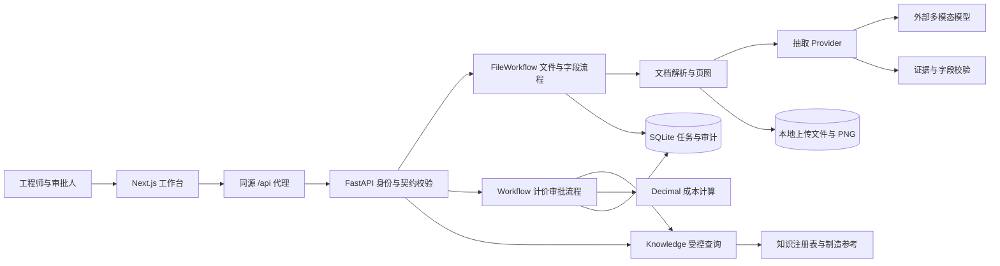
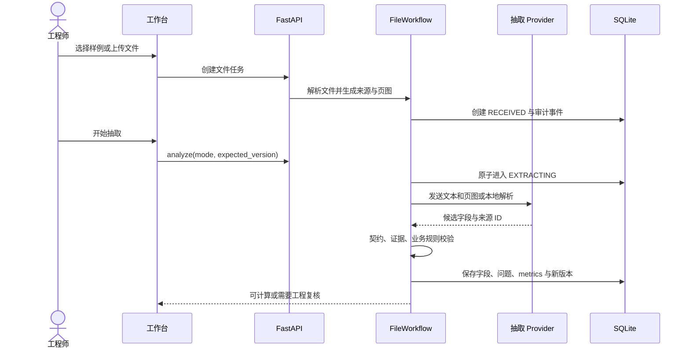
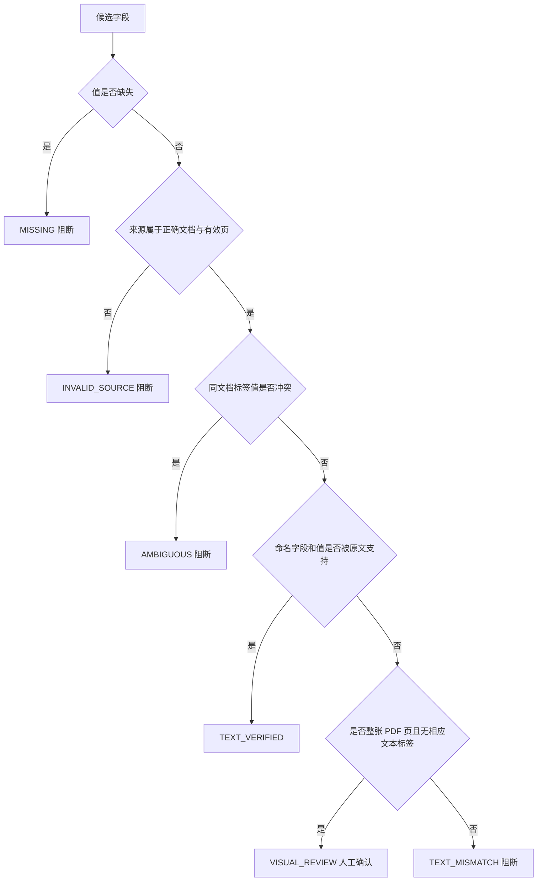
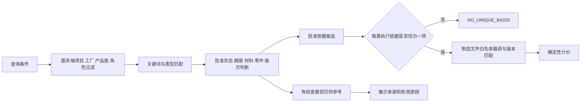
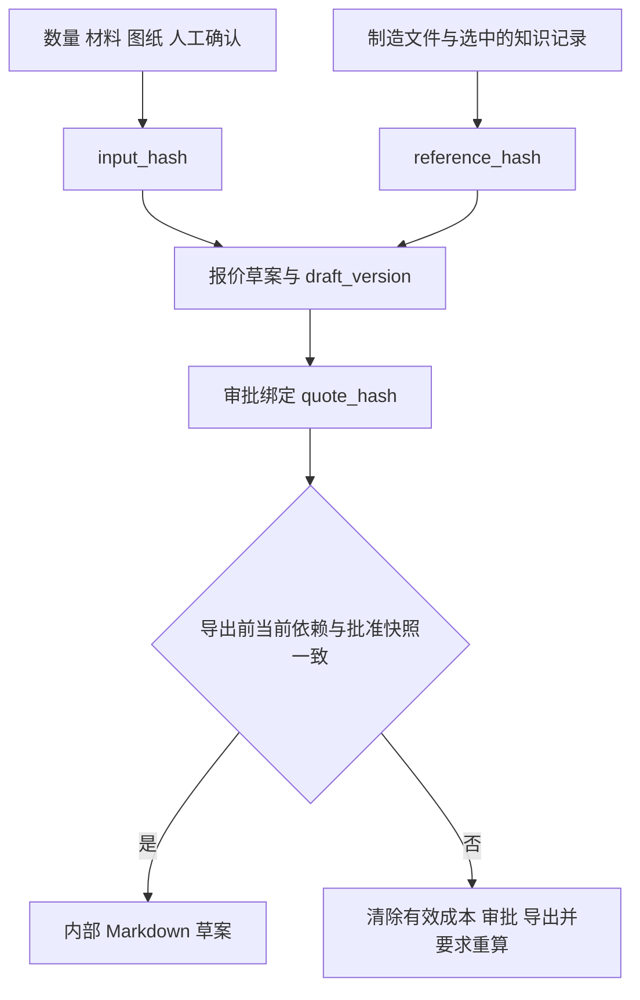
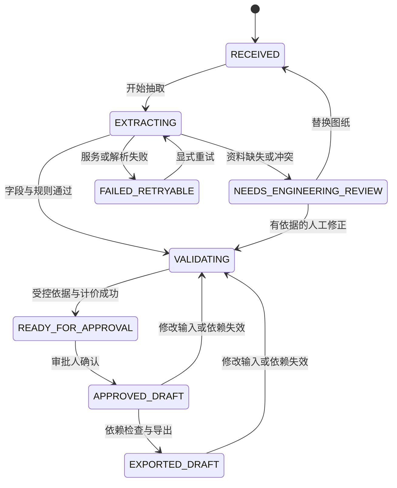

# IndustrialMindAI RFQ 工作台项目手册

> [!abstract] 本手册的用途
> 说明当前项目怎样运行、为什么这样设计、如何复现验证，以及怎样向面试官解释。当前代码基线为 **M4 / `196feb7`**；M0–M4 已完成开发范围验收。招聘题目、规划、当前实现与未来生产方案分别标识。

> [!important] 产品边界
> 这是 Option B 的本地原型：将 RFQ 和图纸转为**可复核的内部预算草案**。全部内置数据为原创合成资料；没有连接客户 ERP、PLM、MES，没有正式报价发布、制造认证或企业 SSO。工艺工时和费用是演示假设。

**阅读路径：** 初次接手先读第 1–4 节；开发维护读第 5–13 节；面试前直接看 [[docs/面试与演示讲解|面试与演示讲解]]。手册末尾嵌入同一讲解文档，避免维护两份话术。

## 1. 项目目标与当前交付

工作台聚焦一个明确业务问题：工程师收到 RFQ 和 PDF 图纸后，需要判断资料是否完整、版次是否适用、能否使用当前制造模板，然后形成有依据的价格草案并交给负责人审批。

本项目把不稳定的文档理解交给模型，把适用性、费用计算和批准流程交给程序及人工。主要评价点是错误能否被阻断、来源能否回查、变更后旧结论能否继续误用。

| 业务对象 | 当前固定范围 | 未验证事项 |
|---|---|---|
| 项目 / 工厂 | PM-DEMO / 德国 DE-DEMO | 客户组织、工厂与权限映射 |
| 产品 | mounting-bracket，PM-BRKT-010 单件安装板 | 装配结构、任意新零件、复杂 CAD |
| 图纸 | 批准 B 版，80 × 50 × 12，孔径 6.5，Al-6061-T6，Anodize | 全部孔位、GD&T、制造可行性仍需工程师复核 |
| 商务 | EUR，内部预算草案 | 采购可得性、产能、交期、税、运输及客户条款 |
| 输入 | UTF-8 RFQ 文本/PDF + PDF 图纸 | 原生 DWG/STEP、复杂扫描文件集 |
| 存储 | 本机 SQLite + 文件目录 | 多租户、分布式锁、生产备份与容灾 |

当前有五个视图：任务总览、资料与证据、成本草案、审批与审计、受控知识。知识查询是独立确定性接口；统一自然语言任务调度尚属于 M5。

工厂和产品族目前来自固定部署上下文，不是模型从任意 RFQ 中动态识别的字段。真实试点需要补充输入范围识别，并与服务端授权上下文交叉校验。

## 2. 快速启动与验收入口

从项目根目录操作。要求 Python 3.12+、Node.js 20.9+；本机系统旧 Node 16 不适用。

首次安装后端：

```powershell
python -m venv .venv
.\.venv\Scripts\python.exe -m pip install -r requirements.lock
.\.venv\Scripts\python.exe -m pip install --no-deps -e .
```

首次安装前端，在已配置新 Node 的终端执行：

```powershell
Set-Location E:\code\IndustrialMind\apps\web
npm ci
```

在根目录两个终端分别启动：

```powershell
.\scripts\start-api.ps1
```

```powershell
.\scripts\start-web.ps1 -NodePath 'C:\Users\z\.cache\codex-runtimes\codex-primary-runtime\dependencies\node\bin\node.exe'
```

已有新 Node 在 PATH 时可省略 `-NodePath`。上述绝对路径是当前电脑的便利配置，其他电脑应使用自己的 Node。启动前端安装/构建时也要确保子进程 PATH 使用新 Node。浏览器打开 `http://127.0.0.1:3000`，API 文档为 `http://127.0.0.1:8000/docs`，健康检查为 `/health`。Ctrl+C 停止各自服务。

根目录 `.env.local` 已创建并被 Git 忽略；模型 key 只在后端读取。不要把实际 key 写到手册、截图、前端环境变量或提交中。模型服务按当前配置使用 DeepSeek；接口通过 Responses 兼容客户端调用，不限定只能使用一家供应商。

| 配置项 | 作用 | 默认 / 注意事项 |
|---|---|---|
| OPENAI_API_KEY / OPENAI_MODEL | 后端模型凭据与模型 ID | 两者都有值才启用 LIVE；这是兼容接口变量名 |
| OPENAI_BASE_URL | 模型服务地址 | 本项目使用用户已配置的服务；远端要求 HTTPS |
| RFQ_MODEL_TIMEOUT_SECONDS | 单次超时 | 默认 60，允许 1–300 秒；无自动重试 |
| RFQ_DATA_DIR | SQLite 与上传存储 | 默认 `var`；相对路径按项目根目录解析 |
| RFQ_ENGINEER_TOKEN / RFQ_APPROVER_TOKEN | 本地角色令牌 | 留空使用公开演示值；自定义后 UI 角色切换尚不支持输入新令牌，可经 API 使用 |
| RFQ_MODEL_PRICING_FILE | 模型费用快照 | 可指定绝对路径；默认 `config/model-pricing.json` |

更改环境配置后重启后端。干净演示使用新的 `RFQ_DATA_DIR`，例如 `var/demo-m4-fresh`，保留旧任务而非删除数据库。细节见 [[docs/runbook|运行手册]]。

## 3. 系统架构与职责边界

采用**模块化单体**：前端和后端两个进程，后端内部按领域划分模块，没有微服务、消息队列或自由循环的 Agent 网络。



模型只得到当前任务文档文本、来源 ID 和真实页图；不读取 `evals/gold`、作者规格或报价费率。它输出候选字段，不能操作数据库、批准任务或决定价格。知识检索和计算都在后端执行。

| 模块 / 代码位置 | 主要职责 | 面试时解释的设计意图 |
|---|---|---|
| `apps/web/app/page.tsx` | 任务、证据、成本、审批视图及操作状态 | 用户看到输入、依据、问题、结果的连续流程 |
| `apps/web/app/knowledge-panel.tsx` | 查询条件、适用/参考标识、角色切换取消请求 | 防止旧角色查询结果回填；服务端仍独立鉴权 |
| `main.py` | 应用工厂、HTTP 路由、演示角色、错误响应 | 传输层与业务职责分开，测试能注入配置 |
| `documents.py` | 限制文件类型/大小/页数，提取文本，生成页图 | 文件输入是实际字节，不是预填答案 |
| `extraction.py` | LOCAL_TEXT 和 LIVE Provider，结构化模型调用 | 抽取实现可替换，流程不依赖某一模型 |
| `evidence.py` | 回查来源、标签和值、冲突和视觉复核 | 存在的引用不一定支持该结论 |
| `file_workflow.py` | 文件任务、抽取状态、修正、换图、业务校验 | 人工修改可追溯，重新抽取也会使旧结果失效 |
| `knowledge.py` | 权限过滤、适用判断、唯一执行依据选择 | 可查询不等于可用于报价 |
| `costing.py` | 有效制造参考、输入适用规则、Decimal 公式 | 价格可独立复算，模型不参与金额决策 |
| `service.py` | 草案版本、审批、导出与依赖失效 | 批准绑定准确快照，不能沿用到新输入 |
| `repository.py` | SQLite 事务、乐观版本、事件追加 | 防止两个操作者互相覆盖；快照和事件一起提交 |
| `contracts.py` | Pydantic 字段、证据、知识与报价契约 | 拒绝额外字段，限制类型和长度，生成机器文档 |
| `config.py` / `model_usage.py` | 配置校验、模型用量与费用估算 | 密钥隔离、耗时可见、未知费用不记零 |

以上后端文件均位于 `apps/api/src/rfq_workbench/`。完整接口见 [[docs/api|API 文档]] 与生成的 `docs/schemas/openapi.json`。

## 4. 一次 RFQ 的实际执行链路



抽取请求在当前 HTTP 请求内完成，外部模型调用不持有数据库事务；当前不是后台任务队列。重复修改必须带最新 `expected_version`。处理中禁止改字段和换图。

后续计价重新检查当前资料，选出唯一有效的目录、模板和费率，计算草案。审批人确认工程依据及仅限内部使用后批准；导出操作再次验证依赖及审批快照，再生成可下载 Markdown。

## 5. 数据、来源与契约

```text
apps/api/                       后端代码
apps/web/                       前端代码与锁定依赖
fixtures/dev/                   6 份开发 RFQ 与 5 份原创 PDF
fixtures/manifests/dev.json      开发资料来源、分组、split 与 SHA-256
fixtures/reference/             制造参数、规则、12 条合成知识记录
fixtures/authoring/              生成资料用规格；不进入运行时
evals/gold/                      开发真值；不进入抽取/检索
config/model-pricing.json        模型费率快照，与制造价格分开
docs/                           技术文档、ADR、验收、生成 schema
scripts/                        生成、启动及显式真实模型验收
tests/                          自动测试，不使用本机密钥
var/                            运行数据库、上传页图、真实调用记录；Git 忽略
```

支持非空、单文件最多 5 MiB；PDF 1–3 页且未加密。文本总量最多 60,000 字符。PDF 转 PNG 后发送模型；当前不要求模型直接接收 PDF。PDFium 使用进程内锁，避免并发渲染线程安全问题。上传文件由服务端生成 ID 存储，原文件名仅作展示。

| 对象 | 关键字段 | 作用 |
|---|---|---|
| Document | id、kind、sha256、pages | 区分 RFQ/图纸，保存输入身份与页内容 |
| Source | id、document_id、page、text、locator、bbox | 解析器签发来源；模型只能引用 |
| Extraction | rfq + drawing 的 value/source_id | 13 个候选字段；未知值为 null |
| ReviewedField | original_value、evidence、human_confirmed | 区分原始模型结论与人工修正 |
| Issue | code、field、message、severity | 稳定问题码和阻断原因 |
| Quote | 金额字符串、draft_version、依赖 hash、knowledge_basis、routing | 可审核的确定性结果快照 |
| KnowledgeRecord | scope、roles、approval、dates、version、payload_source | 约束可见性与可执行性 |
| AuditEvent | sequence、occurred_at、actor、action、detail | 回查谁在什么时间做了什么 |

Pydantic 的基础契约拒绝额外字段；数值数量不接受布尔或字符串冒充整数。API 金额使用十进制字符串。10 个 JSON Schema 由 `scripts/export_schemas.py` 生成；不能在生成文件中手改业务规则。

## 6. 抽取与证据原理

两条路径共用同一 Extraction 契约：

- **LOCAL_TEXT**：读取实际 RFQ/PDF 文本中的固定标签；没有模型调用，也不是历史输出回放。
- **LIVE**：通过 Responses 兼容 API 发送文本与 PNG，按结构化 schema 解析；已验证 DeepSeek `deepseek-flash`。本机网络/服务失效时不会自动伪装成本地成功。

来源 ID 由解析器产生，类似 `document-id:p1:l12`；整页为 `document-id:p1`。验证器检查同一任务、正确文档类型、页号、标签和值，不接受模型自己声明“已验证”。



尺寸 `80` 与 `80.00` 可视为等价；不会自动将英寸换成毫米或将钢件当成铝件。`unknown`、`[not provided]`、空字符串等统一为 null。数量还需满足业务正整数范围。

> [!note] 页级定位的准确含义
> 当前 PDF 来源回到整页图像，`bbox=null`。UI 可打开原尺寸页图，但不会显示推测区域。文本字段验证不等于孔位、公差、复杂几何已经通过工程认证。人工确认保留原证据状态，不将确认值伪装为原文。

## 7. 有限工程审查与知识治理

工程检查覆盖 RFQ/图纸版次一致、批准版次 B、零件号、材料、单位、币种及模板支持的尺寸/表面处理。A 图与要求 B 版冲突会阻断；两边都写 A 也不能绕过批准版次约束。超出当前产品模板范围不猜工时。



当前固定权限范围是 PM-DEMO / DE-DEMO / mounting-bracket，客户端不能传其他项目扩大权限。工程师默认查到 8 条，审批人 9 条；其余记录不泄漏标题或条数。授权详情不存在与越权统一 404。

查询可以显示过期费率、草稿、钢件历史、A 版历史，但必须标“仅供参考”。所有 history 即使获批也不参与成本；其 9.99 EUR 历史单价是反例。实际计价每类 catalog/template/rate 都必须恰有一条适用记录，指向服务端控制的制造载荷。

当前是关键词检索，不是向量 RAG，也没有模型生成的知识回答。此选择让小规模语料的权限与正确性先可验证。未来扩充检索方式时保留这条执行边界。详见 [[docs/adr/003-controlled-knowledge|ADR 003]]。

## 8. 成本公式、版本与审批

每件变动成本：毛坯 8.00 + 加工 0.12h × 60.00 + 表面处理 2.00 + 检验 0.02h × 50.00 = **18.20 EUR**。批次准备费：1.50h × 60.00 = **90.00 EUR**。

```text
单位成本 = 18.20 + 90.00 / 数量
单位报价 = ROUND_HALF_UP(单位成本 / (1 - 0.25), 2 位小数)
总报价   = 已舍入单位报价 × 数量
```

25% 是目标毛利率，不是成本加成率。系统使用 Decimal；先舍入单价再乘数量，和先算总价再舍入可能不同。

| 数量 | 单位成本 EUR | 单价 EUR | 总价 EUR |
|---:|---:|---:|---:|
| 100 | 19.10 | 25.47 | 2,547.00 |
| 500 | 18.38 | 24.51 | 12,255.00 |
| 3 | 48.20 | 64.27 | 192.81 |

模型费用是另一项运营观测，单位 USD，不加进当前合成制造报价。费用估算用缓存/非缓存输入和输出 Token 乘有版本的费率；过期、缺失或模型不匹配则显示未知。历史实测见 [[docs/acceptance-m3]]，不要当作新的供应商实时价格或实际账单。

审批绑定四种身份：任务 `version` 防并发；`draft_version` 标记重算；`input_hash` 绑定确认字段、来源状态和文档 hash；`reference_hash` 绑定制造载荷及选中的知识快照。审批再保存整个报价的 `quote_hash`。



输入修改会立即使有效成本、审批和导出失效；外部参考文件变化在批准/导出等使用边界检测，没有后台监听。无关历史记录变化不会改变当前报价的选中依赖。审计事件保留，清除的是当前有效结果，不是删除历史。

## 9. 状态机、持久化与并发



图为主要路径，非所有允许动作的穷举。重新抽取会清除旧结果；人工修改仍可留下复核问题；参考资料失效后重算可能再次被拒。`FAILED_FINAL` 是预留枚举，不代表已实现完整终止策略。

SQLite `runs` 存当前 JSON 快照与项目、版本；`events` 存按任务递增序号的审计。更新执行 `BEGIN IMMEDIATE`，核对 expected_version，在同一事务中更新快照并追加事件；失败则回滚。两个客户端使用同一旧版本时只有一个成功，另一方得到 409，而不是覆盖数据。

这不是完整 event sourcing：当前快照是读取入口，没有实现从全部事件重建状态。也不是防篡改审计账本；本机文件权限仍是基础。未知数据库 schema 版本拒绝启动，不自动丢数据。

## 10. 接口与扩展接点

| 能力 | 路径 | 角色 / 关键输入 |
|---|---|---|
| 健康 / 能力 | GET /health、/capabilities | health 公开，其余需角色 |
| 创建任务 | POST /runs/upload、/runs/from-fixture/{case_id} | 工程师；实际文件或白名单样例 |
| 已确认输入 | POST /runs/confirmed | M1 验证入口，仍受材料/零件/版次规则限制 |
| 文件抽取 | POST /runs/{id}/analyze | 工程师；mode + expected_version |
| 人工修正 | PATCH /runs/{id}/fields | 工程师；values + reason + expected_version |
| 更换图纸 | POST /runs/{id}/drawing | 工程师；multipart，原因和版本 |
| 计价 / 审批 / 导出 | POST /runs/{id}/cost、/approve、/export | 计价工程师；审批/导出审批人 |
| 任务与证据 | GET /runs、/runs/{id}、/runs/{id}/documents/{doc}/pages/{page} | 两角色，项目与文档归属检查 |
| 知识查询 | POST /knowledge/search、GET /knowledge/{record_id} | 两角色；服务端先做权限过滤 |

写操作不得只依赖按钮禁用；可直接调用 API，但后端仍检查权限、状态与版本。业务错误返回稳定 code/message；结构错误为 422，权限错误为 401/403，版本冲突为 409。

未来增加模型 Provider 保持 Extraction 契约；增加知识检索实现保持权限与唯一执行选择；接 ERP 应通过新适配器及批准动作，不在模型提示词中赋予直接写权限。以上是扩展方向，当前没有这些企业连接器。

## 11. 测试、实测与发布纪律

截至 2026-11-10，本机累计 **77 项测试通过**，生产构建包含 TypeScript 校验且通过。Ruff 与格式化检查已完成；CI 文件存在但未在远端运行。

| 范围 | 证据 | 能得出的结论 |
|---|---|---|
| M0 数据契约 | manifest/hash、8 项初始测试、PDF 视觉检查 | 合成资料可复现，真值不进入运行时 |
| M1 计价审批 | 19 项累计测试 | 金额、权限、并发和失效路径符合示例规则 |
| M2 真实调用 | [[docs/m2-live-result]] | 一次图文输入完成抽取与同任务审批导出 |
| M3 稳健性 | 60 项累计测试，3 个真实开发案例 | 受测正常/冲突/缺失行为正确；不是总体准确率 |
| M4 知识治理 | [[docs/acceptance-m4]]，77 项累计测试 | 受测权限、期限、适用性与执行选择通过 |

后续维护命令：

```powershell
.\.venv\Scripts\python.exe -m pytest -q
.\.venv\Scripts\python.exe -m ruff check apps/api scripts tests
.\.venv\Scripts\python.exe -m ruff format --check apps/api scripts tests
.\.venv\Scripts\python.exe scripts/export_schemas.py
.\.venv\Scripts\python.exe scripts/export_openapi.py
```

前端在 `apps/web` 执行 `npx prettier --check app next.config.ts tsconfig.json package.json` 和 `npm run build`。真实模型脚本必须显式运行，自动测试不会使用本机 key；重复跑 live 会产生费用。

开发集和冻结评测集边界已定义，但独立冻结集评测尚未完成。同零件不同版次不能跨 split 泄漏。测试项数量不是客户准确率，模型自报置信度也不是质量保证。

## 12. 运维、故障与已知限制

| 现象 / 错误码 | 操作 |
|---|---|
| LIVE 不可用 | 检查本机 key/model 是否配置，重启后端；不在聊天打印 key |
| MODEL_CONNECTION_FAILED / MODEL_TIMEOUT | 检查模型网络与限时；记录失败，再显式重试 |
| MODEL_AUTH_FAILED / MODEL_RATE_LIMIT | 检查服务凭据或额度；不循环重试消耗请求 |
| INVALID_SOURCE / TEXT_MISMATCH | 回到原文确认，不能改个 ID 伪造依据 |
| REVISION_CONFLICT | 补充批准图纸并重抽取，或记录有效工程澄清 |
| NO_UNIQUE_BASIS | 检查目录/模板/费率的批准、权限、期限、版本与重复项 |
| STALE_DRAFT / VERSION_CONFLICT | 刷新任务；重新计算、审批，不绕过数据库校验 |
| EXTRACTING 长期停留 | 可能进程中断；当前无任务租约自动恢复，保留记录并创建新任务 |

服务仅绑定 loopback。模型 key 不进入浏览器；实际选用 LIVE 会将任务文本及图像发往配置的模型服务。当前演示限定合成资料；真实客户资料需要先解决授权和数据处理约束。

停止服务后备份整个 `var`，包含数据库与文件。不要运行中只复制 SQLite 单文件。演示重置优先新建数据目录，不递归删除历史。解析失败可能留下孤立上传文件，需停机备份后人工整理。

演示角色令牌是公开模拟身份；任何能访问本机服务的人都不能被视为真实身份隔离。缺少生产 IAM、反向代理请求限制、不可变参考发布、自动任务恢复、完整观测与客户安全审查。知识文件以开发流程受控，不是已有企业治理平台。

## 13. Git 与文档管理

| 里程碑分支 | 检查点 | 内容 |
|---|---|---|
| codex/m0-data-contracts | 171433a | 范围、资料、契约、基础工程文档 |
| codex/m1-deterministic-core | caa8fc5 | 确定性后端 |
| codex/m2-rfq-workbench | 4a58648 | 文件与界面闭环，真实调用验收 |
| codex/m3-extraction-evidence | 9699b76 | 证据与用量 |
| codex/m4-controlled-knowledge | 196feb7 | 有限审查与受控知识 |

后一个分支累计包含前一个阶段。只提交明确相关路径；用户原有未提交材料不混入功能提交。本次无 push、无自动合并 main。保持 Conventional Commits；修改契约同时生成 schema，修改功能同步更新设计、运行手册和验收记录。

文档层次：权威 [roadmap](IndustrialMindAI-OptionB-RFQ工作台-roadmap.md) 定范围；本手册说明已实现系统；[[docs/adr/README|ADR]] 保存取舍；验收记录保存证据；[[docs/面试与演示讲解]] 提供讲解与操作顺序。`docs/baselines` 保留开发开始时计划快照，不能反向覆盖用户当前计划。

Mermaid 图直接维护在 Markdown 中，可在 Obsidian 阅读模式渲染，不依赖在线图片。本文图示只画当前实现或明确标注的主流程，不用概念插画暗示尚未接入的企业系统。

## 14. 后续里程碑与面试材料

| 阶段 | 后续工作，当前不宣称已完成 |
|---|---|
| M5 | prepare_quote / review_drawing / search_knowledge 三入口调度，澄清与统一暂停恢复 |
| M6 | 有界重试、中断恢复、版本日志与 PLM/ERP/MES 适配器预览 |
| M7 | 冻结输入及人工答案、独立指标、失败分析与异常评测 |
| M8 | 用实际数据补齐商业论证、ROI 与分阶段客户实施 |
| M9 | 最终交付排练、备用录屏、他人复现和提交核查 |

下面嵌入面试专用文档。它是当前 M4 的讲解脚本，可独立打开用于排练；准备了 12 分钟和 3 分钟两种版本，不代表 M8/M9 全部交付已通过。

![[docs/面试与演示讲解]]
