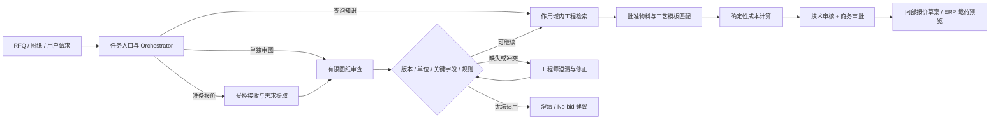

# IndustrialMind.ai Option B：RFQ 工程报价工作台实施 Roadmap

> 制定于 2026-11-08｜执行路线图。目标是用可运行的全栈原型回答 Solution Design Challenge 的 Part 1–5。实际进度见 [[docs/03-实施与开发/06-里程碑记录]]；背景、详细需求、样例成本和三年 ROI 的推导见 [[docs/02-方案与规划/02-需求分析与方案]]。PrecisionMotion 业务数据来自题目或标注为合成假设。

## 1. 最终方案与取舍

**选 Option B：一个可运行的「RFQ → 可审核内部报价草案」工作台。** 对外展示它是面向 PrecisionMotion 的一个受限产品族试点，内部实现同时覆盖图纸理解、有限图纸审查、工程知识检索、物料与工艺草案、确定性计价和人工审批。以执行器配套的单件机加工安装支架作合成演示，德国单工厂、EUR、mm、一个 PDF 图纸版本；真实客户产品族需要发现访谈后确定。

**核心判断：** 用户的分析是对的。报价并非一个孤立 Agent 的单轮回答。图纸字段和风险、受控知识、工艺与成本是报价的依赖。还需补充「能否报价」的商务与制造可行性判断：客户需求是否完整、当前图纸是否获准、材料/外协是否可得、费率是否有效、产能与交期是否已验证、客户条款和审批权限是否满足。原型可完成前几项，并把采购、产能、交期与合同条件明确列为 `pending`；若它们未验证，输出只能是**内部预算草案**，不能称为正式对客承诺。



这里的 `D` 只核对**报价相关的可观察图纸要素**：零件号、修订版、材料、单位、数量关联、所选关键尺寸及可读取的公差/表面处理说明。它不宣称完成 GD&T、几何可制造性、法规或装配设计认证。`K` 既服务独立问答，也给主链路提供受控依据，但**检索相似历史件不能自动决定价格或工艺**。

### 与已有建议的关系

| 来源 | 采纳 | 调整 |
|---|---|---|
| Claude 建议 | Option B、单条纵向链路、合成图纸真值、确定性计价、人工审核、影子评测 | 把图纸审查与检索定义为报价的依赖能力；加入正式报价前的采购/产能/商务门槛；不把自报置信度当作概率；全栈界面优先于 Streamlit，因为它更能展示你的现有 Next.js + Python 经验 |
| 现有 FDE 需求分析 | 单件支架范围、证据契约、审批失效、ERP 预览、ROI 口径和阶段化实施思路 | 本文进一步固定 Orchestrator 的入口、路由和权限，给出每个能力的实现顺序、完成门槛与时间不足时的删减顺序 |
| 你的设想 | 一个能按真实请求调度工具/Agent、在合适节点请人确认的中心 | 实现为**有界任务路由 + 持久化状态机**。不做无限自由循环或多个 Agent 相互讨论；仍能现场展示路由、工具调用、暂停、恢复、审计与异常转交 |

## 2. 为什么这套方案适合你

| 已有经历与可用证据                                          | 在本题中转化为可演示能力                  | 诚实边界                                |
| -------------------------------------------------- | ----------------------------- | ----------------------------------- |
| 企业手册 RAG 论文：本地、来源约束的检索与评估设计                        | 做工程知识的适用性过滤、来源展示和检索评测         | 企业原始手册及未公开评测不能作为演示数据                |
| Personal Digital Twin：已有三语 Next.js 作品集及 FastAPI 基础 | 实现清晰的 RFQ 工作台、状态页、证据查看与后端 API | Personal Agent 仍属规划，不宣称已做成可复用 Agent |
| Knowledge Engine 新架构：Python 契约、事件 schema 和评测基线     | 用 Pydantic 定义字段、来源、问题、审批和事件契约 | N0 仍在进行中，不能称为成熟可直接移植的平台             |
| 桥梁布跨 / 储能等工程优化项目                                   | 把硬约束、可行方案、可复算数值和基线比较放到报价决策中   | 不把 RL/DP 强行塞进报价；本题的价值来自工程规则和工作流     |
| 已有岗位/职业 Agent 的有界写入设计                              | 将模型建议和真实审批/导出分开，变更后使审批失效      | 不宣称拥有客户 ERP/PLM 生产集成经验              |

因此作品应呈现**全栈交付 + 工业决策边界 + 可测评的 AI**，而不靠 Agent 数量或一套很大的基础设施取胜。面试时可以指出：从图纸读出的材料是一条带证据的事实候选；工艺模板是一项受适用条件约束的建议；报价金额是费率版本与公式的计算结果；批准是一位有权限的人对特定快照的决定。

## 3. 工程师真实流程映射

| 阶段 | 责任人/系统（客户实际分工待确认） | 关键输入 | 可自动化的准备工作 | 必须保留的判断 |
|---|---|---|---|---|
| 1 接收与分流 | 销售、报价工程师 | RFQ、附件、数量、目标交期 | 文件归档、零件族和新件/变型件分类、缺失清单 | 是否进入本产品族、是否 No-bid |
| 2 技术澄清与图纸核对 | 设计/报价工程师 | 图纸、规格、修订版、CAD 引用 | 字段提取、版本/单位/材料冲突、关键标注定位 | 公差、材质与客户要求的工程含义 |
| 3 物料与工艺估算 | 工艺/采购 | 已确认要求、物料主数据、批准模板、工厂能力 | 找相似件和模板，生成毛坯与工序候选 | Make-or-buy、设备/刀具/外协适用性 |
| 4 成本与交期 | 报价、采购、计划、财务 | 费率、供应商价格、准备/节拍、库存、产能 | 分解材料/加工/检验/外协/批次准备费用，列出过期数据 | 供应报价、产能及交期承诺 |
| 5 审批与发布 | 技术负责人、商务/销售 | 价格明细、风险与条款 | 汇总依据、生成审批快照与草案 | 最终价格、条款、对客发送 |
| 6 变更与复盘 | 文控、工程、财务 | 新修订版、ECR、实际工时 | 定位受影响草案、使旧审批失效、形成偏差反馈 | 变更是否影响已发报价/订单 |

这与工业软件实践一致：routing 定义工序、工作中心与成本相关时间；PLM 中 EBOM、MBOM/BOP 和变更传播有各自职责；面向机加工的 DFM 审查会关注公差、深孔、薄壁、刀具可达性等。**本原型只演示它有依据的数据部分，不暗示已经完成真正的 CAD DFM 分析。** 参考：[SAP Routings](https://help.sap.com/docs/SAP_S4HANA_ON-PREMISE/5e23dc8fe9be4fd496f8ab556667ea05/bf94d7531a4d414de10000000a174cb4.html)、[Siemens MBOM/BOP 与变更管理](https://blogs.sw.siemens.com/teamcenter-manufacturing/2026/07/28/whats-new-in-teamcenter-manufacturing-easy-plan-2606/)、[Protolabs CNC DFM 指南](https://www.protolabs.com/resources/design-for-machining-toolkit/)。IndustrialMind 自己公开的[液压缸报价案例](https://www.industrialmind.ai/en/use-cases/ai-assisted-quotation-generation-for-custom-hydraulic-cylinders)也描述 RFQ、BOM、routing、成本与现有系统的连接；其中收益是其案例陈述，**不用作 PrecisionMotion 的 ROI 基线**。

## 4. Orchestrator：确实展示调度能力，但保持可解释

### 4.1 三种用户入口与路由

| 请求 | 路由 | 输出 / 权限 |
|---|---|---|
| 「为这个 RFQ 准备报价」+ 上传文件 | `prepare_quote` | 创建持久化任务；可调用抽取、审查、检索、计价；遇到关键问题暂停；审批后仅导出内部草案 |
| 「检查这张图纸哪些信息妨碍报价」 | `review_drawing` | 只读技术问题清单与证据；不生成价格、不自动批准 |
| 「这个材料/工艺模板适用吗？」 | `search_knowledge` | 返回经过项目、工厂、产品族、状态和有效期过滤的资料与差异；不能写入公共知识 |

优先提供显式按钮/任务类型，文本请求可用一次结构化分类。分类不确定或缺文件时请用户选择，不猜测；模型无权直接调用审批、对客发送或真实 ERP 写入。这样 Orchestrator 有真实**条件分支**，而不是为了展示 Agent 概念做无意义的自由对话。

### 4.2 状态与人工闸门

`RECEIVED → EXTRACTING → VALIDATING → NEEDS_ENGINEERING_REVIEW → RETRIEVING → COSTING → READY_FOR_APPROVAL → APPROVED_DRAFT → EXPORTED_DRAFT`。解析/模型超时转 `FAILED_RETRYABLE`，有界重试后转 `FAILED_FINAL`。`NEEDS_ENGINEERING_REVIEW` 可由工程师补充证据/修正后恢复；`READY_FOR_APPROVAL` 必须由授权人员确认。状态及审计事件持久化。

必须停下来的情况：RFQ 和图纸修订版冲突、关键材料或单位缺失、费率过期/币种不一致、无批准模板、超出产品族、知识来源权限不匹配。**模型的 confidence 仅可作为排序线索，不作为放行依据**。关键值来自已验证来源或人工确认。数量、图纸 hash、材料、模板或费率变化后，依赖它们的成本与审批立即失效。审批绑定 `input_hash + rules_version + rate_version + draft_version`。

实现形式：P0 用 Python 中显式的流程节点/路由表和 SQLite 任务状态，能暂停、恢复、重试、审计；完成 M5 的验收且确认需要框架能力后，可用 LangGraph 的持久化和 interrupt 替换状态机内部实现。不要同时维护两套权威状态。选择 LangGraph 时务必验证恢复时节点可能重跑，导出采用幂等键并与中断节点隔离。[LangGraph 官方持久化与中断说明](https://docs.langchain.com/oss/python/langgraph/interrupts)。

## 5. 技术实现切片

### 5.1 推荐栈

- `apps/web`：Next.js + TypeScript；RFQ 列表/上传、PDF 证据查看、问题与修正、成本明细、审批与运行轨迹。用已有作品集经验展示前后端契约、状态与交互；界面保持紧凑。
- `apps/api`：FastAPI + Pydantic；权限/作用域、任务路由、字段验证、成本计算、审批、导出。第一版一个服务和一个本地 worker/进程即可。
- `SQLite` + 本地文件目录：保存任务、输入 hash、事件、审批与版本化样例；单机原型足够。试点再用客户批准的数据库与对象存储。
- PDF 文本层优先解析；遇到扫描页再调用一个可替换的多模态模型/OCR 适配器。模型负责提取和澄清文本；所有模型输入输出与配置记录版本。
- 知识先用小型受控 JSON/Markdown 目录 + 元数据过滤和关键词检索；只有冻结集证明检索不足时再加向量/混合检索。价格永远来自受控费率表，不来自 RAG 文本。
- 用 `Decimal` 计算金额，显式记录单位、币种、费用包含项和舍入口径。`GET /runs/{id}` 等 API 可供 UI 轮询；无需首版加入 WebSocket、队列、容器集群。

### 5.2 数据契约

`RFQ`（范围、零件、数量、币种、要求版次）→ `Document`（文件 hash、版次、作用域）→ `ExtractedField`（值、单位、状态、证据 ID）→ `Issue`（规则、严重度、责任人）→ `KnowledgeHit`（来源、批准状态、适用范围、有效期）→ `MaterialLine` / `RoutingStep` → `CostLine` → `QuoteDraft` → `Approval` / `AuditEvent`。

证据先由解析器产生文本块 ID、页码与可用坐标，模型返回已有 ID；服务端回查并验证，不能接受模型自编的页码/坐标。图像字段若只能做到页级定位，就在 UI 中标页级。人工覆盖保留原值、修改理由和操作人。

### 5.3 真实业务边界

- **BOM：** 一张零件图最多支持单件毛坯/材料需求草案；不能从中推断齿轮箱或伺服电机的完整装配 EBOM/MBOM。
- **工艺：** 仅从已批准支架模板提出候选工序与计价时间；工艺工程师确认，不能把文本建议直接下发 MES。
- **图纸审查：** 做报价前检查，不宣称通用 GD&T/DFM 认证。对所选公差与表面处理给出成本影响提醒，只有明确且经批准的规则才能判定阻断。
- **交期与采购：** 若没有供应商当前报价、库存和产能，输出“待确认”，不能把 0 作为成本或给出确定交期。正式报价还需条款、税/运输、有效期、责任方审批。
- **企业系统：** 原型展示 PLM 版次读取、ERP 成本/报价载荷和 MES 实际工时反馈的**适配器契约与模拟预览**。不声称已经接入客户系统。

## 6. 实施顺序与验收门槛

**按实现里程碑推进，不以第几天或固定工作日数判断完成。** 本 roadmap 是后续开发、测试与验收的执行入口；每个里程碑以可运行产物和验收证据为完成依据，未通过的门槛继续修复，不因排期推进而自动视为完成。招聘方的截止时间和提交形式只用于安排提交范围，不替代验收条件。

输入数据的具体清单、公开来源、合成方法、来源记录及开发/冻结评测划分见 [[docs/02-方案与规划/03-输入数据规划]]。该文档服务于本 roadmap 的范围与技术选择，不构成另一套执行计划。

### 6.1 实现里程碑

| 里程碑 | 前置条件 | 具体工作 | 可检查的验收门槛 |
|---|---|---|---|
| **M0：范围与数据契约** | 已确认本文的产品族与业务边界 | 固定一个支架产品族；制作正常 RFQ、B 版图、A 版图和缺失/模糊资料；人工核对真值；定义字段、问题、状态与证据 schema；确定来源记录和数据划分 | 输入与期望输出可独立阅读，所有合成资料标 `SYNTHETIC`；零件、版本、单位、币种与模板引用一致；真值与运行时知识隔离；开发与冻结评测边界明确 |
| **M1：确定性后端核心** | M0 通过 | FastAPI、SQLite、成本函数、模板读取、草案版本、审批失效和审计事件；先用已确认的固定输入贯通流程 | 无模型也能完成「确认字段→工艺模板→计算→审批→导出」；100/500 件金额可独立复算；输入变化使旧成本与审批失效，事件可以回查 |
| **M2：首个端到端核心** | M1 通过，正常与冲突样例齐备 | Next.js 四个关键视图与 API 接入；PDF 文本块/页图处理；至少一次真实多模态抽取；接入问题展示、人工修正和后端闭环 | 从干净启动可实时提取正常样例并完成内部报价草案；A/B 版冲突阻断；补充有效依据后能继续计算、审批和导出；形成可独立演示的核心版本 |
| **M3：抽取证据与稳健性** | M2 通过 | 完善 Pydantic 输出、来源 ID 回查、空值处理、模型配置和耗时/费用记录；核对图像字段的定位粒度 | 关键字段能回到实际原文或页图；无法区域定位时明确标页级；缺失材料保持未知并进入正确处置；无效来源不能当作已验证证据 |
| **M4：有限审查与知识** | M3 通过 | 完善版本/单位/材料规则；按项目、工厂、产品族、批准状态和有效期过滤目录、模板、费率与历史案例；完成知识查询能力 | 正常件采用有效且适用的模板；过期或不适用资料不能进入当前计价；无权限资料不返回；可见但仅供参考的资料明确标识；价格始终来自受控费率 |
| **M5：Orchestrator 与 HITL** | M4 通过 | 贯通 `prepare_quote`、`review_drawing`、`search_knowledge` 三入口；完善任务持久化、暂停恢复、审批权限与依赖变更失效 | 三条入口各有正确输出和权限边界；歧义请求或缺输入有明确澄清路径；修正后继续；数量/图纸/模板/费率变化后旧审批不能导出新草案 |
| **M6：可靠性与集成预览** | M5 通过 | 有界重试、模型超时注入、输入/输出版本日志、PLM/ERP/MES 适配器契约与模拟预览；明确区分实时与回放 | 失败可定位并可按设计恢复，不产生重复有效审批或导出；越权查询被拒；模拟载荷与真实外部写入明确区分；`REPLAY` 来源可见 |
| **M7：独立评测** | M6 通过，测试输入和人工核对答案已冻结 | 使用冻结集和系统异常案例，覆盖正常、版次冲突、材料缺失、过期费率、不适用历史件、超时与诱导指令；分别评估字段、证据、阻断、检索、价格、审批、耗时与人工复核 | 报告包含样本数、分母、错误与拒答、模型配置和实际测量；关键阻断、计算、权限与审批行为通过；未解决问题有记录；合成结果不外推客户数据 |
| **M8：方案与商业论证** | M7 提供可引用的实测证据 | 用实测更新已实现能力与演示指标；完成架构图、风险、三档 ROI 和 0–3/3–9/9–24 月客户路线图 | Part 1–5 能在 README/方案附件中逐项定位；题目事实、假设、合成评测与客户实测分开；ROI 可复算，未测数据明确标为待验证 |
| **M9：集成 harness** | M8 通过，新增 harness 任务书确认 | 来源快照、独立假系统、持久 outbox、幂等、租约派发和回读对账，17 个冻结故障场景与前端操作 | 新任务书硬门槛达标，M7 不退化，公开模式及 ADR 完整。见 [[docs/03-实施与开发/09-阶段验收/11-M9集成Harness]] |
| **M10：演示与交付** | M9 通过，交付包与运行说明齐备 | 从空数据库/干净状态启动；完成 12 分钟演示、3 分钟短演示与原始备用录屏；核查样例、证据入口和重置方法 | 现场数量变更、错版恢复、审批导出及模拟同步均可操作；另一位使用者按说明可启动复现 |

M10 可选增强的两套费率已通过后端和浏览器验收。正式演示与备用录屏按上表交付。[[docs/05-面试与问答/06-方案架构演示规划]]

里程碑表示逻辑依赖，独立的数据整理、架构说明和商业假设可以提前准备；功能是否完成仍按上述门槛判定。当前里程碑均为计划，完成时记录对应代码/运行产物、验证方式、结果、遗留问题和验收日期。

### 6.2 版本完成边界与范围收敛

- **核心可运行版：M0–M2 通过。** 能从文件输入完成一次真实抽取、冲突处理、修正、确定性计算、审批和导出；此时只声明已通过验证的有限场景。
- **完整功能版：M3–M6 通过。** 具备完整证据检查、受控知识、三入口调度、持久化人工流程、失败恢复与集成预览。
- **面试交付版：M7–M10 通过。** 独立评测、Part 1–5 论证、集成 harness 和可复现演示材料齐备。新增任务书将 M9 用于集成 harness，原演示交付门槛顺延为 M10。

**M2 尚未通过时的范围收敛顺序：** 暂缓独立知识问答 UI → 暂缓历史案例向量检索 → 暂缓多工厂/多语言扩展 → 暂缓复杂布局与动画。保留真实抽取一次、证据/问题、确定性价格、人工修正、审批失效和能启动的 UI。独立知识问答 UI 的暂缓仅用于先完成核心版；完整功能版仍须满足 M4/M5 的知识能力与三入口验收。向量检索、多工厂/多语言和视觉扩展不作为核心闭环的前置条件。

若模型凭据不可用，明确用 `REPLAY` 展示已保存抽取，并现场执行规则、计算和审批；不能冒充实时推理，也不能以回放替代 M2 的真实抽取验收。后续若替换模型、解析器或工作流框架，复验受影响的已通过门槛。

### 6.3 贯穿各里程碑的验证原则

**不写仅重复实现的测试。** 必须验证具有真实损失风险的行为：100/500 件舍入、A/B 版阻断、过期费率拒用、数量/图纸变更使审批失效、越权查询被拒、重试不重复导出。这些验证随相关能力一起完成，M7 汇总独立评测，不能把所有验证推迟到最后。

抽取质量使用独立冻结样本，标准答案由人工核对，不能只让同一个模型生成内容又给自己打分。冻结集一旦用于调优，应转为开发数据并补充新的独立评测样本。范围、技术选型或验收标准变化时，先更新本 roadmap 和关联数据计划，再按新版本实施与测试。

## 7. 演示数据、评测和商业论证

**M7 冻结口径：** 独立料号与版式用于抽取和证据评分。完整报价正例另须独立冻结的批准模板、知识及复算答案，按案例在隔离配置中运行。范围外拒绝、抽取错误与报价错误分别统计，默认演示范围仍为单一料号。冻结与评分方法见 [[docs/03-实施与开发/05-M7评测口径|评测边界]]。

**四个面试瞬间：** ① 上传 RFQ/图纸，选择“准备报价”，展示 Orchestrator 的任务路径；② 点击材料/版次字段回到图纸证据，换 A 版后系统暂停并提示工程师；③ 查看模板与成本来源，把数量从 100 改到 500，看价格重算和审批失效；④ 让用户问“这个工艺依据是什么”，看到过滤后的来源、适用条件与差异，再由授权人批准内部草案。

现有方案的合成样例为：单件可变成本 €18.20，批次准备 €90，毛利目标 25%；按单价先舍入到分，100 件价格 €25.47/件、500 件 €24.51/件。它只用于验证计算和演示，不表示真实材料、加工或市场价格。产能、供应商交期、运输与税费未核实，不能从这组数字生成对客交期或正式总报价。

评测按层拆开：字段 exact match/单位归一准确率、证据定位正确率、关键问题召回率与误报率、检索适用性、价格逐行复算一致性、审批违规次数、端到端 p50/p95 时间、人工复核时间和每单模型成本。报告同时保留拒答与失败样例。单张合成图纸的成功展示是**技术演示**，不是客户采用率或生产可靠性证明。

商业论证沿用现有方案的可审查参数：题目年 RFQ 15,000；假设适用比例 60%、每单人工有效时间 2.00→1.25 小时、年采用率 25/60/80%、产能价值 €65/小时、兑现系数 75%、一次性投入 €100k、运营 €80k/年。由此得到三年产能价值约 €543k、总成本 €340k、简单 ROI 约 59.7%；保守场景可为负值。第三年释放 5,400 小时 ≈ 3.38 FTE 的原始工作容量，**不等于裁员、现金节约或工程部门整体提效 37.5%**。报价周期改善需另测收件到批准的时间戳，不从工作时长下降直接推出。详细公式和敏感性见已有 FDE 分析第 10 节。

## 8. 客户实施路线：回答题目 Part 5

| 阶段 | 范围与交付 | 进入下一阶段的证据 |
|---|---|---|
| 0–3 个月 | 选德国一团队、一产品族和获准的脱敏历史 RFQ；记录人工时间与版本错误基线；只读/影子运行，工程师逐单复核；确定 PLM 版次、ERP 费率和工艺模板权威来源 | 关键错误有阻断；总人工时间真实下降；业务负责人认可准确率、适用率和下一批样本；资料处理获准 |
| 3–9 个月 | 扩至部门更多适用产品族；接入身份、只读 PLM/ERP 和经批准的工作流写入；建立模板与知识发布治理、监控、回滚 | 按真实采用率与维护成本重算收益仍成立；工程/商务审批清楚；IT 可接管运行 |
| 9–24 个月 | 分工厂规则和权限扩展至波兰/中国；按有数据和评测的条件增加 CAD、装配 EBOM→MBOM、工艺 BOP、变更传播与 MES 反馈/RCA | 每个新场景独立评测、授权和投资决策；跨厂知识共享符合客户边界 |

Phase 1 先问客户：哪些 RFQ 属于重复/变型/新设计？真实瓶颈是处理时间还是排队时间？批准版次如何定义？现有费率和供应价谁维护？哪个产品族的模板稳定？谁能批准正式报价？系统能否处理图纸？这些答案决定试点范围，不能用题目给出的 50,000 张图纸直接推断每单图纸数或价值。

## 9. 交付包与完成定义

```text
docs/00-文档导航.md            # 五类文档导航
docs/04-项目介绍与展示/    # 项目简介、启动、架构、接口与 RFQ 样例
docs/05-面试与问答/        # 12 分钟脚本、3 分钟版与问答
apps/web/ + apps/api/      # 可运行全栈原型
fixtures/                 # 图纸、目录、费率、真值与反例
evals/                    # 冻结集、评测脚本和结果
```

规划阶段的 ROI 推导见 [[docs/02-方案与规划/02-需求分析与方案#10. 三年商业价值测算|初始测算]]。M8 交付入口见 [[docs/04-项目介绍与展示/11-方案答卷]]，假设与复算见 [[docs/02-方案与规划/05-商业论证]]。

完成时要能从干净环境启动，输入一份**支持范围内的合成 RFQ**，实时生成带可回查证据的字段与问题；显示批准模板和有效费率；由程序独立复算价格；人可修正、恢复、审批和导出；版次/数量变化会使旧审批失效；三种请求能路由到正确能力；失败与回放有清楚标识；Part 1–5 的结论和不确定性都能在材料里找到。现场任何收益、准确率和交期数字都应标明是题目、假设、合成评测还是客户实测。

## 10. 本文依据

- 题目原文：[[docs/01-原始说明/01-设计挑战|`docs/01-原始说明/01-设计挑战.md`]]；公司候选人资料：[[docs/01-原始说明/02-公司资料|`docs/01-原始说明/02-公司资料.md`]]。
- 对话材料：[[docs/02-方案与规划/01-Claude建议|`docs/02-方案与规划/01-Claude建议.md`]]；现有详细方案：[[docs/02-方案与规划/02-需求分析与方案|`docs/02-方案与规划/02-需求分析与方案.md`]]。
- 个人经历边界：`Personal Digital Twin README`、`Knowledge Engine N0 记录`（仓库外历史参考）及作品集项目页；这些来源不构成报价业务验证。
- 行业与技术原始来源：上文所链 SAP、Siemens、Protolabs、IndustrialMind 官网及 LangGraph 官方文档；查阅日期 2026-11-08。它们说明行业流程和工具机制，不能代替 PrecisionMotion 的实际系统发现。
