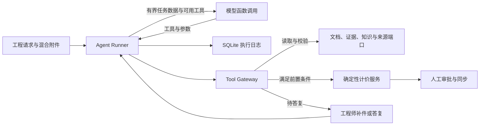

# ADR 06 · 报价 Agent 运行循环

## 决策

在原工作台旁新增 `/agent/runs` 入口，使用 `RFQ_AGENT_ENABLED=1` 启用。原有报价任务、审批、ERP 派发和对账仍使用各自的业务服务及入口。Agent 以请求和混合附件为输入，在已登记工具范围内自行决定如何分诊、读文件、聚焦重抽、查知识、申请计价或交人工处理。采用小型自写循环，将每步的持久化点、工具授权和业务事务直接对应到现有代码，便于验证恢复行为和复用服务。

## 执行约束

- 模型通过 Responses 或 Chat Completions 原生工具调用返回工具名和参数。每步处理一个调用，额外并行返回的工具名记入轨迹。配置 `RFQ_AGENT_MODEL_API=responses` 或 `chat` 可固定接口。默认 `auto` 先用 Responses，端点明确缺少该接口时回退。
- 网关校验当前可用工具、参数类型、附件归属、页范围和任务前置条件。模型可以新增风险和提问，字段修正和审批由现有角色入口执行。批准、下载、同步、派发、决议和发送能力均不在模型工具注册表。
- 循环最多 18 步、48,000 token、180 秒累计执行时间和 5 个错误。重复工具及参数会被阻断。明确的临时来源错误可在同一轮重试一次，仍失败时等待人工答复。模型调用前预留 token，实际用量可用时按供应商返回修正，费用未知时保留该标记。
- `agent.sqlite3` 保存任务、观察、工具选择、待执行步骤、答复和结果。先保存工具选择，再执行。过期租约允许重领，抽取通过步 ID 的审计事件去重，报价通过原业务版本和已提交草案识别。模型调用和源系统读取在事务外。停止生效后不领取新步骤，已经提交的业务记录可回查。
- 附件页文本与图片作为工具数据。每次读取最多两页文本，查看或在线重抽最多一页图。对话携带近期有界观察、来源 ID 和关键字段。日志保存所用上下文与响应标识。冻结评测由脚本回放工具决定，实时执行质量由单独联调验证。

## 接口

| 路径 | 用途 |
|---|---|
| `POST /agent/runs` | 表单字段 `request` 和多份 `attachments`，创建待执行任务 |
| `GET /agent/runs/{id}` | 读取任务、计划、轨迹、预算、问题和交付包 |
| `POST /agent/runs/{id}/step` | 执行或恢复一个模型决策和一个工具步骤 |
| `POST /agent/runs/{id}/answer` | 等待答复时提交 `answer` 与可选补件 |
| `POST /agent/runs/{id}/stop` | 停止后续执行 |

面试步骤见 [[docs/05-面试与问答/09-选项B现场演示流程#先展示报价 Agent]]。用 `python scripts/evaluate_m11.py --output var/m11/report.json` 回放冻结场景。
