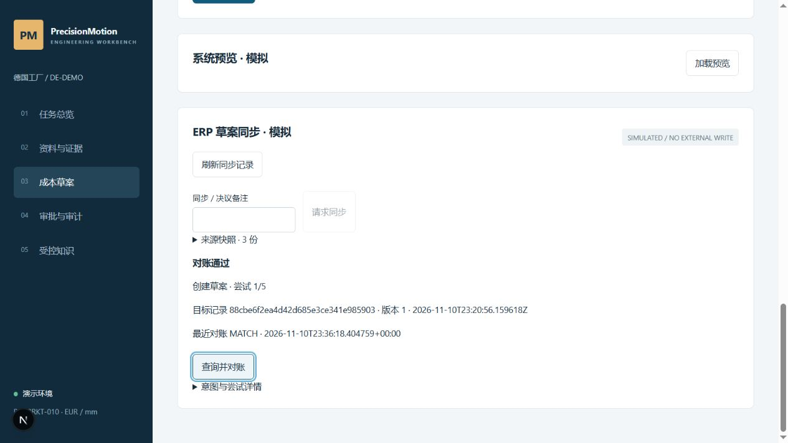

# M9 集成 harness 验收

**通过模拟系统技术验收。** 在分支 `codex/m9-integration-harness` 按 T1–T8 实施，基线为 `3d28ab9`。环境标识为 SIMULATED / NO EXTERNAL WRITE。任务书、设计差异和运行命令分别见 [[docs/03-实施与开发/M9-集成harness-Codex任务书]]、[[docs/03-实施与开发/08-工程决策/05-集成Harness]]、[[docs/04-项目介绍与展示/06-启动与运维]]。

## 硬门槛结果

| 指标 | 结果 |
|---|---:|
| 冻结集成场景 | 17/17 |
| duplicate_effect | 0 |
| lost_write | 0 |
| false_ack | 0 |
| unsafe_send | 0 |
| 未知结果已确认 | 5/5 |
| 注入差异检出 | 4/4 |
| M7 独立报价与阻断 | 正例 4/4，反例 8/8，unsafe_negative_quotes=0 |
| M7 故障检查 | 6/6 |

M9-17 主动插入一条重复目标记录，目标总数为 2，系统报告 DUPLICATE 并转人工。该条受控注入记录从 duplicate_effect 中单列，单列值为 1。未知结果检出分母涵盖提交前后超时、崩溃、迟到结果及 503 查询路径。原始结果包含每例状态、目标记录数、实际调用次数、版本与载荷哈希。冻结输入校验和工作树代码摘要一并记录。[原始结果](../../../evals/results/m9/local.json) · [协议](../../../evals/frozen/m9/protocol.json) · [场景](../../../evals/frozen/m9/scenarios.json)

## 行为与证据

| 范围 | 验收观察 |
|---|---|
| 存储与旧库 | v1→v2 迁移保留旧任务及事件字节。outbox 与 sync_requested 同事务提交，背景派发事件保持任务版本。 |
| 来源快照 | 计价前读取独立假 PLM、ERP、MES，保存版本、时点、TTL 与哈希。缺关键字段阻断，未知新增字段记入快照并追加告警事件。 |
| 安全发送 | 排队期间的 PLM 变化、批准失效和 TTL 过期均阻止发送。取得租约后暂停的进程在恢复时重检，过期租约先恢复为结果未知。 |
| 超时与崩溃 | 提交后超时只查询原记录，目标保持 1 条。发送后崩溃，重启后按过期租约恢复并对账。迟到结果记录 LATE，保留已确认状态。 |
| 并发与更新 | 双派发器竞争只有一条实际写调用。第二个报价版本以 UPDATE_DRAFT 和目标版本校验更新同一 ID。目标被他人修改时保持原数据并报告 DIVERGED。 |
| 逐字段对账 | 金额、单位、币种、数量、行数与追踪字段比对。缺行的部分提交报告 DIFF。已验证目标后来漂移时，追加对账和审计，保留原意图终态。 |
| 失败预算 | 429 退避并尊重 Retry-After。503 按结果未知先查。发送或确认读取预算耗尽后隔离。最终一致查询在 settle 窗口内保持未知。 |
| 人工决议 | rebase 重新确认目标版本、清除本地报价和批准，再由工程师计价和审批人批准。abandon 终止该意图。 |
| API 幂等 | 创建、上传、确认建单、样例建单、审批、导出和同步可返回首次响应。相同键不同内容拒绝，处理待确认返回 409，记录跨重启保留。 |

补充回归覆盖租约取得后暂停、claim 与 send 之间来源改变、来源 TTL、最终一致等待、确认读取预算、漂移巡检、人工 rebase 及读端口在事务外执行。

## 页面与交付检查

浏览器在独立 `var/m9-browser` 库通过本地文本模式创建 DEV-001，确认总价 €2,547.00，审批人批准后从成本页请求同步、派发并回读 MATCH。目标回执显示版本 1，手动再次对账仍为 MATCH。工程师角色可读同步记录，写操作仅供审批人。

后端 151 项测试、Ruff、M7/M9 评测、前端 Prettier、TypeScript 和生产构建均通过。独立演示进程重启后，来源快照可展开查看，原目标草案再次回读仍为 MATCH。公开 schema 和 OpenAPI 已重新生成。默认模拟源、超时故障配置、显式 worker 命令及恢复操作可按运行手册复现。[[docs/04-项目介绍与展示/06-启动与运维]]

最终回归输出为 `var/m7/m9-T8-release-20261111003613/report.json` 与 `var/m9/T8-release-20261111003613/report.json`。M9 原始结果已归档到 `evals/results/m9/local.json`；其中 `git_commit` 为最后一个已提交检查点，`source_sha256` 固定实际受测工作树。CI 已配置同样门槛，本次交付完成本地验证，尚未运行远程 CI。

真实 ERP 的幂等键、查询一致性、版本前置条件、5xx 语义、权威成本来源和舍入契约仍需客户确认。当前 17 个场景验证的是有状态假系统上的工程语义。原路线图的演示交付门槛按新任务书顺延为 M10。
