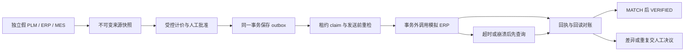

# 当前架构入口

完整架构与基本原理集中维护在 [[docs/04-项目介绍与展示/02-项目手册]]：第 3 节模块职责，第 4 节调用时序，第 6–9 节证据、知识、计价审批与状态机。面试展示用 [[docs/05-面试与问答/01-演示讲稿]]，避免此处重复维护同一张主图。

当前结构是 Next.js + FastAPI 模块化单体，SQLite 保存任务快照和审计，文件目录保存原始资料与页图；模型为抽取 Provider，知识查询和成本判断由后端确定性规则控制。

已接受的决策：

- [[docs/03-实施与开发/08-工程决策/01-单体架构|ADR 001：本地模块化单体]]。
- [[docs/03-实施与开发/08-工程决策/02-证据与模型费用|ADR 002：证据强度与模型用量]]。
- [[docs/03-实施与开发/08-工程决策/03-受控知识|ADR 003：受控知识与执行选择]]。

M5 新增显式三入口 Orchestrator、澄清、补件与人工恢复；决策见 [[docs/03-实施与开发/08-工程决策/04-任务编排]]。当前没有自动自然语言分类、企业连接器、队列自动恢复或生产身份；对应后续里程碑。该边界同时约束演示话术与未来架构图。

M6 在任务快照中持久化识别次数和执行期限，沿用版本比较交换保护恢复后的任务。PLM、ERP、MES 使用有类型的模拟适配器。详见 [[docs/03-实施与开发/09-阶段验收/06-M6恢复与集成]]。

## M9 集成 harness

计价在任务事务外读取独立假系统并保存不可变来源快照。批准时检查来源 TTL 和版本。审批人提出同步后，事务落地 outbox，显式派发器在事务外调用模拟 ERP，回读结果逐字段对账。前端和载荷均标注 SIMULATED / NO EXTERNAL WRITE。

运行时职责、兼容策略与来源/目标版本的假设见 [[docs/03-实施与开发/08-工程决策/05-集成Harness]]。硬门槛和浏览器证据见 [[docs/03-实施与开发/09-阶段验收/11-M9集成Harness]]。
