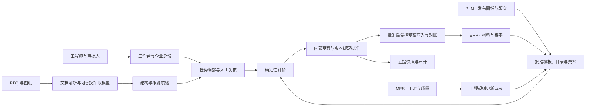

# PrecisionMotion 方案答卷 · Option B

建议从德国工厂一个产品族的 RFQ 报价准备切入。工程师上传 RFQ 和图纸，核对关键字段、批准版次和适用工艺，审批人确认后导出内部预算草案。这条链路同时给出了可运行原型、可复算的成本和可检查的异常处理。[[docs/01-原始说明/01-设计挑战]] · [[docs/04-项目介绍与展示/06-启动与运维]]

| 挑战题 | 答卷位置 |
|---|---|
| Part 1 · 问题分析 | [工时假设与切入点](#part-1-问题分析) |
| Part 2 · 解决方案 | [智能体、来源、工作流与示例](#part-2-解决方案) |
| Part 3 · 技术架构 | [当前边界、技术决策与目标架构](#part-3-技术架构) |
| Part 4 · 商业论证 | [生产力、周期、产能与三年 ROI](../02-方案与规划/05-商业论证.md) |
| Part 5 · 实施路线 | [0–3、3–9、9–24 个月的交付与门槛](../02-方案与规划/06-客户实施路线.md) |

## Part 1 问题分析

题目给定 PrecisionMotion 有约 150 名工程师，每年收到约 15,000 份 RFQ、50,000 张图纸和 30,000 个 CAD 模型。现行图纸审查、BOM、工艺和报价高度依赖人工，资料与知识分散。需要优先验证的工时假设是，报价工程师在找齐资料、核对版次、整理字段以及重复选择工艺和费率上消耗最多可减少的时间。图纸、CAD 和 RFQ 是不同统计口径。[[docs/01-原始说明/01-设计挑战]]

| 可切入流程 | 优先级判断 | 客户验证 |
|---|---|---|
| RFQ 资料归整、版本及字段核验 | 首试。任务量大，存在重复步骤，规则和错误能在报价之前核对。 | 记录每单的找资料、录入、澄清及返工工时。 |
| 标准件模板匹配与计价 | 随 RFQ 一起试。用批准的材料、工时和费率复算，与现行草案对账。 | 计算适用比例、异常漏阻断和复核后净节省。 |
| 工程知识检索 | 用作流程支撑。先验证访问范围、来源新鲜度及参考和可执行依据的区分。 | 测量查找资料用时及依据适用率，收益归入同一 RFQ。 |
| 装配 BOM、原生 CAD、通用 DFM、质量 RCA | 后续按产品族和数据准备度试点。需要更多结构、几何、制造与质量标注。 | 各用独立指标、样本及预算确认价值。 |

最高 ROI 的候选环节是适用件的报价准备，其价值取决于有效人工工时差、适用率、采用率和维护成本。试点先分别测主动工时与等待，再确定瓶颈和收益。[[docs/02-方案与规划/02-需求分析与方案#3. 客户问题与需求发现|需求发现]] · [[docs/02-方案与规划/05-商业论证]]

## Part 2 解决方案

| 能力 | 数据来源与工作流 | 交付状态 |
|---|---|---|
| 图纸助手与有限工程审查 | 工程师上传 RFQ 文本或 PDF 及图纸 PDF。抽取料号、版次、数量、材料、单位和尺寸，回看来源，确认视觉字段或补件。 | 原型支持文件、页图、字段依据与冲突提示。完整 GD&T、公差与原生 CAD 分析需另行验证。 |
| 询价与报价智能体 | 用已核对字段匹配唯一适用的批准材料目录、工艺模板和费率。程序复算，审批人复核工程事项并批准内部草案。 | 原型支持成本明细、版本绑定、失效控制与 Markdown/JSON 下载。正式报价的采购、交期和客户条款由业务人员确认。 |
| 工艺和物料辅助 | 按批准的单件模板列出毛坯用量、工序、准备与加工时间。 | 原型覆盖单件毛坯及模板工序。装配层级 BOM 和从图纸推导新工艺属于扩展。 |
| 工程知识检索 | 工程师查询可见的版本化资料，查看适用条件、有效期、权限和历史参考。 | 原型使用受控 JSON 注册表和关键词查询。部门推广时接批准的知识发布与撤销流程。 |

**样例输入与输出。** DEV-001 的 RFQ 要求 PM-BRKT-010 B 版 100 件，附件为 B 版图纸。当前批准的演示模板给出单价 €25.47、总价 €2,547.00、100 件毛坯及成本和来源快照。把数量改为 500 后，原批准失效，重新计价为 €24.51/件和 €12,255.00。DEV-003 上传 A 版图纸时显示冲突，需要换成正确版次才能继续。这里使用合成资料及演示费率。[[docs/04-项目介绍与展示/08-RFQ样例/01-正常报价]] · [[docs/04-项目介绍与展示/07-功能演示]] · [[docs/03-实施与开发/09-阶段验收/08-M7前置修复]]

## Part 3 技术架构

当前原型由 Next.js 工作台、FastAPI 模块化单体、SQLite 任务与审计及本机文档存储组成。显式任务入口驱动有界编排，缺件、冲突和未核实的视觉值进入人工复核。图文模型仅抽取候选字段和来源，文本及回放模式有各自标识。原文支持、知识适用性、价格和审批由服务端控制。模块化单体让任务版本和审计在同一事务落库。[[docs/04-项目介绍与展示/02-项目手册#3. 系统架构与职责边界|当前系统图]] · [[docs/03-实施与开发/08-工程决策/00-决策索引]]

客户目标架构沿用抽取、决策与批准的职责边界。原型阶段 PLM、ERP 和 MES 为本地模拟预览。图中的企业身份、真实系统读取和受控 ERP 写入是后续建设项。

部署前与 IndustrialMind 团队确认文档理解、知识检索和流程编排可复用的接口及数据边界。客户侧的版次、工艺、费率、审批及对账契约由各系统负责人确认。[[docs/01-原始说明/02-公司资料]] · [[docs/02-方案与规划/06-客户实施路线]]

| 主要风险 | 当前控制及试点动作 |
|---|---|
| 抽取正确值却引用错页，或图纸中的指令改变任务 | 核对来源对象、标签与值。视觉字段交人确认，模型无法批准。试点扩充扫描、跨页和诱导反例。 |
| 使用过期图纸、历史价格或旧审批 | 要求批准版次和唯一适用的制造依据。变更触发复核、重算和重新审批。接入后对账并演练重放。 |
| 图纸权限扩大或跨项目误用 | 原型演示角色分离。推广接企业身份、对象权限和记录留存，由 IT 确定模型处理范围。 |
| 接口不稳或工时收益被复核抵消 | 持久化有界重试，故障任务交回工程队列。试点测转人工、返工、主动工时与审批等待，按结果决定范围。 |

## Part 4 商业论证

基准假设每单有效工时由 2.00 小时降到 1.25 小时，第 3 年可调配产能约 2.53 FTE，三年简单产能价值 ROI 为 59.7%。保守情景为 −52.7%，乐观为 201.6%。报价周期以收件到批准独立计时，30% 缩短是试点讨论目标。[[docs/02-方案与规划/05-商业论证]]

## Part 5 实施路线

0–3 个月做德国单产品族试点，测量基线并跑影子流程。3–9 个月按模板覆盖和业务成效扩到部门，分步接入身份、数据与审批。9–24 个月按工厂扩展，逐项验证 CAD、装配和质量场景。阶段转换由工程、IT、财务及报价负责人共同确认。[[docs/02-方案与规划/06-客户实施路线]]

## 验收证据与待测事项

| 证据类别 | 内容 |
|---|---|
| 题目事实 | 客户规模、工程师数、工厂布局、RFQ 及资料量来自挑战题。 |
| 原型实测 | M7 冻结集共 12 个合成包。DeepSeek 读对 153/153 个可见字段，其中 145 个经原文核对，8 个定位到需人工确认的扫描页。独立离线报价 4/4、异常阻断 8/8、知识检索 12/12。 |
| 方案假设 | RFQ 工时、适用与采用率、费率成本、兑现比例和周期目标来自商业模型。 |
| 客户待测 | 客户图纸准确率、人工复核、业务周期、实际支出、权限与连接器效果在客户试点采集。 |

[[docs/03-实施与开发/09-阶段验收/09-M7独立评测]] · [[docs/05-面试与问答/01-演示讲稿]]
