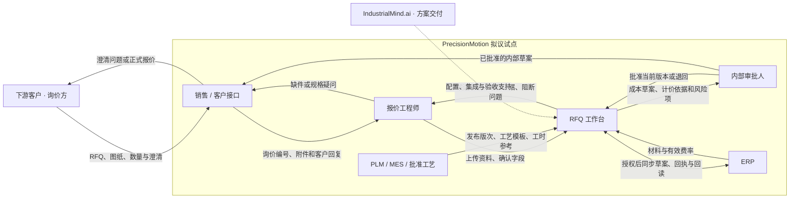
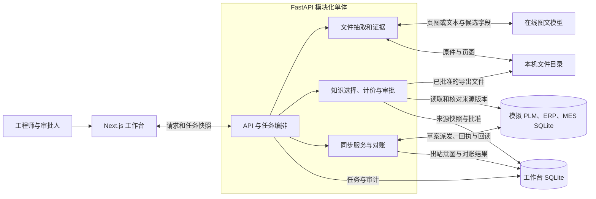
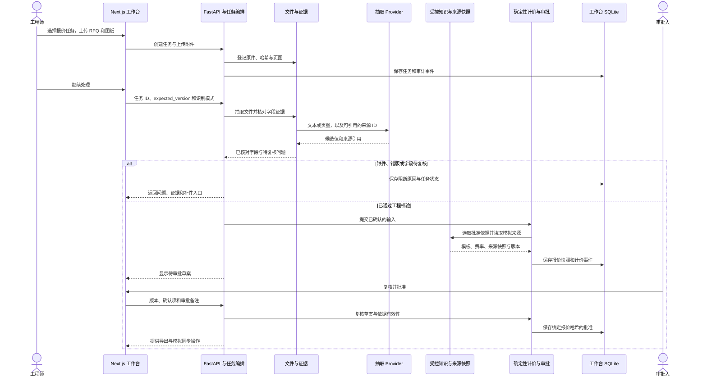

# RFQ 工作台面试演示讲稿

## 挑战题完整答卷

> [!abstract] 建议交付范围
> 先在德国工厂挑一类工艺稳定、有批准模板的零件，试点 RFQ 到内部预算草案。用报价这条流程把图纸证据、工程知识、审批和 ERP 草案对账连起来。客户收益由试点验证，再据此扩展产品族和工厂。
>
> 下文按题目五部分作答。现场操作从 [[docs/05-面试与问答/01-演示讲稿#1. 开场 45 秒|开场讲解]]进入。选项 A 的逐页文字与插图见 [[docs/05-面试与问答/07-选项A演示文稿文字稿]]。[[docs/01-原始说明/01-设计挑战]]

### 第一部分 · 问题分析

PrecisionMotion GmbH 是题设中的工业自动化零部件企业，有约 2,500 名员工、150 名工程师，在德国、波兰和中国设厂。产品包括齿轮箱、伺服电机、工业执行器和定制机械总成。题目给出每年约 15,000 份 RFQ、50,000 张工程图纸、30,000 个 CAD 模型，以及数千份工程变更请求。报价量用 RFQ 计数，图纸、模型和变更单分别反映工程资料负荷。实际每单附件数量、流程工时和各厂差异需要访谈与采样。[[docs/01-原始说明/01-设计挑战]]

#### 利益相关者与信息流

**PrecisionMotion 是方案客户，也是报价流程与数据的责任方。** 向 PrecisionMotion 询价的采购方是它的下游客户，负责提出采购需求和确认澄清。我的 RFQ 工作台服务于 PrecisionMotion 的报价工程师和审批人，把询价资料转成可复核的**内部预算草案**。我以 IndustrialMind.ai 解决方案架构师的角色参与试点，与 PrecisionMotion 确定资料授权、系统接口和验收标准。正式报价由 PrecisionMotion 的商业流程核定并发给询价方。[[docs/01-原始说明/01-设计挑战]] · [[docs/02-方案与规划/06-客户实施路线]]

下图是拟议试点的业务交接关系。当前原型由工程师上传合成资料，PLM、ERP、MES 的读取，以及 ERP 草案的写入和回读，均在模拟环境验证。各岗位的正式分工、数据权威和对外报价流程在现场访谈确认。[[docs/03-实施与开发/09-阶段验收/11-M9集成Harness]]



| 参与方                                           | 给出什么                                                     | 收到什么、负责什么                                              |
| --------------------------------------------- | -------------------------------------------------------- | ------------------------------------------------------ |
| 下游客户与 PrecisionMotion 销售                      | 下游客户提供询价、图纸、数量和交期要求。销售登记询价编号并整理澄清回复。                     | 销售承接工程问题，向询价方确认缺件或需求变化。取得内部草案后，销售再按公司流程协调商务确认并对外报价。    |
| 报价工程师与审批人                                     | 工程师上传资料、回查证据，确认字段和补件原因。审批人批准当前版本或退回补充。                   | 工程师获得候选字段、证据和待解决问题。审批人获得成本明细、适用依据与风险项，对内部草案是否可用负责。     |
| 工艺、采购、生产与质量                                   | 工艺负责人维护获批模板。采购向上游供应商核实供价和供货周期，生产确认产能与交期，质量确认检验要求与例外。     | 接收工程澄清及待确认项。MES 实绩可支持工艺复盘，经工艺负责人审核后更新模板。               |
| 企业系统负责人和 IT                                   | PLM 提供受控发布版次，ERP 提供材料与费率，MES 提供实际工时参考。IT 与各系统负责人确定权限和接口。 | ERP 在获准后接收内部草案，并返回目标记录供工作台对账。IT 与系统负责人共同处理接口异常和数据访问问题。 |
| IndustrialMind.ai 交付团队与 PrecisionMotion 项目负责人 | 客户项目负责人确认样本范围、业务基线和验收门槛。交付团队提供工作台配置、接口适配和验收支持。           | 双方查看工时、周期、错误阻断及对账结果。客户项目负责人据此决定是否扩大试点范围。               |

**一条具体的信息流。** 询价方把数量从 100 改成 500，销售用*原询价编号*转交澄清，报价工程师确认新数量并记录依据。工作台保留原始 RFQ 和变更理由，重算草案并让旧批准失效。审批人重新批准后，可导出新版内部草案，或请求同步并回读模拟 ERP。这个例子把三段容易混在一起的时间区分开：等待客户澄清、工程确认与重算、重新审批。试点分别计时，才能判断应该优先解决哪段瓶颈。[[docs/05-面试与问答/04-全流程演示计划]]

#### 痛点与工时验证

| 题设痛点            | 可能占用工程时间的步骤                          | 首轮如何核实                                   |
| --------------- | ------------------------------------ | ---------------------------------------- |
| 人工审图，规格和版次需反复核实 | 找齐资料、对应 RFQ 和图纸、核对发布版次、录入材料及尺寸、向客户澄清 | 抽取连续进件，分别记录找资料、核对、录入、澄清等待和错版返工时间。        |
| BOM、工艺和报价靠手工准备  | 查找已有件与工艺，选材料、毛坯和加工路线，复算工时与费率并等审批     | 把重复件、变型件、新设计分层。记录模板覆盖率、每单主动工时、退回次数和审批队列。 |
| 设计审查依赖资深工程师     | 核实公差、设计例外、可制造性和专业标准，解答低频疑难问题         | 比较常规检查与例外判断的耗时，确认哪些规则能明确表达、哪些要保留专家签核。    |
| 知识分散在文档和个人经验里   | 找工艺和历史案例，确认当前版本、适用工厂与负责人             | 测查找和确认耗时，盘点批准模板、未受控笔记、过期数据和需要补齐的权限。      |

**最可能占用可节省工程工时的环节**是 RFQ 的资料整理、版次与字段核验，以及有批准模板的报价准备。复杂装配 BOM、工艺制定和资深设计评审也可能耗时更长，题目没有计时数据，无法对全企业流程作工时排名。先访谈报价工程师、工艺负责人、审批人和系统负责人，再用任务事件和工程师工时记录验证排序。

**首选 ROI 场景**是重复件与可控变型件的报价准备。输入、可用模板和输出可以逐项核验，工作量与异常成本可以配对测量，低风险的草案适合先做影子运行。知识检索直接支持找依据，收益计入对应 RFQ 的净节省。装配 BOM、通用设计审查、质量根因分析需要额外标注和验证，分别建立价值假设后再决定投入。[[docs/02-方案与规划/02-需求分析与方案]] · [[docs/02-方案与规划/06-客户实施路线]]

### 第二部分 · 解决方案设计

以工程师工作台承载三种任务入口。*报价入口*覆盖资料核验、成本草案、人工批准和交付。*审图入口*输出字段与工程问题。*知识入口*输出受控资料与适用依据。六项智能体能力可按业务职责组合。当前实现用明确的任务路由和服务模块协调这些能力。

| 核心能力                                 | 输入和职责                                         | 输出和覆盖范围                                                      |
| ------------------------------------ | --------------------------------------------- | ------------------------------------------------------------ |
| 图纸助手（Drawing Assistant）              | 从 RFQ、图纸 PDF 的文本或页图抽取料号、版次、数量、材料、单位和尺寸，提供来源引用 | 已实现候选字段、页图和证据回查。扫描件的页级视觉结果由工程师确认。                            |
| 报价智能体（Quotation Agent）               | 依据已确认字段选择获批材料目录、工艺模板和费率，由确定性程序计算价格            | 已实现成本明细、单价和总价、审批及 Markdown／JSON 导出。采购供价、产能、交期和商务条款仍由业务负责人确认。 |
| 物料清单智能体（BOM Agent）                   | 当前按批准模板计算单件毛坯规格及用量。装配阶段从 PLM 读取结构与版本          | 已实现单件毛坯及批量用量。后续针对装配层级、替代件、生效条件和 EBOM／MBOM 转换单独验收。            |
| 设计审查智能体（Design Review Agent）         | 核对图纸版次、材料、单位、字段证据和适用范围，标记工程问题                 | 已实现有限图纸核验与异常阻断。完整几何、公差、GD&T 和可制造性验证需要领域规则、可靠数据及人工签核。         |
| 工艺规划智能体（Process Planning Agent）      | 当前复用已批准的工序、准备时间和加工时间，MES 工时可供工程复核             | 已实现模板工序及计价依据。后续可针对工厂设备和约束产生候选工艺，由工艺负责人批准后发布。                 |
| 工程知识智能体（Engineering Knowledge Agent） | 按项目、工厂、产品族、角色、有效期和批准状态查找受控资料                  | 已实现受控记录和来源快照。历史案例可供参考，计价只采用适用且唯一的批准依据。                       |

| 数据来源 | 当前原型 | 客户试点拟确认的权威 |
|---|---|---|
| RFQ、图纸、客户澄清 | 使用合成 PDF／文本，保留原件、文件哈希、页图和字段依据。客户澄清由工程师带原因确认 | 由销售或报价团队确认收件、附件范围及业务编号，工程师核对客户需求。 |
| 发布图纸与工程变更 | 模拟 PLM 提供发布版次与有效期 | 由 PLM 负责人明确发布状态、有效期和替代关系。 |
| 材料、费率与草案 | 本地批准制造参考与模拟 ERP 成本快照交叉核对，草案写入独立模拟 ERP | 与 ERP 和成本负责人确认费率、币种、单位、草案对象及授权写入边界。 |
| 工序与实际工时 | 受控模板提供工序，模拟 MES 工时供对照 | 由工艺负责人核定批准模板，MES 实绩经复核后用于更新工艺知识。 |

**用户工作流与预期结果。** 工程师创建报价任务，上传 RFQ 和图纸，核对候选字段与原件。系统校验版次和可用依据后生成内部预算草案，审批人复核并确认当前版本，再导出文件或单独请求模拟 ERP 同步。用 `PM-BRKT-010` B 版和 100 件合成询价，得到 €25.47/件、€2,547.00，以及 100 件毛坯需求、工序、费率和来源版本。模拟同步回读 `MATCH` 后可查到目标 ID 与版本。改为 500 件时，原批准失效，重算为 €24.51/件、€12,255.00，等待重新批准。若客户要求 B 版而收到 A 版，任务停在澄清，补正确图纸后继续。[[docs/05-面试与问答/04-全流程演示计划]] · [[docs/03-实施与开发/09-阶段验收/11-M9集成Harness]]

### 第三部分 · 技术架构

当前实现是 **Next.js 工作台、FastAPI 模块化单体、本机文件存储和两套独立 SQLite**。工作台数据库保存任务快照、版本、审计、来源快照、同步意图和对账。另一套数据库模拟 PLM、ERP 和 MES，模拟 ERP 记录可以独立回读。业务模块按抽取、证据、知识、计价、审批和集成分开，相关任务版本和审计可以在本地事务内一致提交。现场组件图、数据时序与各模块代码入口见 [[docs/05-面试与问答/01-演示讲稿#2. 系统架构与数据交互|系统架构与数据交互]]。

| 题目要求           | 当前设计和架构取舍                                                                                                     | 客户部署如何验证                                                         |
| -------------- | ------------------------------------------------------------------------------------------------------------- | ---------------------------------------------------------------- |
| 大语言模型及其他 AI 模型 | 可替换的抽取 Provider 接收 PDF 文本或页图及来源 ID，返回结构化候选字段。M7 用 DeepSeek 完成在线图文评测，在线图文、本地文本和回放分别记录。程序验证来源与字段值，金额和权限由后端规则处理。 | 用客户批准样本比较原生 PDF、扫描件、跨页及复杂版式的准确度、证据质量、耗时和成本。按效果决定是否加 OCR 或专用版面模型。 |
| 知识库            | 版本化注册表和制造参考保存项目、工厂、产品族、权限、生效区间与批准状态。搜索可返回参考资料，执行选择要求唯一获批依据。记录资料和载荷摘要，以便复核旧报价。                                 | 确认发布、撤销、回滚和保留责任。扩大检索范围时先落实对象权限，再用真实查询比较检索效果。客户资料按授权范围保管。         |
| 智能体编排          | 任务目的确定允许的动作。编排保存进度，证据缺失、版次冲突或抽取超时进入暂停和恢复路径。通过任务版本限制并发修改。                                                      | 复验异常、超时、恢复和任务归属。按实际并发与恢复目标决定是否引入企业队列或拆分服务。                       |
| 人在回路           | 工程师回查来源、处理缺件和修正，保留原值与原因。审批人确认技术范围及内部用途，批准绑定报价哈希。变更后重算和重新批准。                                                   | 接企业身份与角色，确认谁能复核、批准、导出和派发。对高风险异常由工程和 IT 共同设置回退条件。                 |
| ERP、PLM、MES 集成 | 计价前读取模拟来源快照，校验版本、有效期及来源一致性。批准后按业务键和幂等键保存出站意图，派发前重检，写入模拟 ERP 并逐字段回读。超时先查已存在的目标。                                | 先只读确认权威系统和字段契约。再在测试环境验证幂等、查询一致性、目标版本和断线恢复，达到门槛才开放受控草案写入。         |

M7 用 12 份不同料号的合成支架资料验证，正常报价 4/4、异常阻断 8/8。在线抽取读对 153 个有值字段，其中 145 个得到文本核验，8 个定位到正确视觉页并由工程师复核。M9 的 17 个模拟集成场景通过，包含提交后超时、版本变化、重复与部分写入。M10 的两套费率从不同本地配置得到 €2,547 与 €2,817，各自通过同一套审批和模拟对账。这些结果分别证明合成场景的核验、故障处理和配置复用。真实企业身份与连接器按客户实施计划验证。[[docs/03-实施与开发/09-阶段验收/09-M7独立评测]] · [[docs/03-实施与开发/09-阶段验收/11-M9集成Harness]] · [[docs/05-面试与问答/06-方案架构演示规划]]

### 第四部分 · 商业论证

**模型口径。** 假设年 RFQ 量保持在题设的 15,000 份。手工准备每单 2.00 小时，辅助流程包含工程复核、澄清、纠错、返工与审批的主动工时。以 €65/小时计工程产能，1 FTE 每年 1,600 个有效小时。第 1–3 年有效采用率分别为 25%、60%、80%，以当年适用 RFQ 为分母。兑现比例反映已释放工时能实际用于其他工程任务的份额。

**成本口径。** 三档共用期初投入 €100,000 和年持续成本 €80,000，三年总成本 €340,000。期初投入包括实施 €50,000、数据与规则 €25,000、集成验收 €20,000、培训 €5,000。年度成本包括许可 €32,000、推理与基础设施 €12,000、支持 €20,000、数据与评测 €12,000、运行与安全 €4,000。多工厂和新增应用另算增量成本。[[docs/02-方案与规划/05-商业论证]]

每年采用量等于年 RFQ 数乘适用比例和有效采用率。每年释放工时等于采用量乘单均工时差。释放工时再乘工时价值和兑现比例，得到当年可兑现产能价值。

| 题目要求 | 基准假设与估算 |
|---|---|
| 工程工作量减少 | 每单从 2.00 小时降至 1.25 小时，节省 45 分钟，即 **−37.5%**。以适用且实际采用的任务为分母。 |
| 潜在生产力提升 | 同样的有效工程工时，可处理的同类 RFQ 为原来的 `2.00 ÷ 1.25 = 1.60` 倍，即 **+60%**。 |
| 节省或重新调配人员 | 第 3 年采用 `15,000 × 60% × 80% = 7,200` 单，释放 5,400 小时。按 75% 兑现率折算，约 **2.53 FTE** 可调配给复杂 RFQ、工程变更及新产品导入。 |
| 报价周期缩短 | 从收件到内部批准，以 **5 个工作日到 3.5 个工作日**作为试点讨论目标，即 **−30%**。分别记录工程处理、客户澄清等待和审批队列。 |
| 三年 ROI | 三年采用 14,850 单，释放约 11,137.5 小时。兑现产能价值为 `11,137.5 × €65 × 75% ≈ €542,953`，扣除成本后净产能价值约 €202,953。三年简单产能价值 ROI **59.7%**，按年度均匀实现约第 22 个月收回累计产能价值成本。 |

| 情景 | 适用比例 | 辅助工时／单 | 兑现比例 | 三年产能价值 | 三年 ROI | 第 3 年可调配 FTE |
|---|---:|---:|---:|---:|---:|---:|
| 保守 | 40% | 1.50 小时 | 50% | €160,875 | **−52.7%** | 0.75 |
| 基准 | 60% | 1.25 小时 | 75% | €542,953 | **59.7%** | 2.53 |
| 乐观 | 75% | 1.00 小时 | 85% | €1,025,578 | **201.6%** | 4.78 |

三年 ROI 按 `（兑现产能价值 − 三年成本）÷ 三年成本` 估算，未折现、未计税。周期缩短单独跟踪，收益只计可兑现工时。基准的三年持平线约为每单净节省 28.2 分钟，前提是适用率、采用路径、兑现率和成本符合基准假设。试点用连续进件估适用率，用配对工时测净节省，向采购和 IT 核对实际支出，并让工程经理记录释放工时的实际去向。若结果接近保守情景，优先查复核、等待和覆盖瓶颈后再决定推广。[[docs/02-方案与规划/05-商业论证]] · [ROI 复算脚本](../../scripts/calculate_m8_roi.py)

### 第五部分 · 实施路线图

月份从客户立项算起。每阶段根据数据授权、工程安全和实测价值决定是否进入下一阶段。现场解决方案架构师负责需求澄清、数据权威与验收，平台团队将通用流程、连接器契约和故障回归沉淀为可复用资产。跨区域分工的成本用实施工时、返工与支持工时验证。客户工艺、价格和审批政策由各客户负责人确认。[[docs/02-方案与规划/06-客户实施路线]] · [[docs/05-面试与问答/06-方案架构演示规划]]

| 阶段 | 工作与交付物 | 验收与责任 |
|---|---|---|
| **0–3 个月 · 快速验证与德国试点** | 选一个稳定产品族和一组报价工程师。确定可接资料、批准模板、失败转人工机制及现行工时。先做历史配对回测，再对连续进件做只读影子运行。交付数据清单、基线、独立验收样例、异常记录和更新后的 ROI 模型。 | 初步规划至少 30 对可比任务，另备错版、缺材料、过期费率和越权例。工程经理与报价负责人复核关键错误、配对净工时及采用意愿，IT 确认资料和模型处理边界。出现关键漏阻断或越权时暂停扩展。 |
| **3–9 个月 · 部门推广** | 扩到批准模板齐备的产品族。接企业身份、对象权限、PLM 与 ERP 的只读数据。先验证字段和版本，再在受控范围启用 ERP 草案写入。交付知识发布、异常处理、指标巡检、关闭连接器和回滚流程。 | 工程运营、ERP／PLM 负责人、IT 和财务共同验收。检查过期输入阻断、权限分离、回放无重复写、回读差异可处理，以及采用率和维护成本是否支撑推广。 |
| **9–24 个月 · 企业级平台** | 分批纳入波兰和中国工厂，确认各厂数据处理要求、工艺、费率、单位与角色。对原生 CAD、装配 EBOM／MBOM、工艺规划、变更传播和 MES 质量反馈各自试点。交付工厂级配置、独立样本、运行责任和应急方案。 | 各厂工程、质量和 IT 分别签收。每个新增场景有本地基线、验证样本、异常恢复演练和增量投资测算。将可通用的代码与契约沉淀回平台。 |

> [!quote] 答卷收尾
> “我建议批准一个有明确范围和退出条件的试点。让工程师先用获准资料验证草案质量和净节省，再决定是否接入 ERP 草案写入和扩展工厂。下一家客户可以复用证据、审批与对账，新增投入集中在获批工艺、费率和接口映射。”

## 现场演示讲稿

![[docs/04-项目介绍与展示/10-展示附件/05-系统架构总览.png|1000]]

*图 1 · RFQ 工作台架构示意。左边是客户文件，中间是字段核验与计价审批，右边是批准后产生的文件或模拟 ERP 草案。组件边界和数据流见第 2 节。*

> [!abstract] 现场目标
> 用一份合成 RFQ 和图纸，让面试官看到工程师怎么核对证据、程序怎么用受控依据算价、审批人怎么批准，以及系统怎么确认草案确实写进了模拟 ERP。随后用数量变更和错版验证这条流程遇到异常时怎么处理。
>
> 主线使用德国演示工厂的工业执行器配套安装支架 `PM-BRKT-010`。题目列出的齿轮箱、伺服电机、工业执行器整机和定制机械总成属于不同的后续验证范围。当前材料是合成零件级输入，输出是内部预算草案。[[docs/01-原始说明/01-设计挑战]] · [[docs/04-项目介绍与展示/11-方案答卷]]

## 1. 开场 45 秒

> “PrecisionMotion 的报价工程师收到 RFQ 和图纸后，要查料号和版次、找适用工艺和费率，再把成本草案交给审批人。我选了工业执行器的一个配套支架，把这条流程做成了可运行的试点。图里左边是原始文件，模型读取候选字段，工程师能回查来源。中间由规则选择获批的制造依据并算出价格。右边，审批人可以导出草案，也可以把它同步到模拟 ERP，再回读核对。接下来我会改一次数量，换一次错版图纸，看看系统什么时候继续、什么时候停下来。”

先指图 1 的三处：**输入和证据**、**计价和批准**、**导出和回读**。架构讲解到此先切产品。面试官追问时再展开下面的时序和模块表。

## 2. 系统架构与数据交互

Next.js 工作台收集文件、工程确认和审批操作，通过 API 访问 FastAPI 模块化单体。后端按操作校验角色，人工修改、计价和审批时还校验任务版本。任务快照、审计、来源快照、同步意图和对账记录由工作台 SQLite 保存，原文件、页图和导出件保存在本机文件目录。模拟 PLM、ERP、MES 使用另一份 SQLite，模拟 ERP 的草案能够独立回读。模块划分按业务职责，部署时由一个 API 服务协调。[[docs/04-项目介绍与展示/02-项目手册#3. 系统架构与职责边界|项目手册]] · [[docs/04-项目介绍与展示/03-系统架构]]



### 2.1 从上传到批准



### 2.2 主要模块的输入与输出

| 模块 | 输入 → 输出 | 现场指出什么 |
|---|---|---|
| **工作台与任务编排** | 任务目的、附件、当前版本 → 任务状态、下一步操作、审计 | 报价、图纸审查和知识查询有各自入口。缺件或校验失败时保存状态，补件后沿原任务继续。 |
| **文档抽取与证据** | RFQ、PDF 文本或页图、来源 ID → 结构化字段、引用、复核问题 | 点开材料和版次的「依据」。文档、页号、标签和值共同决定证据是否支持字段。只有页级视觉线索时，由工程师回图确认。 |
| **受控知识与来源快照** | 已确认字段、角色、来源版本 → 适用目录、工艺模板、费率和来源快照 | 费率必须批准、有效且适用。历史价可参考。模拟 PLM 提供发布版次，ERP 提供费率参考，MES 工时用于对照。 |
| **计价、审批与导出** | 已确认输入与批准依据 → 成本明细、毛坯、工序、报价和版本绑定的批准 | 成本由 Decimal 按模板计算。审批人确认后可生成 Markdown 和 JSON。数量、文件或依据变化时，需按当前输入重算并重新批准。 |
| **持久化与并发** | 任务 ID、当前版本、动作 → 最新快照和审计事件 | `expected_version` 阻止旧页面覆盖新状态。相关任务状态与审计在同一事务记录，工程师补件后仍能追溯原值。 |
| **模拟 ERP 同步** | 当前已批准报价、来源快照、同步请求 → 出站意图、目标回执与对账结果 | 目标 ID、版本和 `MATCH` 来自模拟 ERP 的实际回读。派发前重检来源和批准，发生超时先查询。 |

面试官想看代码时，从相应入口进入。[任务编排](../../apps/api/src/rfq_workbench/orchestrator.py) · [文件与证据](../../apps/api/src/rfq_workbench/file_workflow.py) · [知识适用性](../../apps/api/src/rfq_workbench/knowledge.py) · [计价与审批](../../apps/api/src/rfq_workbench/service.py) · [同步服务](../../apps/api/src/rfq_workbench/sync.py)

## 3. M9 模拟 ERP 集成

![[docs/04-项目介绍与展示/10-展示附件/06-模拟ERP同步流程.png|1000]]

*图 2 · 草案同步示意。回执之后还要读回目标草案，才能确认业务数据一致。*

1. **请求同步。** 审批人确认当前草案后提出同步。API 校验任务版本和请求幂等键，按已批准快照生成目标载荷，将出站意图和审计记录一同保存。
2. **派发。** 派发器认领意图，重检批准、来源快照有效期和版本。更新已有草案时携带目标版本。实际模拟 ERP 调用在工作台数据库事务外执行。
3. **回读。** 收到回执后读取目标记录，逐字段核对金额、数量、币种、成本行及追踪字段。页面的「对账通过」对应 `MATCH` 和 `VERIFIED`，出现差异则显示差异并转人工。
4. **结果未知。** 如果目标已经写入但回执超时，按幂等键或业务键查原记录并核对。只有在确认目标没有写入并符合重试条件时，才再次派发。

> “我把‘收到回执’和‘业务数据一致’分成两个步骤。比如第一次请求已写入，但回执超时，我会先查目标有没有那条草案。找到后对账，避免重复创建。草案的料号、版本和价格都能追溯到批准时的输入。”

![[docs/04-项目介绍与展示/10-展示附件/02-M9同步对账.jpg|1000]]

*图 3 · 工作台实拍。目标 ID、目标版本、尝试次数和最近一次 `MATCH` 同屏可查。界面标明 SIMULATED / NO EXTERNAL WRITE。* [[docs/03-实施与开发/09-阶段验收/11-M9集成Harness]] · [[docs/03-实施与开发/08-工程决策/05-集成Harness]]

## 4. 12 分钟现场脚本

文件及详细点击路径见 [[docs/05-面试与问答/04-全流程演示计划]]。下表是解决方案架构师版，主线在 100 件草案获批后加入 M9，再继续演示数量变更。短版和故障备用见第 6、7 节。

| 时间 | 操作与证据 | 可直接说 |
|---|---|---|
| **0:00–1:15** | 开场，指图 1，打开 01 询价和 02 B 版图纸。 | “我先交付一条可核对的单件报价链路。这里会看到文件、依据、价格和审批如何接起来。” |
| **1:15–2:45** | 工程师新建报价任务，上传 01 + 02，保存后选择识别方式并继续处理。展示页面上的实际识别模式。 | “这一步读取两份文件，形成结构化候选值，并保留原文和页图入口。” |
| **2:45–4:15** | 对比 RFQ 与图纸都是 B 版。点开材料依据，切受控知识，区分三条可执行依据和历史记录。 | “这次报价采用的是适用、有效且批准的目录、模板和费率。相似的历史件只能作为参考。” |
| **4:15–5:15** | 成本页展开加工依据和费率版本。100 件为 **€25.47/件、€2,547.00**。 | “报价可以独立复算。这里是每件加工工时和一批的准备费，后面改变数量就能看到摊销变化。” |
| **5:15–7:15** | 切审批人，批准并生成 Markdown、JSON。在成本页填写同步备注，点「请求同步」和「派发一次」。指回执的目标 ID、版本 1 和 `MATCH`。 | “审批绑定这版草案。同步后我能指出目标草案是哪一条，以及读回了什么结果。” |
| **7:15–8:45** | 打开 03 数量澄清单。切回工程师，在原任务确认 500 并填写依据。查看旧批准失效，再继续处理。 | “原 RFQ 的 100 保留。新数量走同一套规则，重新计算为 **€24.51/件、€12,255.00**，此刻还在待审批。” |
| **8:45–10:20** | 新开报价任务，用 04 + 05 演示要求 B、收到 A。换 02 后继续处理，显示同一任务恢复。 | “缺少获准的正确图纸时，流程停在工程澄清。补到正确文件后，任务和审计接着走。” |
| **10:20–11:05** | 切到 A/B 费率截图，指金额和费率版本。保留同一 100 件输入。 | “现在换的是加工费率。证据、审批和 ERP 对账沿用同一套代码。这说明一个客户差异可以通过配置交付。” |
| **11:05–12:00** | 用 M7 或 M9 验收结果交代已验证边界。按第 8.1 节收尾。 | “我会在客户现场测真实适用率、工程净工时和异常处理，再决定如何扩到其他产品族和工厂。” |

如被问到 500 件如何回写 ERP，再用审批人批准同一任务的新草案，重新请求同步。显示原目标 ID、版本 2 和新总额，说明这是更新已有目标。可用已排练任务缩短操作。[[docs/05-面试与问答/04-全流程演示计划#M9 同步加演 · 约 2 分钟|同步加演步骤]]

## 5. M10 费率配置对照

| 相同输入 | 已批准的合成费率 | 报价总额 | 浏览器验收 |
|---|---:|---:|---|
| DEV-001，B 版，100 件 | A · €60/小时 · `rates-eur-demo-1` | €2,547.00 | 已批准，模拟 ERP `MATCH` |
| DEV-001，B 版，100 件 | B · €75/小时 · `rates-eur-demo-b-1` | €2,817.00 | 已批准，模拟 ERP `MATCH` |

> “同一个零件，同一个批量。换到另一套获批费率后，报价和依据版本随配置变化，审批与对账照常执行。下一家客户还可能有自己的权限、工艺和 ERP 字段映射，我会把这些差异逐项核对。”

现场使用一个运行中的配置和另一套截图。两套配置由 API 启动参数选择，分别保存任务与模拟 ERP 记录。费率是合成的制造成本依据。[[docs/04-项目介绍与展示/06-启动与运维#M10 费率对照|启动方式]] · [[docs/05-面试与问答/06-方案架构演示规划|配置验收]]

> [!example]- A / B 浏览器实拍
> **A · €2,547.00**。看成本依据中的 €60/小时、费率版本和页面下方的模拟 ERP 对账。
>
> ![[docs/04-项目介绍与展示/10-展示附件/03-费率A.jpg|780]]
>
> **B · €2,817.00**。相同的 RFQ 和批量，使用 €75/小时费率。
>
> ![[docs/04-项目介绍与展示/10-展示附件/04-费率B.jpg|780]]

## 6. 3 分钟短版

| 时间 | 操作 |
|---|---|
| **0:00–0:30** | 用图 1 说明试点范围和模型、规则、审批人的分工。 |
| **0:30–1:15** | 打开已保存的 100 件任务，点一次材料或版次依据，再展示 €2,547 和批准。 |
| **1:15–2:05** | 打开已对账的模拟 ERP 记录，指出目标 ID、版本和 `MATCH`。 |
| **2:05–2:40** | 展示预先准备的 A/B 错版阻断任务，指出应补的 B 版图纸。 |
| **2:40–3:00** | 用一句话交代复用：“费率和模板由客户确认，证据核验、审批和对账可以复用。” |

## 7. 技术追问与现场备用

| 面试官可能问 | 回答要点 |
|---|---|
| 引用是否说明读对了？ | 引用只说明候选值指向一个来源。还要检查文件、标签和值是否吻合。扫描页只有视觉线索时，展示页图并请工程师确认。 |
| 为什么数量变了必须重审？ | 审批绑定已批准的报价哈希。数量或依据变化后，重算会得到新版本，上一版审批和导出资格随之失效。 |
| 超时会不会重复写入？ | 用持久化出站意图、幂等键、租约和回读来控制。展示提交后超时的冻结用例，系统查询到已有草案并核对。 |
| 测了什么？ | M7 合成集的正常报价 4/4、异常阻断 8/8。在线抽取读对 153 个有值字段，其中 145 个有文本核验，8 个定位到正确视觉页并需要人工复核。M9 模拟故障矩阵 17/17，M10 两套费率通过浏览器验收。 |
| 能否直接处理四类产品？ | 现有开发和 M7 评测覆盖单件安装支架范围。整机与总成要先确认装配 BOM、工艺路线、批准模板和客户级验收数据。 |
| 原型如何接生产环境？ | 先确认身份与角色、PLM 发布规则、ERP 的幂等与目标版本契约，再只读验证和试点对账。当前现场连接的是模拟系统。 |

- 在线服务不可用时，明确切到本地文本识别继续走同一份 PDF。需要解释模型调用时打开保存的实际在线记录。内置 `REPLAY` 对应原始 DEV-001 文件哈希。
- 浏览器下载受限时，打开预先生成的 Markdown 或 JSON，并用当前任务审计说明它对应哪个批准版本。
- 时间不足时，保留 3 分钟路径。错版恢复、单图纸审查、知识查询以及提交后超时作为可选加演。

[[docs/05-面试与问答/02-常见问答]] · [[docs/03-实施与开发/09-阶段验收/09-M7独立评测]] · [[docs/03-实施与开发/09-阶段验收/11-M9集成Harness]]

## 8. 从试点到客户交付

先请客户一起选一个稳定产品族，确认 ERP、PLM 和工程团队各自负责哪些数据。试点记录适用率、复核后净工时、审批等待和异常情况。现有商业测算的基准假设是每份已采用的适用 RFQ 节省 45 分钟，三年产能价值 ROI 为 59.7%，保守情景为 −52.7%。这些数字用于设计试点，现场用客户工时、采用率和真实成本重新计算。[[docs/02-方案与规划/05-商业论证]] · [[docs/02-方案与规划/06-客户实施路线]]

### 8.1 解决方案架构师版：从第一单到第二单

> “我会用首个试点验证哪些差异适合配置，哪些值得沉淀到产品。今天的证据核验、审批和对账可以复用，费率、工艺和 ERP 字段则要跟客户确认。我会把通用处理、接口契约和异常样例留给下一次交付。欧洲侧可以负责现场发现和验收，远程团队按明确契约做适配和测试，再用下一单的实施工时、返工和支持成本检验这种分工。接入客户 ERP 后，工程师能在原有业务流程里追溯草案依据和对账结果。持续可靠地运行这条流程，是我期待客户继续使用它的原因。”

如果面试官问「怎样证明第二家更快」，说明会记录从字段映射确认到首份合规草案的工程工时，以及可复用的测试与上线后支持工时。客户业务 ROI 单独用客户工时和周期测量。[[docs/05-面试与问答/06-方案架构演示规划]]

## 9. 上台前检查

- [ ] 启动 API 与工作台，核对选定的费率配置和 100 件正常样例金额。
- [ ] 按演示顺序打开 01、02、03、04、05。06 材料缺失图纸用于追问。
- [ ] 预备一条批准且已对账的正常任务，以及一条仍显示错版冲突的任务。
- [ ] 打开 A/B 截图、M7 与 M9 验收报告。展示在线抽取时确认调用模式和凭据已准备。
- [ ] 复算 €2,547、€12,255 和 €2,817，确认草案版本、费率版本和模拟 ERP 目标版本各自代表什么。

[[docs/04-项目介绍与展示/06-启动与运维]] · [[docs/05-面试与问答/04-全流程演示计划]]

> [!note]- 架构插图生成提示词
> 图 1 和图 2 使用 Codex 内置 imagegen 生成。下面保留原始提示词与图 1 的修订提示词。
>
> **图 1 · 原始提示词**
>
> ```text
> Use case: infographic-diagram
> Asset type: landscape illustration for the opening of an Obsidian interview script about an implemented RFQ workbench.
> Create an exceptionally legible, restrained engineering diagram, white background, dark navy type, teal flow arrows, subtle engineering-document line icons, large margins. Landscape around 16:9. Header exactly "RFQ Workbench". Beneath it, a wide boundary labeled exactly "FastAPI Workflow" contains the middle stages. The main left-to-right flow has exactly these five clearly separated nodes, joined by simple rightward arrows: "RFQ + Drawing" → "Extract & Verify" → "Cost Draft" → "Human Approval" → "Draft Export". Above the first middle stage put a small independent callout "Vision Model" with an arrow pointing into "Extract & Verify". Above "Cost Draft" put a separate callout "Approved References" with an arrow pointing into "Cost Draft". Below "Human Approval", show a separate branch from it to "Outbox & Reconcile" then to "Simulated ERP", visually distinct from file export. In the footer use one discreet flat band labeled "SQLite: Tasks & Audit". Spell labels verbatim. Keep each label large and render it once. Use no legend, extra text, vendor logos, gradients, people, invented components, or extra connections. All boxes and arrows must stay well inside the safe margins.
> ```
>
> **图 1 · 修订提示词**
>
> ```text
> Use case: precise-object-edit.
> Edit the supplied RFQ Workbench architecture illustration, retaining its canvas, alignment, title, boxes, arrows, icons and every internal label. Remove only the single large rounded outer rectangle that encloses all the boxes, leaving the individual card outlines and bottom SQLite band in place. Replace the centered line "FastAPI Workflow" with the exact text "Request-to-Draft Flow" in the same navy style. The illustration should read as a workflow across internal and external components, without an enclosing process boundary. Preserve the three links after approval and the existing white background. No new objects, claims, labels or connections.
> ```
>
> **图 2 · 提示词**
>
> ```text
> Use case: infographic-diagram
> Asset type: landscape architecture illustration for an Obsidian engineering interview script.
> Draw a clean five-stage pipeline on a white background in navy, teal and light gray, with technical line icons and large highly readable English labels, landscape around 16:9. Header exactly "ERP Draft Sync". Five equal cards in one horizontal row, joined by exactly four rightward arrows, labeled exactly in this order: "Approved Draft", "Durable Outbox", "Dispatch", "Simulated ERP", "Read-back Check". Under the row, one separate callout with this exact text: "Timeout: Query First". Add an unobtrusive footer "SIMULATED / NO EXTERNAL WRITE". The simulated ERP has a database icon, the last card has a magnifier over a checklist. No model, cloud logo, people, explanatory paragraphs, extra arrows or added claims. Give the edge cards ample padding. Style: precise editorial schematic, no gradients or perspective. Render every label once, spell every character accurately.
> ```
