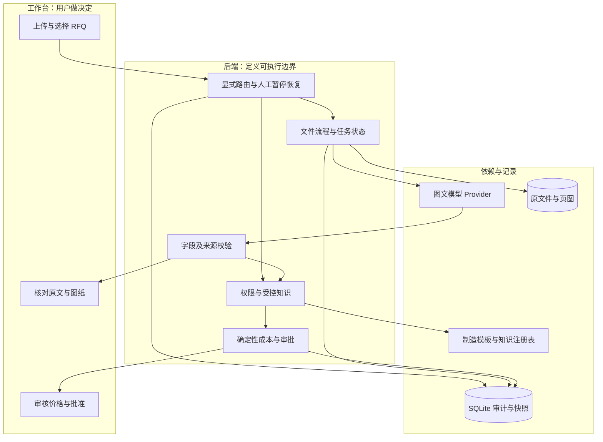

# RFQ 工作台面试与演示讲解

> [!abstract] 演示的主线
> 让面试官看到：你能把模糊业务需求收敛成边界明确的产品，利用模型读取非结构化资料，用证据和规则控制错误，交付可运行、可测试、可维护的工作流程。
>
> 功能以 M0–M6 和 [[docs/03-实施与开发/09-阶段验收/08-M7前置修复|M7 前置修复]]为依据，数字取自 [[docs/03-实施与开发/09-阶段验收/09-M7独立评测|M7 独立评测]]。架构、代码路径和启动方式见 [[docs/04-项目介绍与展示/02-项目手册]]。

## 1. 开场：用 45 秒说清项目

可以直接使用这段话，再根据自己的表达习惯调整：

> “我选择了 RFQ 到内部预算草案这条完整业务链。收到图纸后，工程师需要确认版次、材料和尺寸，找到适用的制造依据，然后计算价格并批准。我把图纸理解、证据回查、确定性计价和人工审批接在同一个工作台里。今天使用一个德国工厂、一个支架产品族的合成样例；采购、产能和交期仍需另外确认。我会先展示正常流程，再故意引入版次冲突和数量变化，看系统如何阻断错误、使旧审批失效。”

这段话应在展示技术栈之前说。面试官先理解业务决策，才容易理解为什么需要来源、版本和审批。

## 2. 展示模块时，怎样连接业务、架构与原理

| 展示模块 | 现场动作 | 架构设计 / 基本原理 | 可用讲解句 |
|---|---|---|---|
| 统一任务入口 | 选择报价、审图、知识查询；未选目标时显示澄清 | Orchestrator 有界分支 + 同一 SQLite 快照 + CAS 恢复 | “任务目的限定了可执行动作，缺资料就停下来请人补充。” |
| 任务总览 | 选 DEV-001 或上传实际文件 | 输入生成 Document、Source、任务 ID；SQLite 保存快照 | “每次演示从实际文件进入，不依赖写死的答案。” |
| 多模态抽取 | 选 LIVE，开始抽取 | Provider 接口 + Responses 图文输入 + Pydantic 结构化输出 | “模型负责读资料；结果还要通过独立校验。” |
| 资料与证据 | 点材料/版次的依据 | parser 签发 source_id，回查文档类型、页号、标签与值 | “一个引用存在，并不能证明它支持这个结论。” |
| 工程问题 | 选 DEV-003 或 DEV-004 | 版次、材料、单位、尺寸与批准模板匹配 | “资料不够时系统停下来，保留未知，交给工程师澄清。” |
| 受控知识 | 查询全部，查看历史与过期记录 | 服务端权限先过滤；批准/期限/适用性判断；唯一执行选择 | “能查阅的资料不一定能用于这一次报价。” |
| 成本草案 | 展示明细、依据与工艺路线 | Decimal、明确舍入、模板驱动、快照 hash | “这张价格表可以脱离模型独立复算。” |
| 人工审批 | 切角色并确认 | 后端角色校验，审批绑定准确报价快照 | “按钮只是入口，权限和批准范围在后端执行。” |
| 变更与审计 | 把数量 100 改 500 | 乐观锁、依赖失效、事件与快照同事务提交 | “改输入后，原来的批准不再对新价格有效。” |
| 模型记录 | 展示模型、响应 ID、token、耗时、估算费用 | 模型用量与业务成本分别记录，费用带来源和版本 | “我能解释一次调用发生了什么，也能明确哪些成本未知。” |

## 3. 面向面试官的架构图

这张图适合先讲 60–90 秒，再切到产品。每个区域对应已实现代码。

讲解顺序：

1. 用户操作工作台，FastAPI 验证角色与请求契约。
2. Orchestrator 管目的、澄清和有界恢复，FileWorkflow 管文件和字段，Workflow 管价格和批准，Knowledge 管可用依据。
3. 模型是可替换的抽取依赖；它没有批准或定价权限。
4. 当前用单体和 SQLite，是为了先把事务、边界和可复现闭环做完整。客户并发、身份和恢复要求明确后，再决定拆分服务或引入队列。

图中的模块没有独立部署为微服务。当前 Orchestrator 是明确目的的有限分支，不做无限 Agent 循环或自然语言自动分类；审批始终是独立授权动作。

## 4. 12 分钟演示脚本

时间是排练建议，不是性能承诺。提前准备一个正常任务和冲突任务，但现场仍至少完成一次真实文件抽取。模型耗时波动时简短讲解架构，不假装即时生成。

| 时间 | 操作 / 展示 | 讲解重点 | 当场可检查的证据 |
|---|---|---|---|
| 0:00–0:45 | 开场，说明业务与合成范围 | 目标是可信内部草案 | SYNTHETIC 标识、pending 范围 |
| 0:45–1:45 | 展示上方架构图 | AI、规则与人工各自承担什么 | 图与模块文件一一对应 |
| 1:45–3:00 | 准备内部报价 + DEV-001，LIVE，执行任务 | 图文输入与结构化候选事实 | LIVE 标签、响应 ID、耗时 |
| 3:00–4:00 | 点材料与版次依据，打开页图 | 证据粒度与验证强度 | 原文标签、页级说明、原尺寸图 |
| 4:00–5:00 | 受控知识视图，空查询 | 权限、适用性与参考资料分开 | 3 条批准依据候选；历史/过期标识 |
| 5:00–6:00 | 回原任务展示自动生成的成本 | 金额由程序计算，工艺来自批准模板 | 100 件 25.47 / 2,547.00 EUR，依据与路线 |
| 6:00–7:00 | 审批人确认，导出草案 | 内部用途与人工批准边界 | 审批记录、Markdown 草案 |
| 7:00–8:30 | 工程师将数量改 500，填写原因，恢复任务重算 | 变更传播与旧审批失效 | 12,255.00 EUR；仍需新审批 |
| 8:30–10:00 | 准备报价 + DEV-003，暂停后补 B 版图并恢复 | 错误阻断与有依据的恢复 | REVISION_CONFLICT、换图审计 |
| 10:00–11:00 | 单图纸审查结果；知识查询任务 | 目的限定能力，两个入口都没有价格 | 审查范围限制、来源快照与角色差异 |
| 11:00–12:00 | 验收报告与下一步 | 报价反例、扫描页证据、客户试点 | 4/4 报价，8/8 阻断；8 个视觉值须人工复核 |

### 操作细节，避免现场卡住

- 先用工程师创建、抽取、修改和计价，再切审批人批准及导出。
- 改数量：资料页字段选“数量”，值填 `500`，原因写“客户澄清批量由 100 改为 500”，保存后重新计算；界面不会让旧审批继续生效。
- 换图：在上方原因栏先填写至少三个字符的依据，再选择 `fixtures/dev/drawings/PM-BRKT-010_B.pdf`，替换后重新抽取。按钮会因缺原因而禁用。
- A/B 冲突演示优先上传正确 B 图，体现补充依据；不要仅为了消除红字而把字段随意改成 B。
- 知识查询默认 B 版铝件；批准依据只有三条，历史价 9.99 EUR 不能进入价格。
- 验证审批人专有知识可作为加分项：工程师查 8 条、审批人查 9 条。说明这是本地模拟角色，不是企业 SSO。
- 在图纸视图说明孔位和完整几何仍需工程师确认，避免把文本字段命中说成制造认证。

## 5. 只有 3 分钟时的版本

1. **0:00–0:30**：说明一个产品族、一份内部预算草案，以及模型/规则/人工的分工。
2. **0:30–1:15**：打开正常任务，展示一次真实抽取记录和材料原文/页图；明确这是实时调用记录或已保存任务。
3. **1:15–2:00**：展示 2,547.00 EUR 的独立计算和审批；将数量改成 500，旧批准消失。
4. **2:00–2:40**：展示已准备的 A/B 冲突任务，系统阻断；说明补 B 图重抽取恢复路径。
5. **2:40–3:00**：展示测试和下一步。不要在短版中声称已做全量评测或客户集成。

短版允许复用已保存的真实运行记录，但必须说清楚；系统当前没有专门的 REPLAY 引擎，不能把保存任务说成可验证回放系统。

## 6. 关键原理的口头解释

核对实现时，打开 [[docs/04-项目介绍与展示/02-项目手册]] 的抽取、证据、计价和状态机章节。现场演示步骤见 [[docs/04-项目介绍与展示/07-功能演示]]。

### 6.1 为什么模型没有直接输出价格

> “图纸文字可能模糊，所以抽取允许不确定；但金额需要明确规则。我把价格放到 Decimal 函数中，由有版本的费率和工时计算。缺少合适模板时拒绝计价，避免模型猜一个看起来合理的数字。”

可在白板复算：18.20 + 90/100 = 19.10；19.10 / 0.75 舍入到 25.47；再乘 100 得 2,547.00。数量变大使批次准备费被更多件分摊，所以单位价格下降。

实现：[[docs/04-项目介绍与展示/02-项目手册#8. 成本公式、版本与审批|成本公式与取数规则]]。

### 6.2 引用为什么仍可能是错的

> “模型可能引用一行真实存在的材料信息，却给出另一个材料。因此我分别记录来源是否存在、来源是否支持这个字段、是否只能页级视觉回查。人工确认也会留下原始值与原因，不覆盖原始证据。”

可用 `INVALID_SOURCE`、`TEXT_MISMATCH`、`VISUAL_REVIEW` 三个状态解释，而不把 schema 校验等同事实正确。

实现：[[docs/04-项目介绍与展示/02-项目手册#6. 抽取与证据原理|引用校验与视觉复核]]。

### 6.3 为什么相似历史件不能直接报价

> “历史件可能来自不同批量、材料、工厂或旧费率。查询能帮助工程师理解，但当前报价只使用获批且适用的目录、模板和费率。这里允许看见参考记录，同时明确禁止它进入计算。”

当前检索是权限过滤加关键词匹配。不要称为已有向量数据库；如果面试官关心 RAG，可以解释如何将混合检索作为候选召回层加入，而保留适用性检查和价格边界。

实现：[[docs/04-项目介绍与展示/02-项目手册#7. 有限工程审查与知识治理|知识分级与适用性规则]]。

### 6.4 审批为什么必须和版本绑定

> “批准的是这份输入和这套依据产生的草案，不是永远批准这个任务编号。数量、图纸或费率变化后，hash 与批准快照不一致，必须重新计价与审批。两个用户同时操作时，expected_version 防止旧页面覆盖新状态。”

注意区分：输入修改立即清空当前结果；参考文件变化在批准/导出等动作时检测。现在没有后台主动推送失效通知。

实现与验收：[[docs/04-项目介绍与展示/02-项目手册#8. 成本公式、版本与审批|批准快照与版本]]、[[docs/03-实施与开发/09-阶段验收/08-M7前置修复|旧批准文件的下载保护]]。

### 6.5 如何证明模型真的调用了

> “我保留服务主机、请求模型和实际响应模型、响应 ID、Token、耗时与费用估算。M2 和 M3 都做过真实图文调用。自动测试使用替身验证异常路径，两类证据分开记录。”

> “M7 的 12 个合成包与开发集料号不重合。DeepSeek 读对了 153 个有值字段，另有 3 个缺失项保持为空。145 个字段能回到原文核对，扫描图上的 8 个只定位到页，系统仍要求工程师确认。报价另跑了四个正例和八个反例。这些是合成验收结果，试点还要测客户图纸和人工复核时间。”

验收：[[docs/03-实施与开发/09-阶段验收/09-M7独立评测#抽取与证据|抽取与证据]]、[[docs/03-实施与开发/09-阶段验收/09-M7独立评测#耗时、费用与人工复核|耗时与用量]]。

## 7. 常见追问

见 [[docs/05-面试与问答/02-常见问答]]。

## 8. FDE 视角：从演示转向客户实施

演示结束后可主动提出试点发现问题，体现你知道真实交付还缺什么：

- 现有 RFQ 中重复件、变型件、新设计分别占多少？真正慢的是处理还是排队？
- 哪个系统和角色决定批准版次？费率、工艺和材料目录由谁发布？
- 谁负责技术与商务确认？哪些字段可由系统建议，哪些必须人签字？
- 资料是否允许发送到托管模型？需要哪些权限、保留期和部署约束？
- 选哪个稳定产品族拿到获准脱敏样本？错误成本和人工复核成本如何记录？

> “按题目的年进件量，基准假设每份适用且已采用的 RFQ 节省 45 分钟，三年产能价值 ROI 为 59.7%。保守情景为 −52.7%，所以先在德国一个产品族测适用率和复核后的净工时。基准的持平线是每单约 28 分钟，再用试点的成本和采用率重算。收件到批准的周期另记，模型耗时也单独保留。”

现场评审可从 Part 1–5 索引跳到答卷、架构、复算和分阶段客户交付。[[docs/04-项目介绍与展示/11-方案答卷]] · [[docs/02-方案与规划/05-商业论证]] · [[docs/02-方案与规划/06-客户实施路线]]

## 9. 演示前检查与故障备用

- [ ] 从新数据目录启动，确认 API /health 与前端可访问；Node 为受支持版本。
- [ ] 熟悉五个视图，准备正常、版次冲突、缺失材料三个案例。
- [ ] 打开当前批准 B 版图纸；知道替换图纸的文件位置与原因栏。
- [ ] 验证本机 LIVE 配置可用；不展示 `.env.local` 内容。
- [ ] 准备已保存的真实调用任务与验收报告，明确其时间和模式。
- [ ] 复算 100/500 件价格，能够解释毛利率和 setup 摊销。
- [ ] 能指出一种尚未解决的失败：例如扫描件需人工确认、模型中断后任务租约未恢复。
- [ ] 为图表与源码准备可点击入口；不要现场打开整个仓库寻找函数。

| 现场情况 | 应对方式 |
|---|---|
| 模型网络失败 | 保留失败记录，说明错误码；显式切 LOCAL_TEXT 继续讲规则，展示历史 LIVE 证据并说明时间 |
| 抽取返回需复核 | 展示原图并解释阻断依据，不为了顺利演示隐瞒问题 |
| 出现版本冲突 | 刷新任务；说明这是并发保护，而非直接重放旧写入 |
| 时间不足 | 切 3 分钟脚本，优先展示证据、一次变更失效和一个冲突 |
| 面试官指定超范围零件 | 说明应拒用当前模板，先获取获准依据；不临场猜价格 |

## 10. 结束时的 30 秒

> “这个原型已经把文件、证据、受控依据、价格和批准串成可验证流程。我可以展示它何时给出结果，也可以展示它何时必须停下来。下一步我会先和客户选一个稳定产品族拿到获准样本，建立人工基线和冻结评测，再决定接入企业系统和扩展范围。”

结束后让面试官自由选择改变数量、查看依据或挑冲突样例。能够解释并承受现场变化，比按顺序播放一组页面更能体现交付能力。结果仍取决于岗位匹配与面试评估，不以演示承诺录用。

## M5 现场加演：怎样解释调度与 HITL

1. 在“新建任务”中选择“请选择任务类型”，输入“检查资料并报价”。系统要求明确目标；解释“我不让模糊意图直接触发工具”。
2. 选择“图纸审查”，恢复后仅要求 drawing；上传 B 版 PDF，LOCAL_TEXT 执行，展示九字段、结果限制和禁用的计价按钮。强调没有补造 RFQ 数量。
3. 新建“准备内部报价”+ DEV-003，执行后暂停。补 B 版图纸或使用有依据的人工修正，再恢复，同一 ID 和审计链继续；合法后停在待审批。
4. 新建“查询受控知识”，空关键词查看授权范围内资料；工程师 8 条、审批人 9 条，切角色旧快照消失。历史 EUR 9.99 只是参考，不进入当前价格。
5. 追问“服务重启怎么办”时，先展示人工等待任务跨重启恢复。若执行器在处理中断，M6 允许工程师在租约到期后触发恢复；证据见 [[docs/03-实施与开发/09-阶段验收/06-M6恢复与集成|M6 恢复验收]]。

可用讲解句：“这里的调度能力体现在明确分支、暂停点、可恢复上下文和权限边界；模型只参与抽取，下一步是否合法由后端决定。”

相关工程证据：[[docs/03-实施与开发/09-阶段验收/05-M5人工复核]]、[[docs/03-实施与开发/08-工程决策/04-任务编排]]。
