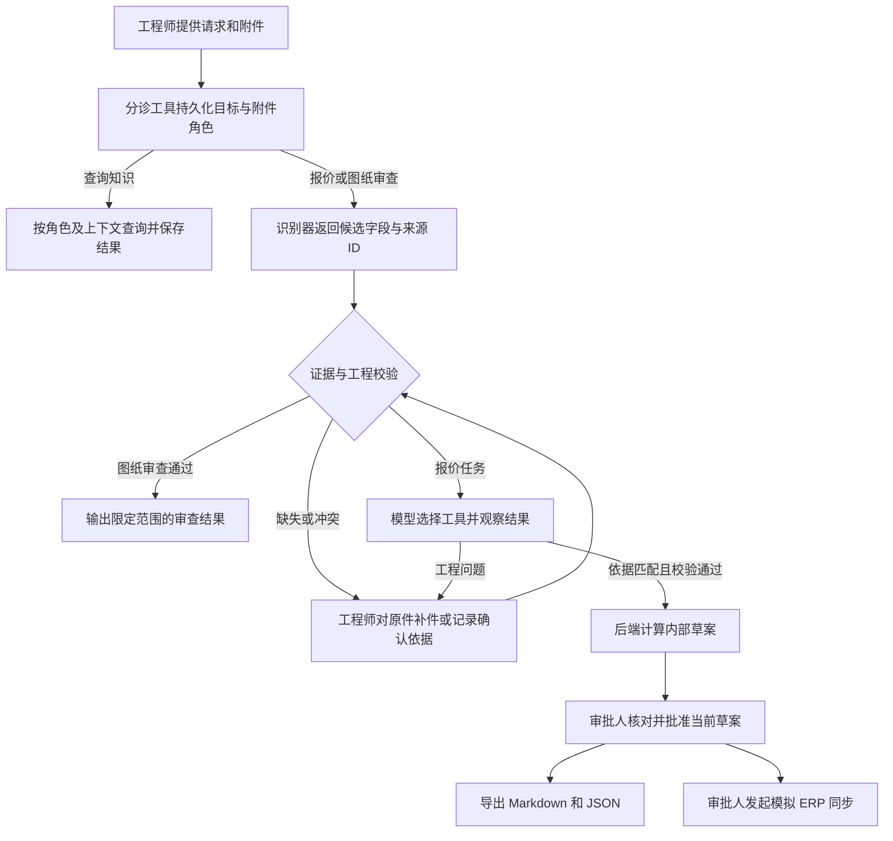

# AI Agent 设计与实现

> 面试短答：“工程师提供询价资料。报价 Agent 会根据工程校验和工具结果选择下一步。正常单查到批准的模板、材料和费率，就可以调用计价；错版单会交给工程师补件。工作台负责验证工具权限、执行成本公式并保存轨迹。审批人批准当前草案后，才能发起模拟 ERP 同步。”

![[docs/04-项目介绍与展示/10-展示附件/05-系统架构总览.png]]

## 1. Agent 能做什么

工作台将操作员选择的任务目标、已收到的附件、候选事实、校验问题和人工决定持久化到同一条任务。用户补齐信息后可以从当前状态继续。任务目标由用户选择，第一次确定后固定。

| 目标 | 输入 | 执行与输出 |
|---|---|---|
| 准备内部报价 `prepare_quote` | RFQ、图纸、工厂与零件上下文 | 抽取与复核 → 匹配受控依据 → 计价 → 待审批内部预算草案。批准后可导出，审批人可单独发起模拟同步 |
| 图纸审查 `review_drawing` | 图纸 | 校验当前模板范围的图纸字段与适用性，产出带证据和范围说明的审查结果。孔位、完整 GD&T 与可制造性仍由工程师审查 |
| 查询受控知识 `search_knowledge` | 零件、版次等查询条件 | 按角色与上下文检索，把结果保存在任务中。执行由确定性查询完成 |
| 尚未明确目标或缺少输入 | 当前请求和附件状态 | 进入 `CLARIFICATION_REQUIRED`，给出待补项目。用户明确目标或补件后继续 |

### 1.1 报价 Agent 如何选择工具

配置 `RFQ_AGENT_ENABLED=1` 后，从侧栏「报价 Agent」提交工程请求和混合附件。模型按观察、选择工具、观察返回结果的方式推进。工作台通过 `/agent/runs` 系列接口执行和保存轨迹，原有任务入口仍可以单独运行。

| 工具 | 输入和返回 |
|---|---|
| 分诊与读取 | 模型选择目标、标记 RFQ 与图纸，按范围读取页文本或查看页图 |
| 抽取与校验 | 模型选择本地抽取或聚焦页重抽，工作台验证来源、版次、材料、单位与模板适用性 |
| 检索计价依据 | 读取版本化知识目录、模拟 PLM 发布版次及模拟 ERP 材料成本和费率 |
| 请求生成草案 | 工程校验和受控依据前置条件通过后，由工作台计算价格并保存待审批草案 |
| 交人工处理 | 指定问题、答复对象和可选项，录入答复或补件后继续同一 Agent 任务 |
| 复核交付包 | 核对当前草案版本、报价依据、回复草稿与风险。审批、导出和 ERP 同步走原有人工入口 |

步骤先写入观察和工具决定，再执行工具。每个任务最多 18 步、48,000 token、180 秒累计执行时间和 5 个错误。重复动作、供应商失败及预算耗尽会保留已完成的步骤，等待答复或结束。使用 Responses 原生函数调用，也支持 Chat Completions 适配器。见 [[docs/03-实施与开发/08-工程决策/06-Agent运行循环]]。

「继续处理」由后端 `Orchestrator.resume` 驱动。它用 `expected_version` 拒绝过期页面操作，复用已有的抽取字段，并在缺件、识别失败或工程问题处暂停。已有草案时，重复继续会检查依据是否仍有效。审批、导出和同步各有独立入口与角色检查。可在 [编排](../../apps/api/src/rfq_workbench/orchestrator.py)、[任务 API](../../apps/api/src/rfq_workbench/main.py) 和 [[docs/03-实施与开发/08-工程决策/04-任务编排]] 对照。

## 2. 从 PDF 到可信字段

### 2.1 三种识别方式，共用证据校验

| 模式 | 实际执行 | 适用场景 |
|---|---|---|
| `LIVE` | 用 `OpenAIProvider` 将文档文本片段、来源 ID 和 PDF 页图送给配置的 Responses 兼容端点，按 `Extraction` 结构解析输出 | 需要图文理解时。端点需支持实际调用的图片输入与结构化输出契约 |
| `LOCAL_TEXT` | 从已解析文本中的字段标签提取值，并附文本来源 ID | 有标准标签与可提取文本的 PDF，适合现场走通主流程 |
| `REPLAY` | 只有文档哈希匹配已记录样例时才使用捕获结果，并保留回放标记 | 固定样例复现及离线演示 |

抽取调用返回固定字段的候选值与 `source_id`。提示要求把附件内容视为数据，并在缺失或歧义时返回空值。成功的在线抽取记录响应 ID、模型、耗时、提示版本和可用的用量数据。报价 Agent 的工具选择有独立执行记录。实现见 [识别器](../../apps/api/src/rfq_workbench/extraction.py)、[回放](../../apps/api/src/rfq_workbench/replay.py)。

### 2.2 来源校验是进入工程规则的第一道门

1. 文件处理生成文档哈希、页和文本位置。抽取值带的 `source_id` 必须在当前任务中解析为真实来源，文档类型和页号须匹配。例如 RFQ 的需求版次与图纸标注版次来自不同文档。
2. 后端独立检查字段标签和规范化后的值。如果原文标签和值能验证，标为 `TEXT_VERIFIED`。来源不存在、文本不支持、字段缺失或同文档存在歧义时，状态分别记录为 `INVALID_SOURCE`、`TEXT_MISMATCH`、`MISSING` 或 `AMBIGUOUS`。
3. 只有可定位 PDF 页、需要从视觉读取且没有对应的文本标签值时，候选值可标为 `VISUAL_REVIEW`。工程师打开原页核实，提交确认值和原因。版次等关键字段还有专门的证据与一致性规则。补件会更换参与校验的文档，改值或替换附件会清除已派生的草案、审批和导出。
4. 字段证据通过后，工程校验继续检查零件、版次、材料、数量、单位、尺寸、孔数与模板适用范围。RFQ 要 B 版而图纸为 A 版时，即使两个识别值都正确，任务仍以 `REVISION_CONFLICT` 暂停。

这里需要区分**识别正确、证据充分、业务可用**三件事。比如识别器正确读到 A 版，证据也成立，但它与客户要求 B 版冲突，因此不能生成草案。见 [证据校验](../../apps/api/src/rfq_workbench/evidence.py)、[文件工作流](../../apps/api/src/rfq_workbench/file_workflow.py)。

## 3. 从工程事实到金额、物料与批准

1. **确定知识依据。** `Knowledge.search` 按角色筛选可见项，记录适用范围和使用结论。计价通过 `Knowledge.resolve` 为当前零件、版次和工厂选择唯一有效的批准模板、材料目录和费率。历史、过期或不匹配的条目可出现在查询结果里，并标为仅供参考。缺项或存在多个可执行匹配时停在复核。
2. **固定计价输入。** `Workflow.cost` 检查任务版本与阻断问题，获取模拟上游快照，再核对参考依据和快照内容。草案保存输入哈希、参考依据哈希、草案版本以及快照引用。
3. **由代码计算。** `calculate` 根据模板生成工序、费用和一行毛坯需求。以费率 A、100 件为例，准备费 €90 分摊为 €0.90/件，加上 €18.20/件可变成本后为 €19.10/件。目标毛利 25%，以 `19.10 ÷ 0.75` 计算，Decimal 按分舍入，得到 **€25.47/件、€2,547.00**。草案列出待确认项，审批时可以逐项复算。
4. **人工批准具体内容。** 审批接口校验角色、任务版本、输入与依据、当前草案状态以及来源快照。批准绑定 `quote_hash` 和 `draft_version`。数量从 100 改到 500 时，清除当前草案、批准和导出，在原任务留下修改原因。新结果为 **€24.51/件、€12,255.00**，重新等待审批。

实现见 [知识选择](../../apps/api/src/rfq_workbench/knowledge.py)、[成本计算](../../apps/api/src/rfq_workbench/costing.py)、[报价和审批](../../apps/api/src/rfq_workbench/service.py)。模拟来源校验和对账见 [[docs/05-面试与问答/11-Harness可靠性设计]]。

## 4. 面试追问

| 问题 | 可直接回答 |
|---|---|
| 为什么称为 Agent？ | “报价模式下，模型会根据任务证据和工具返回，决定查哪项资料、请求计价还是交人复核。正常单和错版单的工具轨迹可以在界面上对照。计价金额和审批由工作台按规则处理。” |
| 模型答错怎么办？ | “先检查它引用的是不是当前任务、正确文档的原文。值和标签对不上就阻断，只有页图证据就交工程师核实。即使 A 版识别正确，遇到客户要求 B 版仍然停住。” |
| 换模型会影响什么？ | “接口必须能收图文并返回结构化字段。换模型以后，用同一批冻结案例重测字段值、引用、弃答和延时。金额公式、审批和写入路径由后端独立控制。” |
| 怎么控制工具权限？ | “模型按当前状态选工具，网关重新验证权限和参数。报价前要校验事实并查询受控知识。审批、导出、派发、修正字段由现有人工入口执行。” |
| 能自动规划工艺或生成完整 BOM 吗？ | “当前实现基于批准的支架模板输出有限工序和单件毛坯需求。多层 BOM、完整工艺路线和任意图纸的可制造性需要扩展数据与验证范围。” |

## 5. 可展示的评测证据

仓库中的 [M7 在线抽取报告](../../evals/results/m7/live.json) 记录了 12 份冻结样例，153 个可见字段的候选值正确，3 个缺失字段正确留空。153 个值里，145 个由文本验证，8 个在正确视觉页上，按运行规则进入人工复核。这个口径是该次有限样例的**候选值和证据评测**。业务报价阻断、知识适用性与故障恢复另有 [M7 本地报告](../../evals/results/m7/local.json)。要把结果和界面对应起来，按 [[docs/05-面试与问答/09-选项B现场演示流程#02:25–04:05 · 核对原件和受控知识]] 和其中的错版步骤操作。
