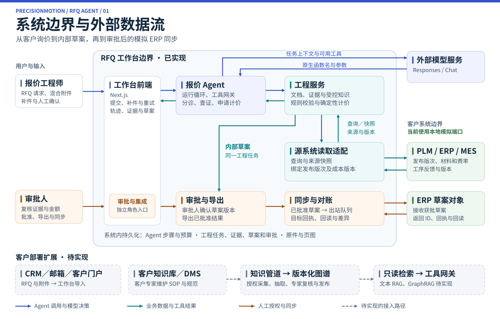
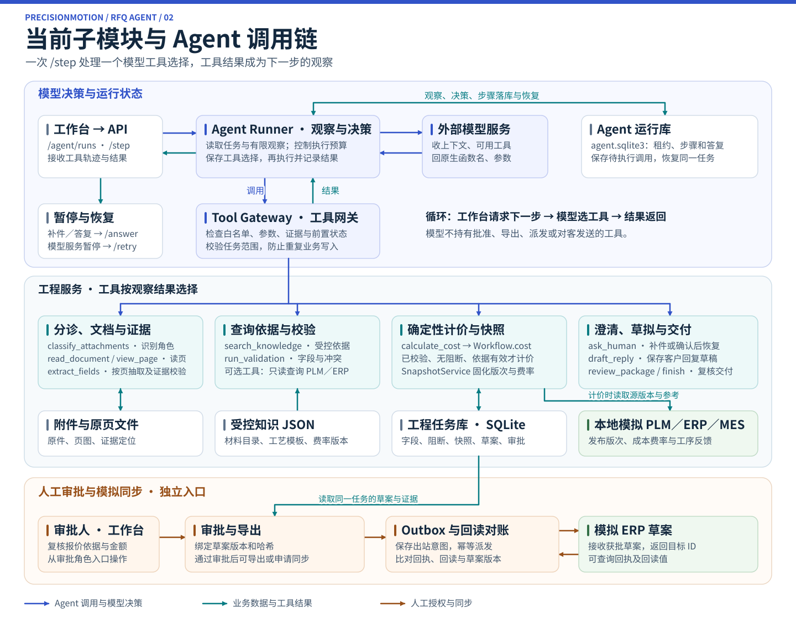

# RFQ Agent 面试展示

| 材料 | 什么时候打开 |
|---|---|
| [[01-Agent完整演示流程]] | 彩排和现场操作。按截图走正常单、错版单、缺图补件三条路径，逐步查看预期结果和话术 |
| [[02-Agent系统架构设计]] | 解释模型、工具和业务权限的边界，说明客户知识库与知识图谱如何建设，以及 RAG、GraphRAG 的待实现范围 |

开场用正常单建立参照。先让面试官看到模型做了哪些选择，再打开工具结果、字段原页与成本。错版和缺图展示两个不同的人工交接点。谈到客户部署时，切到架构设计，说明 ERP、PLM、MES 的数据交互和客户专家维护知识的责任。

## 图 1 · 系统边界与外部数据流

**开场指图顺序：** 从工程师上传 RFQ 和图纸开始，沿蓝线走到 Agent 和外部模型服务，再沿青线说明证据、报价依据和内部草案如何流转。最后沿橙线说明审批人如何复核，并将批准后的草案派发到模拟 ERP、回读对账。底部灰色路径是客户部署规划；当前 PLM、ERP、MES 使用本地模拟端口，客户知识管道、知识图谱、RAG 与 GraphRAG 均待实现。

## 图 2 · 当前子模块与 Agent 调用链

**技术追问指图顺序：** 工作台请求 `/step` → Runner 组装有限上下文 → 模型返回原生工具调用 → Runner 保存选择 → 网关检查权限、参数和前置条件 → 工程服务执行 → 结果成为下一步观察。中间四组工具由模型按需选择。错版、缺图可以进入人工澄清，连接故障走模型重试；审批、导出和 ERP 派发走图底部的人工授权路径。

现场可在 [[01-Agent完整演示流程]] 的正常单中展开一条工具轨迹，对照图 2 说明模型选了什么、后端核验了什么。外部接口、数据归属及客户知识建设方案见 [[02-Agent系统架构设计]]。
