# RFQ Agent 完整演示流程

这次演示围绕同一款安装支架 `PM-BRKT-010`。先让 Agent 处理一笔资料齐全的 100 件询价，再让审批人在工作台复核并派发模拟 ERP 草案。最后用错版和缺图两笔独立任务，展示 Agent 怎样解释问题、等待答复并在补件后恢复。

> [!info] 截图与现场运行
> 18 张截图均来自当前工作台的实际页面。在隔离环境里，模型的工具选择使用 M11 脚本化回放，工具、规则校验、计价、审批和模拟 ERP 均由应用实际执行。截图中的模型步骤、用量和耗时是回放数据。用已配置模型现场运行时，工具顺序、提问文字及用量可能变化。正常单金额、错版阻断和人工授权由应用校验。真实模型的正常单与错版单联调记录见 [M11 验收](../03-实施与开发/09-阶段验收/12-M11报价Agent.md)。

架构解释见 [[02-Agent系统架构设计]]。本稿里的「Agent 已完成」表示交付包就绪。实际批准、下载与模拟 ERP 派发仍需要审批人操作。

## 演示准备

从项目根目录开两个 PowerShell 终端。API 终端启用 Agent、选择费率 A，并使用独立数据目录。每次独立彩排可改数据目录名称。

```powershell
Set-Location 'E:\code\IndustrialMind'
$env:RFQ_AGENT_ENABLED='1'
$env:RFQ_RATE_PROFILE='A'
$env:RFQ_DATA_DIR='var/agent-interview-rehearsal-01'
.\scripts\start-api.ps1
```

在第二个终端运行 `.\scripts\start-web.ps1`。打开 [工作台](http://127.0.0.1:3000)，右上角选「工程师」，确认左侧出现「报价 Agent」。模型连接使用项目现有的后端配置。环境依赖、Node 路径及排查见 [本地运行手册](../04-项目介绍与展示/06-启动与运维.md)。

| 路径 | 附件 | 要展示的业务结果 |
|---|---|---|
| 正常单 | [01 RFQ 100 件](../05-面试与问答/05-演示输入材料/01-RFQ-100件.pdf) ＋ [02 B 版图纸](../05-面试与问答/05-演示输入材料/02-PM-BRKT-010-B版.pdf) | RFQ 要求 B，附件为 B，生成 €2,547.00 草案。审批后导出并模拟 ERP 对账 |
| 错版单 | [04 版次冲突 RFQ](../05-面试与问答/05-演示输入材料/04-RFQ-版次冲突.pdf) ＋ [05 A 版图纸](../05-面试与问答/05-演示输入材料/05-PM-BRKT-010-A版.pdf) | RFQ 要求 B，附件为 A，记录 `REVISION_CONFLICT`，等待工程师答复 |
| 缺图单 | 先选 [01 RFQ 100 件](../05-面试与问答/05-演示输入材料/01-RFQ-100件.pdf)，待答复后补 [02 B 版图纸](../05-面试与问答/05-演示输入材料/02-PM-BRKT-010-B版.pdf) | Agent 提出补件问题，补图后同一任务恢复并产生草案 |

## A · 正常单，从工程请求到 ERP 回读

### 1. 输入工程请求与混合附件

以「工程师」打开「报价 Agent」。若页面上还有上一笔任务，先点「新建 Agent 任务」。在「工程请求」粘贴下文，在同一个「附件」控件里多选 01 和 02。此时可看到选中 2 个文件，「运行 Agent」可用。

> 正常报价：请为 PM-BRKT-010 的 100 件询价核对 RFQ 与图纸版次，并生成内部预算草案及回复草稿。

**话术**　“我把询价邮件的目标和两份附件交给 Agent。用户只说明要完成的工程任务，系统随后辨认哪份是 RFQ、哪份是图纸。”

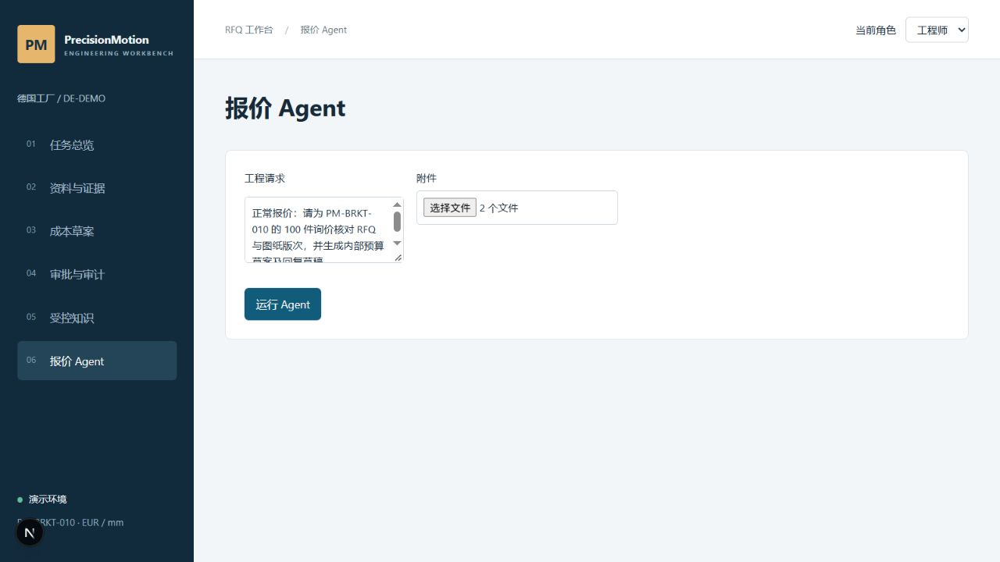

### 2. 运行 Agent，查看分诊、计划和结果

点「运行 Agent」，观察状态和工具轨迹。完成后看顶部的「处理计划」、标为 RFQ 的 D1、标为图纸的 D2，以及「内部草案 · 100 件 · EUR 2547.00」。文档编号按本次上传顺序分配，重点核对实际文件名和角色。

若显示「模型服务暂停」，先确认运行 API 的环境能连接模型服务，再点「重试模型」。系统保留原任务、附件和已执行步骤，不必重新上传或填写人工答复。「待人工答复」则用于补图、版次冲突等需要业务确认的情况。

**话术**　“我先看 Agent 怎么分配附件角色，再看它走了哪些工具。当前状态显示交付包已完成，草案还要交给审批人。”

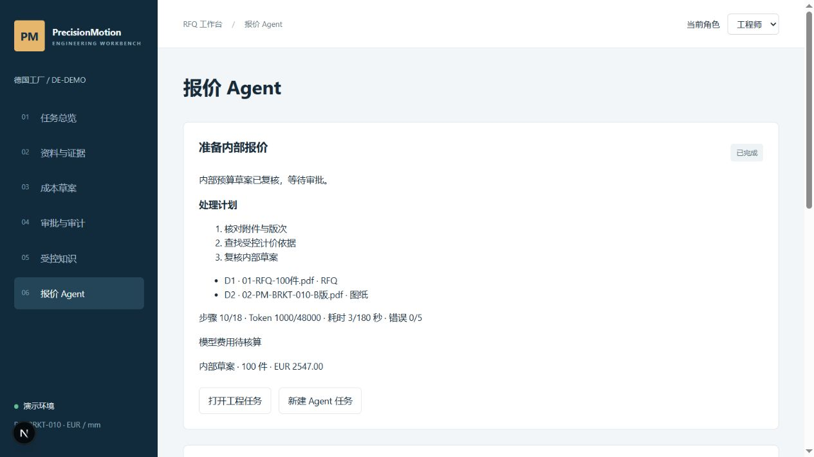

### 3. 展开计价和交付复核的工具结果

下滚至「交付包」，看「客户回复草稿」。继续下滚至「工具轨迹」，展开「生成内部报价草案」，指给面试官看 `quantity=100`、`unit_price=25.47`、`total_price=2547.00` 和草案版本。再展开「复核交付包」，回放中显示 `consistent: true`。可以顺势指出上方的「校验证据与工程规则」「检索受控知识」及成本来源工具。

**话术**　“模型选择调用工具。校验与知识匹配通过后，计价由业务服务执行，并把金额、费率版本和草案版本返回。回复是工作台里的草稿，交付复核会核对它绑定的草案。”

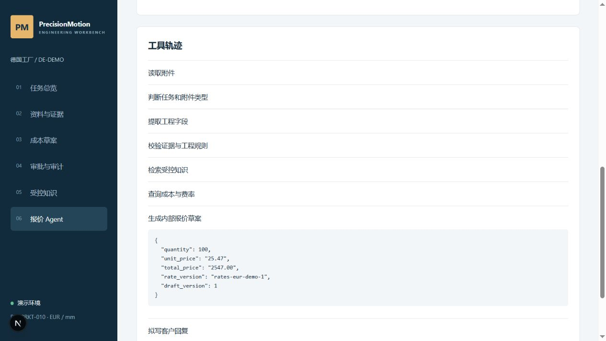

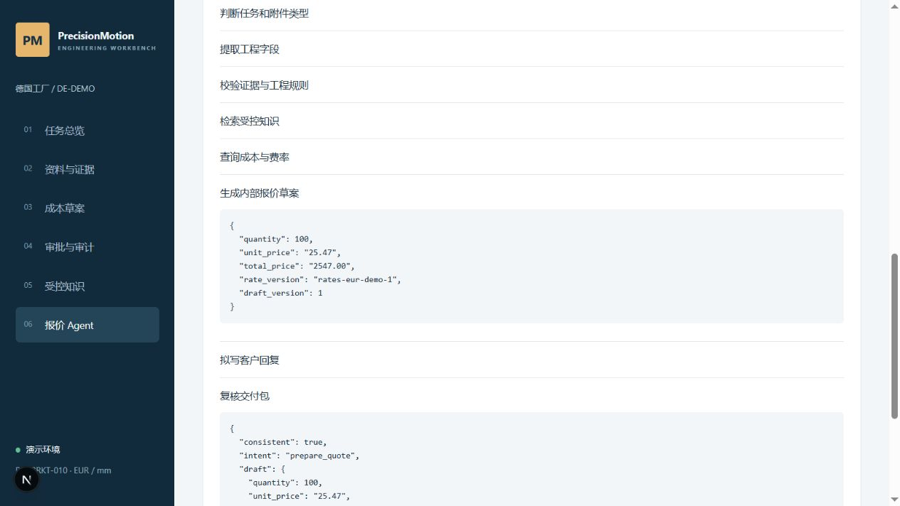

### 4. 从结构化字段回到图纸原页

回顶部，点「打开工程任务」，进入「资料与证据」。依次指出 RFQ 要求 B、图纸版次 B、数量 100。找到「材料」行，点「依据 ↗」，在右侧「来源回查」看原文和页图，需要细看可点「打开原尺寸页图 ↗」。

**话术**　“如果只看到一个材料字段，我还不能复核它。这里从 Al-6061-T6 回到图纸对应页，工程师可以检查系统读出的值和原件是否一致。”

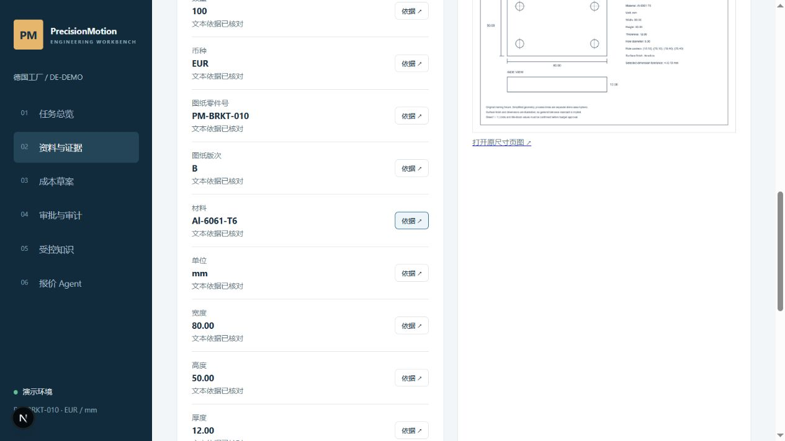

### 5. 打开成本草案，复算报价

点左侧「成本草案」，查看数量 100、单位成本 €19.10、单位报价 €25.47 和草案总额 €2,547.00。下方「计价依据」显示批准材料目录、工艺模板和费率版本。可展开「查看批准工艺路线」，再看毛坯需求、成本项及待确认事项。

**话术**　“同一批次 €90 的准备费分摊到 100 件，每件 €0.90。加上 €18.20 的单件可变成本是 €19.10。按 25% 目标毛利计算并把单价舍入到分，得到 €25.47，总额 €2,547.00。”

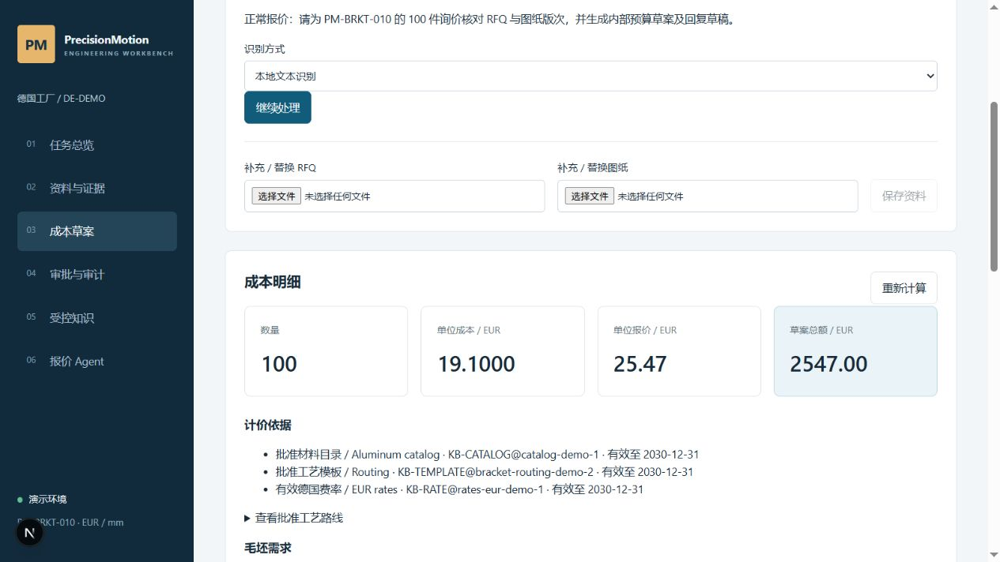

### 6. 切换审批人，批准当前草案

在右上角「当前角色」切为「审批人」，进入「审批与审计」。如未留在原任务，从「任务总览」按请求标题或任务 ID 打开刚才的工程任务。勾选复核确认框，填审批备注，点「批准当前草案」。页面显示批准人、备注和审批事件。

> 已核对 B 版图纸、材料及工厂计价依据，同意作为内部预算。

**话术**　“现在切换到审批人。审批针对的是当前这版草案及其依据。角色和草案版本由工作台校验。”

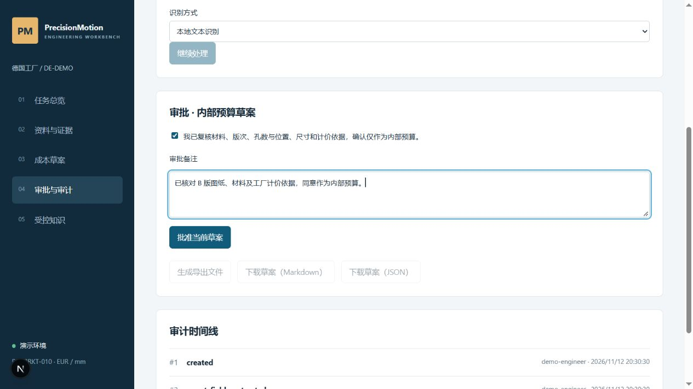

### 7. 生成并查看内部草案导出

保持审批人角色，点「生成导出文件」。生成后可用「下载草案（Markdown）」查看可读版本，或用「下载草案（JSON）」查看结构化草案。界面显示已批准，审计时间线中可回查抽取、计价和批准事件。

**话术**　“这里把内部草案交给审批角色。Markdown 便于阅读，JSON 便于后续系统消费。下方事件能说明是谁、在什么时候批准了这份草案。”

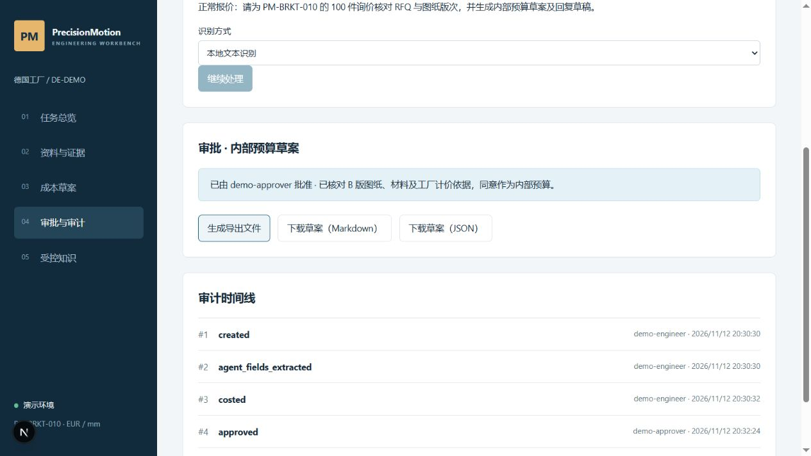

### 8. 请求同步，确认模拟 ERP 意图待派发

回「成本草案」，滚动到「ERP 草案同步 · 模拟」。在「同步 / 决议备注」填下文，点「请求同步」。确认出现「待派发」，此时可以展开「来源快照」。截图里的模拟标记说明派发对象是本地模拟 ERP。

> 面试演示：提交已批准的 100 件内部草案。

**话术**　“审批人发起同步后，系统先记录出站意图。现在状态是待派发，可以看到关联的来源快照。后续派发与对账会更新同一条同步记录。”

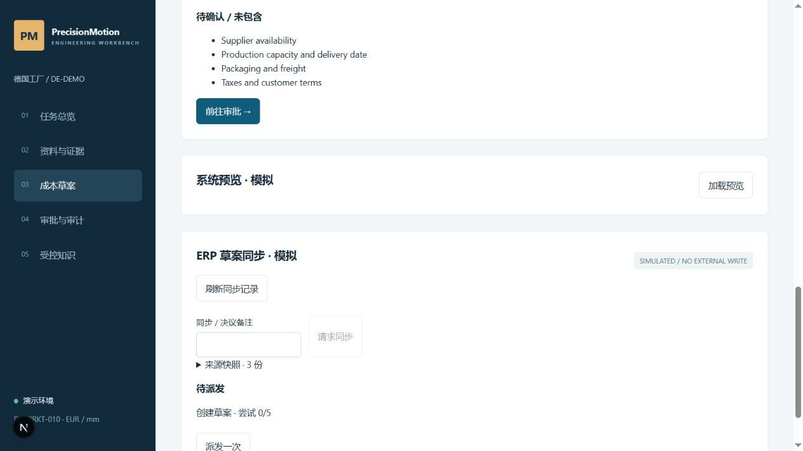

### 9. 派发一次，核对目标记录与回读

在同一条「待派发」记录上点「派发一次」。等「对账通过」，确认有目标记录 ID、版本 1 及「最近对账 MATCH」。可以展开「意图与尝试详情」查看步骤。若现场停在待确认状态，使用页面给出的「查询并对账」并检查结果。

**话术**　“出站结果有目标记录 ID 和版本。系统还从模拟 ERP 读回草案逐字段核对，这里显示 MATCH。这个操作由审批人发起，走的是模拟接口。”

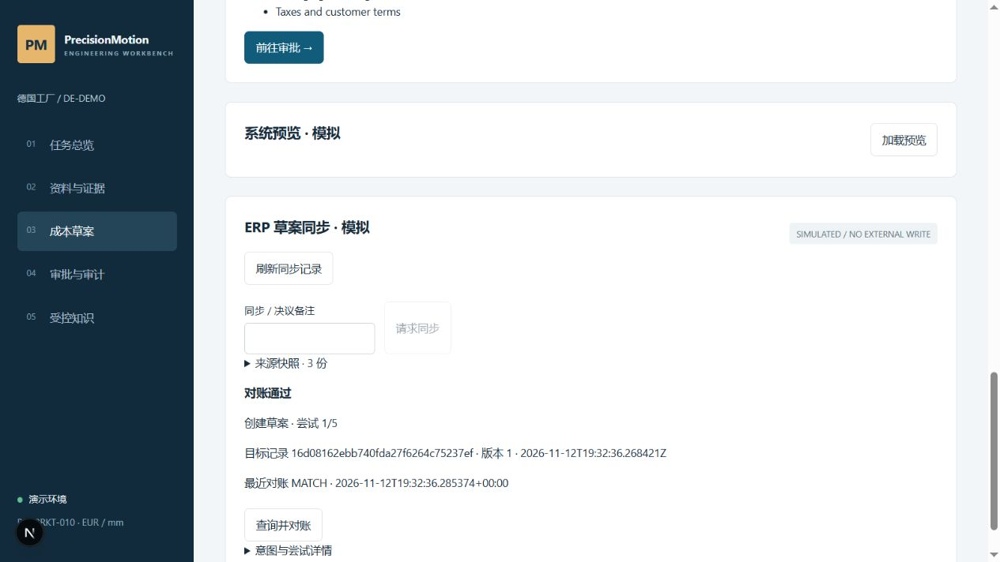

## B · 错版单，校验阻断并交工程师处理

### 10. 提交 RFQ 与 A 版图纸

切回「工程师」并打开「报价 Agent」，点「新建 Agent 任务」。填写下文并同时选 **04 和 05**。04 要求 B 版，05 是 A 版。点击「运行 Agent」。

> 版次冲突：请核对随附 RFQ 的要求版次与来件图纸；若不一致，请说明缺少什么资料。

**话术**　“第二笔故意让 RFQ 的要求和来件不一致。重点看 Agent 是否能够把问题交给合适的人，以及报价入口是否被规则阻断。”


### 11. 查看交接问题与工程阻断码

Agent 面板显示「待人工答复」，「待答复 · 工程师」说明 RFQ 要 B、来件为 A，并要求补充发布图纸。查看「工具轨迹」中相关的版次校验与 PLM 查询。点「打开工程任务」，在「资料与证据」查看 `REVISION_CONFLICT` 与本案例的 `UNAPPROVED_REVISION`。这个分支未生成报价。

**话术**　“RFQ 的 B 和图纸上的 A 各有依据，冲突由工程规则识别。Agent 把差异和补件要求交给工程师。提交符合要求的发布图纸后，可以回原 Agent 任务继续。”

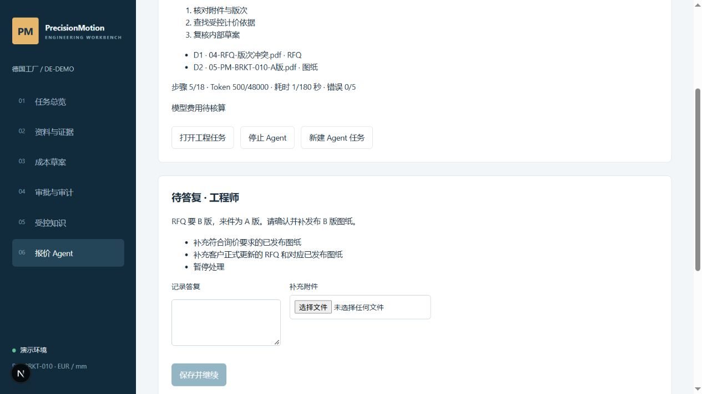

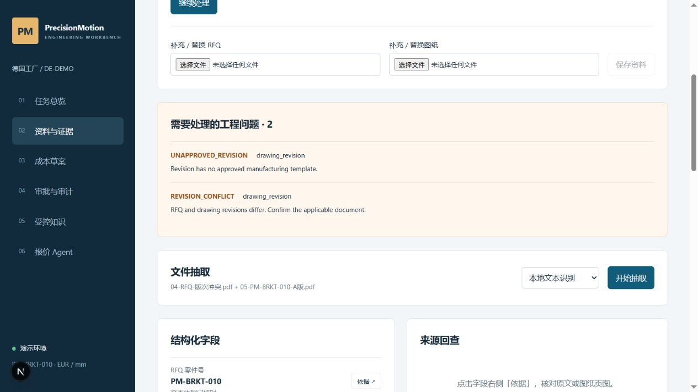

## C · 缺图单，答复并恢复原任务

### 12. 只上传 RFQ

保持「工程师」角色，回「报价 Agent」，点「新建 Agent 任务」。填下文，在「附件」里只选 **01**，点击「运行 Agent」。

> 缺图纸：收到 PM-BRKT-010 的 100 件 RFQ，请判断资料是否齐全，再准备内部报价。

**话术**　“这一笔只有客户询价。Agent 需要识别报价还缺什么，并明确提出所需附件。”


### 13. 查看针对客户的补件问题

Agent 显示「待人工答复」，答复对象是客户，并明确要求补发 `PM-BRKT-010` 的 B 版图纸。此时只有 D1 RFQ，页面未显示报价草案。工程师在工作台记录从客户收到的答复。

**话术**　“问题写明了料号和所需版次。客户补发后，我把答复和实际图纸交回这个任务，系统再继续核验。”

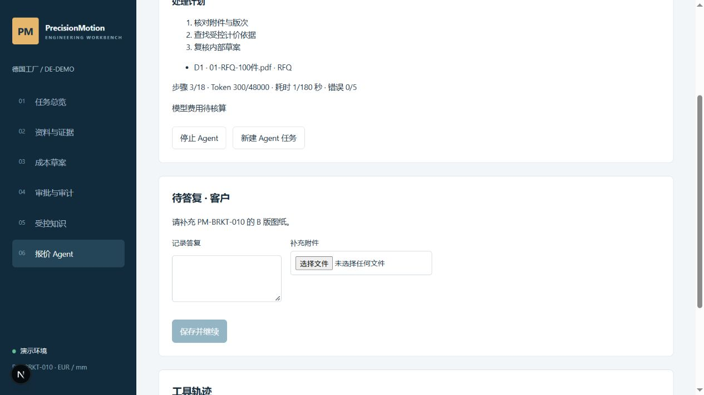

### 14. 在原任务记录答复并上传 B 版图纸

在当前页面的「记录答复」输入下文，在「补充附件」选择 **02**。确认界面显示 B 版文件名后，点「保存并继续」。

> 客户已补发 PM-BRKT-010 的 B 版图纸，请核对发布版次后继续。

**话术**　“这里新增一份有来源的附件。Agent 以同一任务的旧观察和新资料继续工作，重新判断附件角色与工程依据。”

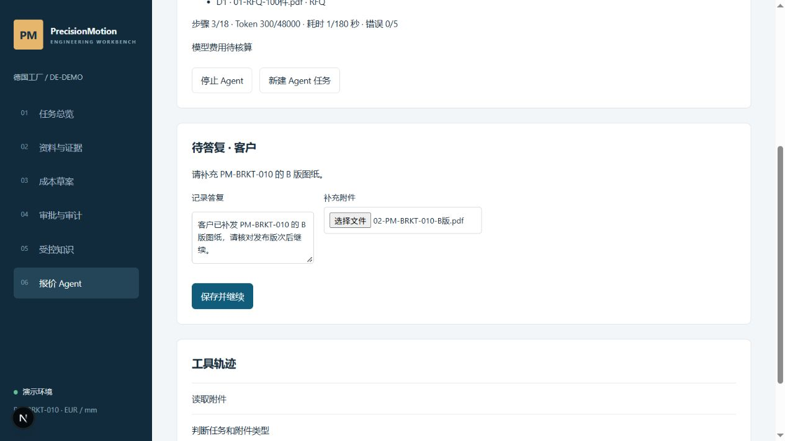

### 15. 验证恢复后的草案与提问记录

等待状态变为「已完成」。在附件列表确认 D1 仍是原 RFQ，D2 是补发的 B 版图纸。查看 **100 件、€2,547.00** 的内部草案。下滚「工具轨迹」展开「请求人工答复」，再指向后续分诊、复核和完成记录。此组截图前后使用同一 Agent 运行 ID `716667f8753d4e519c3cf844662fb322`，隔离环境 API 显示保留一条答复。

**话术**　“原来的补件问题仍在轨迹里。现在图纸齐全，Agent 生成了草案，工程任务可以交给审批人。前面错版时的阻断和这里的恢复，都能回到具体输入和工具结果。”


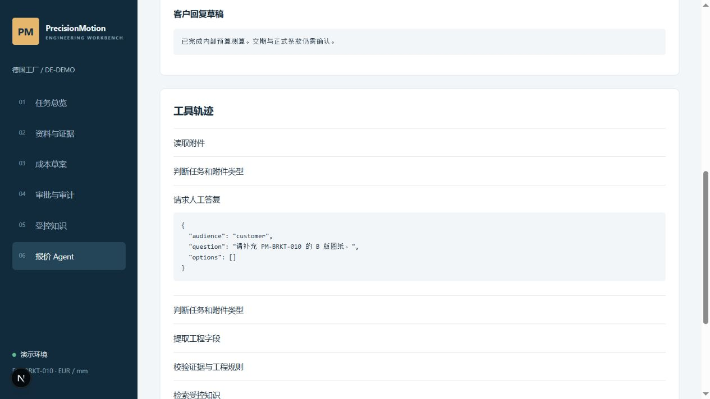

## 转到架构设计

> “刚才模型负责选择工具和提问，工程服务负责核验事实、计算和保护审批边界。客户部署时，PLM 和 ERP 仍提供各自的权威版本和成本。客户专家维护专业知识库，我们将批准的知识转换成带证据、版本和适用范围的图谱，再通过同一工具网关给 Agent 查询。”

打开 [[02-Agent系统架构设计]]，先指当前架构图上的模型和工具网关，再指目标架构图上的客户审批发布与图谱查询服务。**文本 RAG 和 GraphRAG 都属于待实现能力。**
