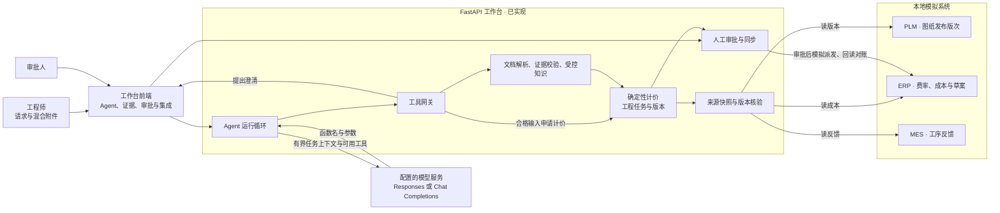
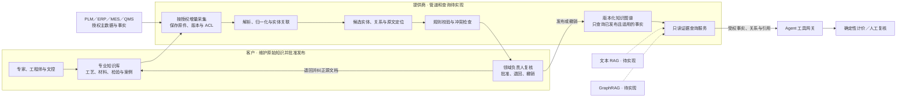

# Agent 系统架构设计

面试中先用一笔 RFQ 解释现有 Agent 如何作决定、何时停下来等人，再用客户知识图谱说明试点如何扩展。报价 Agent、工程任务和人工审批已实现。ERP、PLM、MES 通过本地模拟端口演示。客户知识库接入、图谱生产管道及查询服务属于目标设计，**RAG 和 GraphRAG 均待实现**。

现场操作和截图见 [[01-Agent完整演示流程]]。当前代码决策与评测见 [Agent 运行循环](../03-实施与开发/08-工程决策/06-Agent运行循环.md) · [M11 验收](../03-实施与开发/09-阶段验收/12-M11报价Agent.md)。

## 1. 当前系统如何运行

### 1.1 决策、执行和批准的分工

| 层 | 当前职责 | 面试中可指给对方看 |
|---|---|---|
| 工作台 | Next.js 面板接收工程请求和混合附件，调用 `/agent/runs` 创建任务，再逐步调用 `/step`。`/answer` 保存回复及补件，`/stop` 停止后续步骤 | 计划、步骤轨迹、问题、草案、预算。切到工程任务可复核原页和金额 |
| Agent 运行循环 | 根据任务状态给模型提供当前可用的工具与有限观察，每步取得并处理一个原生函数调用。支持 Responses 和 Chat Completions。用 `RFQ_AGENT_ENABLED=1` 开启独立入口 | 正常单继续调用计价工具。错版单查 PLM、记录风险并等待答复 |
| 工具网关 | 对任务归属、附件、页范围、字段、参数、角色和前置条件做服务端验证。工具可分诊、读页、聚焦重抽、查询受控知识及模拟 PLM／ERP、校验、申请计价、草拟回复和发起人工问答 | `REVISION_CONFLICT` 或缺少来源时，轨迹显示对应动作及暂停原因 |
| 工程服务 | 确认字段与原页证据一致，唯一选择批准材料目录、工艺模板和费率，并用版本化规则计算草案。计价时保存 PLM、ERP、MES 来源快照，检查发布版次和成本参考 | 证据页、工艺明细、价格分项、知识 ID 与来源快照 |
| 人工与同步服务 | 审批人核对草案版本和哈希。正式批准、字段修正、下载、ERP 派发和差异决议在工作台各自的权限入口。Agent 的客户回复作为草稿保存 | 同一任务的待审批状态、审批事件、模拟 ERP 目标 ID 与回读结果 |

代码可从 [Agent 路由](../../apps/api/src/rfq_workbench/agent/routes.py) · [运行循环](../../apps/api/src/rfq_workbench/agent/runner.py) · [工具网关](../../apps/api/src/rfq_workbench/agent/tools.py) · [工程服务](../../apps/api/src/rfq_workbench/service.py) 跟进。

### 1.2 两条分支和两个执行记录

1. **正常单。** 模型辨认 RFQ 和图纸，读取或抽取所需字段，完成校验和受控知识查询后申请计价。后端生成内部草案，模型草拟回复并复核交付包。验收中的 DEV-001 生成 **100 件、€2,547.00** 的内部草案。Agent 的「已完成」表示交付包已就绪，工程任务此时仍可处于「待审批」。
2. **错版单。** RFQ 要求 B，附件图纸为 A。Agent 可查询模拟 PLM 的发布记录并向工程师提问。工程师补交正确图纸后，用原任务继续。新附件需要经过同样的识别和校验。验收中的 DEV-003 在等待答复时没有报价草案。
3. **执行记录。** `agent.sqlite3` 保存步骤、观察、模型选择、答复和待执行决策。`workbench.sqlite3` 保存工程任务、字段证据、草案、审批、来源快照和出站意图。原始上传与 PDF 页图由本地文件存储管理，模拟系统使用独立数据库。两类任务记录通过工程任务 ID 关联。
4. **恢复与预算。** 先保存工具决定，再执行。租约到期可重领，抽取用步骤 ID 的审计记录去重，计价用业务版本和已提交草案识别重复动作。每任务有 18 步、48,000 token、180 秒累计执行时间和 5 个错误的预算。资料和页图以工具数据进入模型上下文，网关独立判定执行权限。

相关验证见 [运行循环 ADR](../03-实施与开发/08-工程决策/06-Agent运行循环.md) · [M11 冻结回放报告](../../evals/results/m11/local.json)。

> **现场话术**
>
> “我给 Agent 同一组报价目标和附件。正常单会推进到计价，错版单会停下来问工程师。步骤轨迹能看到模型选了哪些工具，证据和价格页面能看到系统用什么依据接受或拒绝这个动作。交付包完成后，我切换成审批人复核同一个工程任务。”

## 2. 与其他系统的数据交互

下表中的「模拟」对应当前可演示的接口行为。「目标」表示未来接入的方向，客户实际系统品牌、协议、字段和权限由项目试点确认。

| 系统与责任人 | 流向及对象 | 当前与目标 |
|---|---|---|
| RFQ 来源，销售或报价运营 | 客户要求、数量、币种、交期和附件 → Agent。内部回复草稿 → 工作台用户 | 当前手动填写请求及上传文件。**目标**可通过获授权的 CRM、邮箱或客户门户导入，关联客户和 RFQ ID。发送交由既有业务流程 |
| PLM／PDM，文控或工程负责人 | 料号、工厂、图纸修订、发布状态、生效区间 → 校验与计价来源快照 | 当前模拟 PLM 读取发布版次并探测来源版本。**目标**对接发布／变更事件及只读版本接口，按客户项目冻结规则确定适用版次 |
| ERP，财务与采购负责人 | 材料成本、费率、单位、币种及版本 → 工作台。已批准草案 → ERP。目标 ID、版本、回执和回读 → 工作台 | 当前模拟 ERP 读费率、成本和派发草案，界面标注 `SIMULATED / NO EXTERNAL WRITE`。**目标**对接客户草案对象，明确幂等键、条件更新和回读一致性 |
| MES，制造工程负责人 | 工序、计划／观察工时、样本及版本 → 来源快照 | 当前只读模拟反馈。**目标**接入获授权的工序与工时，用于校对工艺模板及提出变更，由专家复核后发布 |
| DMS／工程知识库，客户专家与文控 | 受控 SOP、工艺模板、检验规范、FAQ 及审批、访问权限、变更记录 → 提供商管道 | 当前受控知识和制造参考来自合成 JSON。**目标**读取客户已授权且受版本管理的资料，产出带溯源的知识图谱 |
| QMS，质量负责人 | 缺陷分类、检验记录、批准处置与经验教训 → 知识管道 | **目标**。隔离敏感个案，发布经质量专家复核的通用规则。批准处置与历史观察分别记录 |
| 企业身份提供方，IT | 用户身份、组织、角色、工厂与项目权限 → 工作台、检索授权 | 当前用工程师和审批人演示角色。**目标**连接企业 SSO，并在查询时映射客户、工厂、项目和记录权限 |
| 模型服务，提供商或客户 IT | 受控请求、必要字段、允许的页片段及工具定义 → 模型。工具调用和用量 ← 模型 | 当前支持配置模型服务。**目标**根据客户政策决定托管位置和发送范围，并保留同一工具网关 |

**权威归属。** PLM 管理发布版次，ERP 管理成本及费率，MES 提供生产事实，客户知识库维护解释、模板、检验规则和适用条件。一次报价引用自己的来源快照。若源系统版本变化、记录过期或多条批准依据同时适用，计价服务要求复核。模拟集成中，批准后的草案先写出站意图，再带幂等键派发，回读对账后记录结果。相关实现见 [集成端口](../../apps/api/src/rfq_workbench/integrations/ports.py) · [来源快照](../../apps/api/src/rfq_workbench/integrations/snapshots.py) · [集成 Harness](../03-实施与开发/08-工程决策/05-集成Harness.md)。

> **现场话术**
>
> “真实客户接入时，我会先问清楚哪个系统有权决定版次、费率和工艺。这个原型已经能演示这三类数据怎样进入报价依据，以及审批后怎样用回执和回读核对一条草案。屏幕中的 PLM、ERP、MES 记录都来自模拟端口。”

## 3. 客户知识库与知识图谱目标设计

客户的专家和工程师在现有工程知识库中编写并维护专业知识。提供商实现数据管道、领域模型、图谱查询和 Agent 集成，把已获授权的资料转成带证据和适用条件的结构化记录。客户领域负责人掌握业务含义和发布批准，提供商负责转换可重放、访问可核验和失效可追踪。

### 3.1 客户负责准备什么

| 资料 | 客户维护人 | 建议维护内容 |
|---|---|---|
| 批准工艺与设备能力 | 工艺工程师 | 操作顺序、设备范围、适用工厂和产品族、允许材料、几何与批量范围、例外 |
| 材料规范与替代规则 | 材料工程师／采购 | 牌号、状态、单位、来源标准、替代触发条件和批准记录 |
| 图纸解读与检验规范 | 设计／质量工程师 | 版次、公差、检验方法、接受标准及不合格处置 |
| 历史报价与经验 | 报价工程师 | 背景、当时工厂／材料／费率和最终结果。作为带时间与来源的参考，执行依据继续使用当期获批资料 |
| 版本与授权 | 文控／IT | 文档唯一 ID、修订号、状态、所有者、有效期、工厂与项目范围、允许读者和变更原因 |

提供商为试点给出资料模板、字段映射和审核差异页。专家可在原系统修订源文件和批准范围，管道将相应变更传到候选图谱和已发布快照。

### 3.2 管道如何把文档转成有溯源的图谱

| 阶段 | 输入、处理与验收 |
|---|---|
| 1. 授权采集 | 读取批准文档与接口变更。记录来源系统、原始 ID、版本、文件哈希、采集时间、删除或撤销标记和原始 ACL。按客户、项目、工厂和源版本隔离重放及去重 |
| 2. 解析与切分 | 对 PDF、表格和受控文档提取正文、标题、页码、表行和列坐标。保留原文件定位。对 OCR 低置信字段和难以解释的跨页表格标记待审核 |
| 3. 抽取候选事实 | 规则解析规格、料号、修订号、币种和单位。模型辅助提取工艺条件、检验关系和例外。输出受 schema 约束的候选，要求每个事实绑定明确的原文或结构化主记录 |
| 4. 归一化和实体解析 | 用客户主键、工厂和修订将候选链接到已知实体，建立材料同义词与单位映射。保留原值和归一值。零件同名、材料状态冲突、币种不符或版本歧义进入人工待审队列 |
| 5. 校验与人工复核 | 检查关系端点、必填证据、有效期和来源权威。提供候选、引用原页与现有图谱版本的差异。领域专家确认适用条件和互斥例外，批准后才可进入发布快照 |
| 6. 发布与失效 | 以图谱发布版本冻结节点、边与来源索引。撤销、到期或源 ACL 收紧时，先从有效查询视图移除受影响事实及相关缓存，再增量更新。历史发布保留审计链接并继续执行访问控制 |
| 7. 监控与回收反馈 | 收集冲突、缺失证据、查询拒绝、候选接受率和更新延迟。工程师在 Agent 中指出错误时创建待维护条目，经客户复核后进入后续发布 |

溯源模型可借鉴 W3C PROV-O 中实体、生成活动和责任方的分工。这里以客户可用的文档定位、审签和访问规则定义工程契约。[W3C PROV-O](https://www.w3.org/TR/prov-o/)

### 3.3 图谱存什么

- **业务实体。** 零件、图纸修订、工厂、材料与状态、工艺模板、工序、设备能力、费率版本、检验规则、历史案例。
- **工程关系。** 零件对应哪个已发布图纸修订。某模板适用于哪个工厂、材料和修订。工序要求什么设备能力与检验。费率由哪个 ERP 成本版本授权。例外覆盖哪条规则并在什么条件下生效。
- **事实的证据。** 每条关系及关键数值带来源系统和文档或记录 ID、版本、页／表／字段、原值、归一值、采集时间、适用范围、有效期、批准记录、ACL 和发布版本。模型置信度用于安排复核优先级，批准状态决定事实是否进入有效查询视图。
- **发布与查询。** 同一零件的不同修订分开建节点。关系优先挂到修订及工厂，防止跨版本推用。可见历史记录与当期可执行依据保留各自的用途标记。撤销依据时支持查找依赖它的查询结果和未批准草案。

以演示零件 `PM-BRKT-010` 为例，目标图谱会表达「PLM 发布 B 版」和「批准工艺适用于 B 版、Al-6061-T6、DE-DEMO」。查询可以回传对应的发布记录和模板原文。A 版历史样件仍可用于查阅。若 RFQ 要 B 而提交图纸为 A，图谱能解释规则和给出证据，工作台仍按版次校验阻止生成草案。这里是目标模型示意，当前演示使用原始文件、模拟 PLM 和合成受控记录。

### 3.4 Agent 怎样用图谱降低幻觉

1. Agent 提交结构化查询，例如料号、修订、材料、工厂和目标用途。网关从已登录角色推导身份与权限，按客户、项目、工厂及源文档权限过滤，模型参数只负责描述业务目标。
2. 查询服务先按精确键和有效期匹配，再沿经过批准的关系找工艺与检验条件。工具返回少量候选，并附来源定位、适用范围和图谱发布版本。无证据、来源撤销或存在多个相斥候选时返回可解释的阻断或澄清结果。
3. Agent 用可回查证据回答问题、生成核对清单或申请计价。关键字段与价格仍由独立服务校验。计价服务重新解析唯一、当期、批准的材料目录、模板及费率，草案绑定源版本和证据快照，审批人核对后签署。
4. 在回复或交付包中检查关键结论能否回到所引用的原文或主数据。缺少证据或证据相互冲突时，显示需要客户补什么。图谱降低凭空选材料、跨版套用工艺和引用失效费率的机会，效果应由试点评测验证。

可先复用现有 `search_knowledge` 的工具入口和 `APPROVED_BASIS`／`REFERENCE_ONLY` 语义，在其后接只读图谱服务。现有的资料范围过滤与唯一依据选择已有代码。见 [受控知识实现](../../apps/api/src/rfq_workbench/knowledge.py) · [受控知识 ADR](../03-实施与开发/08-工程决策/03-受控知识.md)。

## 4. RAG 与 GraphRAG 的实现状态

| 能力 | 当前状态 | 目标用途与验证 |
|---|---|---|
| 受控 JSON 知识查询 | **已实现** | 关键词匹配，适用性与权限过滤，可执行依据的唯一选择 |
| 客户知识管道、知识图谱及精确图查询 | **目标设计，待实现** | 先验证从受控源文档到带溯源的发布事实。按料号、版次、工厂和有效期执行可解释查询 |
| 文本 RAG | **待实现** | 为自然语言问题检索授权文档片段并生成带引用答案。评测检索命中、引用正确、缺少证据时的拒答及权限隔离 |
| GraphRAG | **待实现** | 从实体和关系检索受控子图，结合原文片段生成跨材料、工艺、检验和例外的解释。评测多跳关系、误连、跨版本误用和失效传播 |

知识图谱负责表达经批准的工程事实与关系。GraphRAG 是以后利用图和文档证据组织模型回答的查询路径。图谱工程可先用确定性的精确键与关系查询验证。GraphRAG 的索引与查询过程可参考原始项目文档。[Microsoft GraphRAG 索引](https://microsoft.github.io/graphrag/index/overview/) · [Microsoft GraphRAG 查询](https://microsoft.github.io/graphrag/query/overview/)

### 4.1 试点怎么判断有效

先选一个工厂和一个产品族。请客户工程师建立覆盖正常、缺件、错版、同名异物、过期费率和无权访问的冻结案例。用相同 RFQ 对比当前受控资料和目标图查询，记录关键事实正确率、引用定位正确率、跨版本误用、权限泄露、正确澄清率与人工复核耗时。对撤销与变更另测生效延迟，并检查依赖旧知识的草案能否被定位和重新复核。文本 RAG 与 GraphRAG 各自追加针对其查询方式的评测，避免用报价成功率替代检索质量。

> **现场话术**
>
> “专业知识由客户专家维护。我们的管道从获授权的文档、PLM 和 ERP 提取候选事实，让客户看到每条关系从哪一页来、适用于哪个工厂和版次，再由领域负责人批准发布。Agent 查询时拿到证据和适用条件，工作台用独立的规则核验它们。现有原型能演示受控知识和来源快照。客户图谱是下一步设计，文本 RAG 和 GraphRAG 都待实现。”

## 5. 面试追问

| 问题 | 可直接回答 |
|---|---|
| 模型可以自己批准或写 ERP 吗 | “模型可以申请计价、记录风险并准备回复草稿。批准、派发和差异决议由工作台授权入口完成。面试中我会展示两个角色的任务记录。” |
| 为什么先做客户维护的知识库 | “料号、修订、工艺例外和批准状态都有企业内的负责人。让他们在原有流程中维护和批准，提供商负责把这些记录转换成 Agent 可查询且可追溯的证据。” |
| PLM B 版和手册 A 版冲突怎么办 | “以 PLM 发布与项目适用规则判定现行修订。旧手册继续保留来源和历史用途。若 RFQ 与当前资料不一致，要求工程师提供适用图纸或确认正式变更后再重新校验。” |
| 有了图谱怎么证明幻觉减少 | “用冻结案例比较证据支持率、正确澄清率和跨版本错误。给一份失效费率和一份错版图纸，看系统能否引用正确来源并停在需要人工的步骤。” |
| 当前有哪些可展示的事实 | “真实模型联调中，正常单产生 €2,547.00 草案，错版单查到 PLM 发布 B 版并等待补件。M11 的 8 个脚本化冻结场景通过，真实模型验证和回放报告分别说明执行质量与确定性控制。” |
