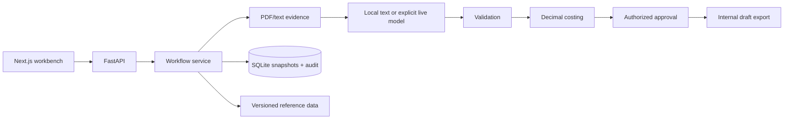

# 架构

Owner: Engineering · Status: implementation baseline · Updated: 2026-11-08

M0 定义契约与合成资料，M1 实现可独立验证的后端核心，M2 接文件抽取和用户界面。抽取不能产生审批；前端不能决定权限。运行目录不包含评测真值。

业务变更持久化为版本化快照并追加审计记录。报价依赖输入和参考文件 hash；变更后必须重新计价与审批。SQLite 本地事务保证同一版本的并发修改不会覆盖。

边界：单工厂、单产品族、EUR/mm；没有客户 ERP/PLM/MES 连接、企业 SSO、正式对客发布或制造认证。
